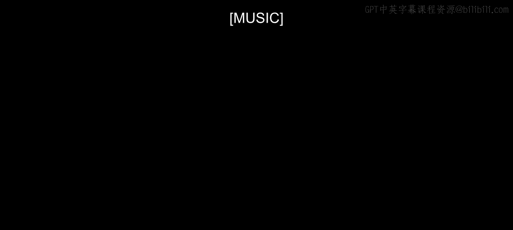
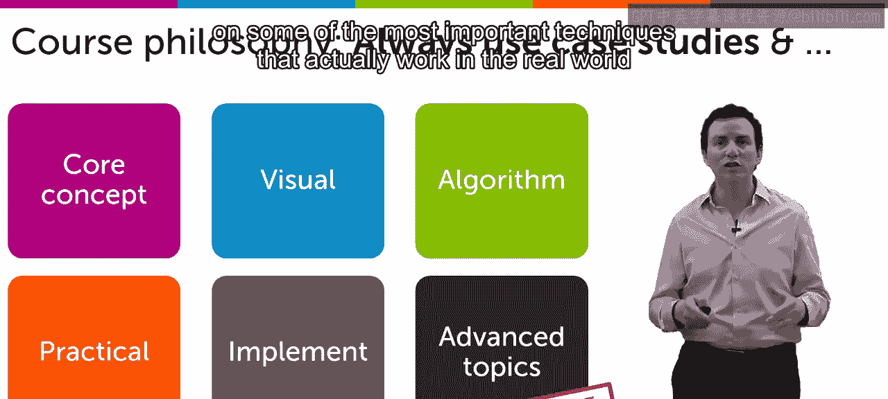
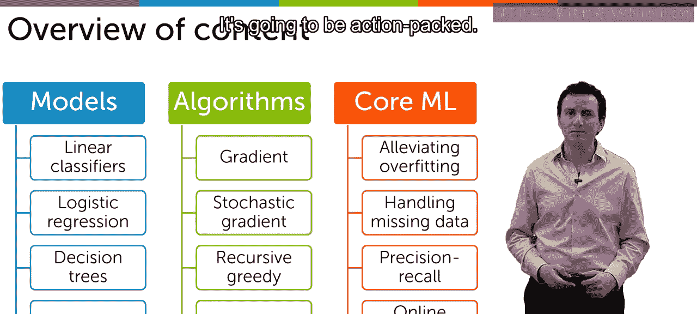

# 机器学习（分类，聚类和检索）：第3-4课：课程概览 🧭

在本节课中，我们将要学习这门课程的核心理念、教学方式以及涵盖的核心内容。这是一门高度注重实践的课程，旨在通过案例研究、可视化工具和动手实现，帮助你掌握当今世界真正实用且有影响力的分类技术。

## 课程核心理念与结构

上一节我们介绍了课程的整体定位，本节中我们来看看课程的具体教学方法和模块设计。本课程将始终围绕一个核心哲学展开：**使用案例研究来驱动所有教学内容**。你将在整个课程中看到这一点的体现。

此外，每个教学模块都将围绕以下六个方面构建：

以下是每个模块包含的六个核心要素：
1.  **核心概念**：讲解超越特定模块技术的通用概念。
2.  **可视化辅助**：为课程的每个方面创建了新的可视化图表，以帮助你深入理解底层思想。
3.  **实际算法**：详细讨论能在实践中构建分类器的具体算法。
4.  **实践实现**：你将从头开始实现所有讨论的算法，并能将其应用于现实世界。
5.  **可选高级主题**：每个模块都包含标记为可选的高级内容，供有兴趣深入学习者探索。
6.  **聚焦实用技术**：课程内容经过精心筛选，专注于那些在当今世界真正产生实际影响的技术。

## 核心技术与算法

在了解了课程结构后，我们来看看本课程将深入讲解哪些具体的技术和算法。我们不会涵盖分类的所有内容，但会深入讲解足以让你真正理解并能应用的技术。

我们将重点放在能产生最大影响的模型上：
*   **线性分类器**
*   **逻辑回归**
*   **决策树**
*   **集成方法**

如果你能理解这些模型，你将能够创建在各种现实世界问题中取得惊人准确度的分类器。

我们将讨论基础算法，并且你将实现它们并熟练掌握：
*   **梯度下降**：我们在回归课程中也讨论过。
*   **随机梯度下降**：对于将梯度方法扩展到大规模分类问题非常有用。
*   **递归梯度算法**：对于学习决策树非常有用。
*   **提升法**：一种用于学习分类器集成的卓越技术。

## 超越本课程的机器学习概念

除了具体的技术和算法，本课程还将讨论一些核心的机器学习概念。这些概念的应用范围远不止于本课程或分类问题本身。

我们将探讨以下关键概念：
*   如何避免**过拟合**。
*   如何处理**缺失数据**。
*   **精确率与召回率**。
*   **在线学习**。

本节课中我们一起学习了本课程的概览。我们了解到这是一门注重实践、以案例驱动的课程，涵盖了从核心概念、可视化、算法实现到高级主题的完整学习路径。课程聚焦于线性分类器、逻辑回归、决策树和集成方法等实用技术，并将深入讲解梯度下降、随机梯度下降等关键算法。此外，我们还将学习过拟合、缺失数据处理等具有广泛适用性的核心机器学习概念。这门课程内容充实，旨在让你通过动手实践成为真正的专家。