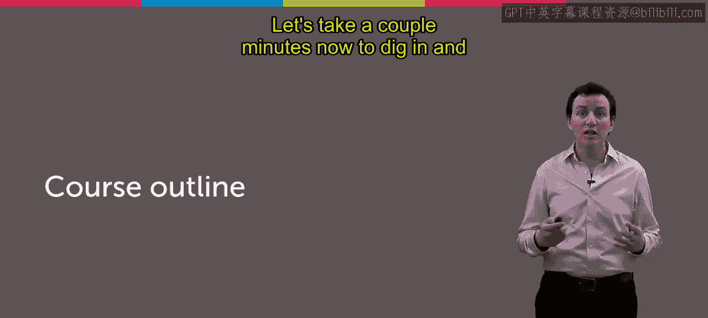
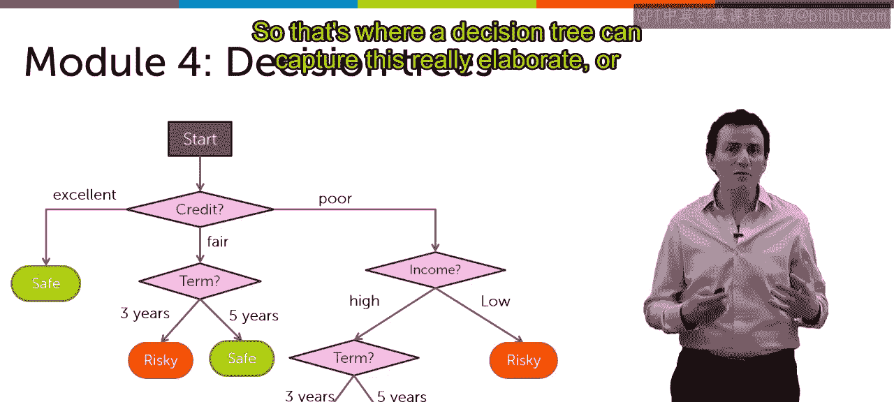
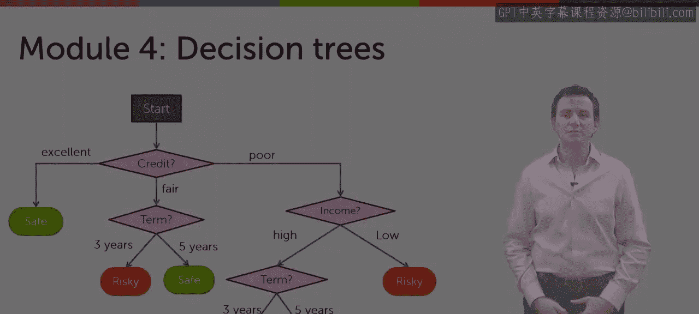
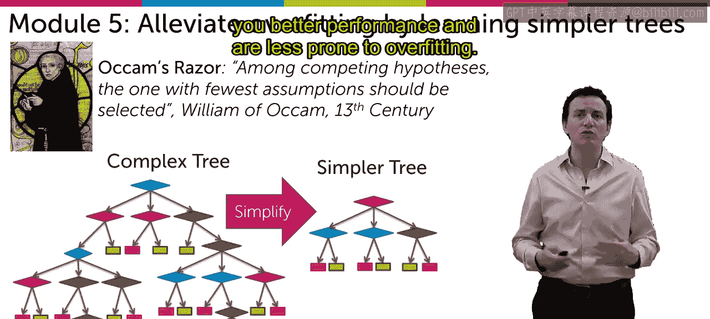

# 华盛顿大学《机器学习（分类，聚类和检索，第3-4课⧸共4课）｜Machine Learning》中英字幕 p05 4_课程前半部分大纲.zh_en -BV1Sr421F7N7_p5-

。

Let's take a couple minutes now to dig in and see what's going to happen in each module of this course。

So this was the overview we're going to have nine modules and some models are going to appear in multiple modules。

 some models are going to appear in one module， and some concepts are going to cover multiple modules。

 but in general we're going to see a precohesive presentation where we start with everything about linear classifiers and logistic regression。

 and everything about decision trees and then we'll cover boosting and some advanced topics。

So in particular we're gonna start with linear classifiers and we discuss those in the first course so for example in a sentiment analysis case we have two words that I care about the number of times the word off who appears in the review and the number of times the word awesome appears in the review and the linear classifier might say that every awesome is worth one off is minus 1。

5 and when you have a particular review if it has， for example like the one on the bottom has three awesome is zero off we're gonna classify that is positive because its core is greater than zero and that's true for everything below that line and everything above the line has core less than zero and we're going to classify those as negative points we discuss this concept of linear classifiers in the first course。

 we're going go in depth and really understand those in the first module and then we'll extend it with something called logistic regression which is gonna to allow us to not only predict plus one or minus1 but assign a probability to every。

So for example the points in bright green are very likely to be positive。

 the points in bright future very likely to be negative。

 but the white band between our areas were less certain so it's 5050 probability well be able to predict those probabilities and that's going to really change how your classifiers are going to get used。

😊，Now that we defined the idea for linear classifier and logistic regression in the second module。

 we're going to figure out how to learn the parameters。

 the coefficients of these classifiers from data。😊，So we define the notion of likelihood。

 which measures how well a line is classifying this data and for different values of the coefficients。

 we're going to have different lines or different classifiers and we're going use gradient asscent to find the best possible classifier in a similar way to what we did in a linear regression in the previous course。

😊，Overfitting can be a really significant thing in classification so here in plotting the classification error in the Y axis as we make models more and more complex and as you know。

 the training error will go to zero as you make those models more complex but the true error will go down and eventually go up as we overfit so in classification the way we're going experience that is our decision boundaries will start very simple like a line separating positives and negatives。

😊，Then maybe it will become a curve parallel that thats the data pretty well。

 but as we make the model too complex we end up with this crazy decision boundaries and eventually the last one here you see that's really fitting the data way well in a really kind of unbelievable way so we'll see this amazing visualizations and we'll address this issue by introducing regularization in a very similar way that we did with linear regression in the previous course and that will be the focus of the third module。

😊，In the fourth module we're going to explore a whole new kind of classifier called a decision tree decision trees are extremely useful in practice they're simple。

 easy to understand and can fit data really well providing non- nonlinear feature for the data so here's an example where I'm trying to predict whether a loan you might take in the bank is going to be a good loan safe or is going to be a risky loan so you might walk in the bank and the bank person might ask you what's your credit history like have you been really good。

 have you paid your previous loans if you have then the loan is likely to be safe。

 it likes to be a good loan if your credit history has been okay fair then it depends if it's a short loan then I'm worried but if it's a loan loan then eventually pay it off。

Now if your credit history is bad， don't worry， not everything is bad。

 maybe you'll ask about your income if your income is high。And you're asking for a long term loan。

 then maybe it's okay to make a loan， but if your credit history is bad and income is low。

 then don't even ask me for it。 So that's where a decision tree can capture this really elaborate but very explainable cuts over the data。

In module5， we're going to see that overfitting is not just a bad， bad problem， logistic regression。

 but it's also a bad bad problem in decision trees。 So here as you make those。

Trees deeper and deeper and deeper， those decision boundaries can get very。

 very complicated and really overfit。 So we're gonna to have to do something about it。

 And what we're gonna to do is use a fundamental concept called Aham's razor where you try to find the simplest explanation for your data and this concept goes back way before Aham whos was around the 13th century it goes back to Pyagoras and Aristotle。

 and those folks said the simplest explanation is often the best one。

 So we're going take this really complex deep trees and find simple ones that give you better performance and less prone to overfitting。

