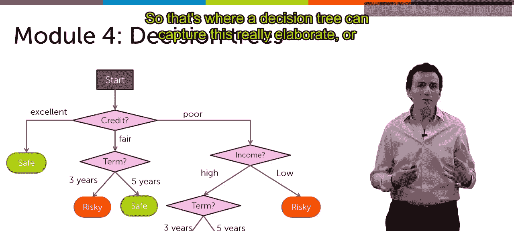
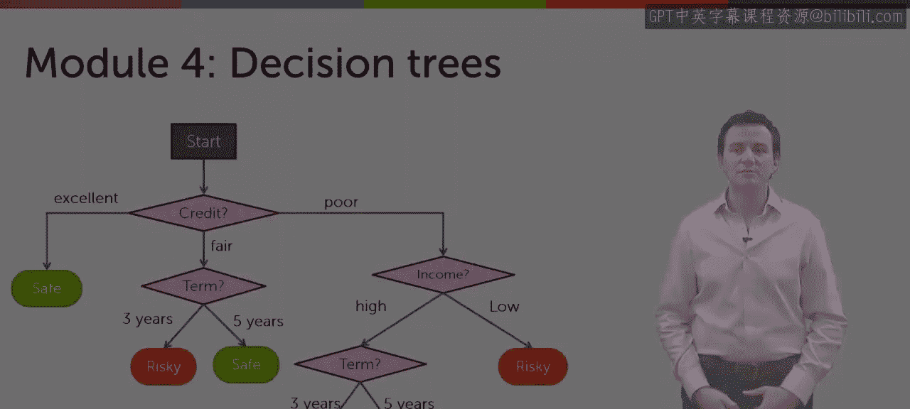
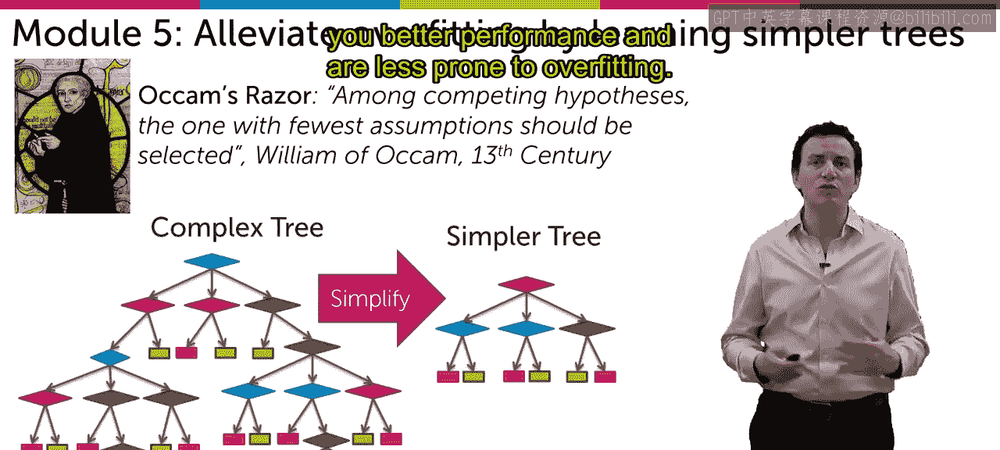

# 机器学习（分类，聚类和检索）：第3-4课：课程前半部分大纲

在本节课中，我们将要学习华盛顿大学《机器学习（分类，聚类和检索）》课程前半部分的核心内容。我们将深入探讨线性分类器、逻辑回归、决策树等关键模型，并了解如何学习模型参数、处理过拟合问题以及应用奥卡姆剃刀原理来简化模型。

---

## 🧠 模块一：深入理解线性分类器与逻辑回归

在上一节概述之后，本节中我们来看看课程的第一个核心模块。我们将从线性分类器开始，并扩展到逻辑回归。

线性分类器是分类任务的基础。例如，在情感分析中，我们可能关心“awesome”和“awful”两个词在评论中出现的次数。一个线性分类器可能会为每个“awesome”赋予+1的权重，为每个“awful”赋予-1.5的权重。对于一个具体的评论，我们计算其得分：`得分 = (1 * awesome次数) + (-1.5 * awful次数)`。如果得分大于0，则分类为正面；否则为负面。决策边界是一条直线。

逻辑回归在此基础上更进一步，它不仅能预测类别（+1或-1），还能为每个预测分配一个概率。例如，得分很高的点被预测为正面的概率接近1（亮绿色），得分很低的点被预测为负面的概率接近1（亮紫色），而得分在0附近的点则概率接近0.5（白色区域），表示模型不确定。这使得分类器的应用更加灵活。

---

## 🔍 模块二：从数据中学习模型参数

上一节我们介绍了线性分类器和逻辑回归的基本思想，本节中我们来看看如何从数据中自动学习这些模型的参数（即权重系数）。

我们定义了**似然**的概念，用于衡量一个分类器（由一组参数定义的一条线）对数据的拟合好坏。不同的参数值对应不同的分类器。我们的目标是找到使似然最大化的那组参数。为此，我们将使用**梯度上升**算法，这与我们在之前线性回归课程中使用的梯度下降思想类似，但目标是最大化而非最小化。

---

## ⚠️ 模块三：分类中的过拟合与正则化

过拟合在分类中是一个非常重要的问题。当我们绘制模型复杂度与分类错误率的关系图时，可以看到：随着模型变得复杂，训练误差会不断降低直至接近零，但真实误差（测试误差）会先下降后上升，这表明模型开始记忆噪声而非学习规律。

在分类中，过拟合表现为决策边界变得异常复杂。例如，决策边界可能从一条简单的直线，变成一个稍微弯曲的曲线来更好地拟合数据，最终变成一个极其扭曲、几乎包裹住每个数据点的复杂形状。这种边界虽然完美拟合了训练数据，但泛化能力很差。

为了解决这个问题，我们将引入**正则化**技术。这与在线性回归中应用正则化的思路非常相似，通过给模型复杂度增加惩罚项，来鼓励更简单、更平滑的决策边界，从而防止过拟合。

---

## 🌳 模块四：决策树分类器

在第三个模块处理了线性模型的过拟合问题后，本节我们将探索一种全新的分类器：**决策树**。决策树在实践中非常有用，它们结构简单、易于理解，并且能够很好地拟合数据，提供非线性的决策边界。

以下是一个预测银行贷款风险的决策树示例：
*   首先检查信用历史。
    *   如果信用历史“良好”，则贷款“安全”。
    *   如果信用历史“一般”，则进一步检查贷款期限。
        *   如果是“短期”贷款，则贷款“有风险”。
        *   如果是“长期”贷款，则贷款“安全”。
    *   如果信用历史“差”，则进一步检查收入水平。
        *   如果收入“高”，且是“长期”贷款，则贷款“安全”。
        *   如果收入“低”，则贷款“有风险”。

决策树能够捕捉数据中复杂但可解释的规则。

---

## ✂️ 模块五：决策树的过拟合与奥卡姆剃刀

上一节我们看到了决策树的强大能力，本节中我们来看看决策树同样面临严重的过拟合问题。

随着决策树变得更深、更复杂，其决策边界会变得极其繁琐，从而严重过拟合训练数据。我们需要对此进行处理。

我们将应用一个基本原则：**奥卡姆剃刀原理**。该原理主张“如无必要，勿增实体”，即最简单的解释往往是最好的。这一思想可以追溯到毕达哥拉斯和亚里士多德，并在13世纪由奥卡姆的威廉明确提出。

在决策树中，这意味着我们需要将那些非常复杂、深层的树进行简化（例如通过剪枝），找到在保持良好性能的同时更简单、更不易过拟合的树模型。

---

本节课中我们一起学习了课程前半部分的大纲，涵盖了从线性模型到决策树的核心分类方法，并重点探讨了模型学习、过拟合及其解决方案。这些内容为后续深入学习更高级的机器学习主题奠定了坚实的基础。