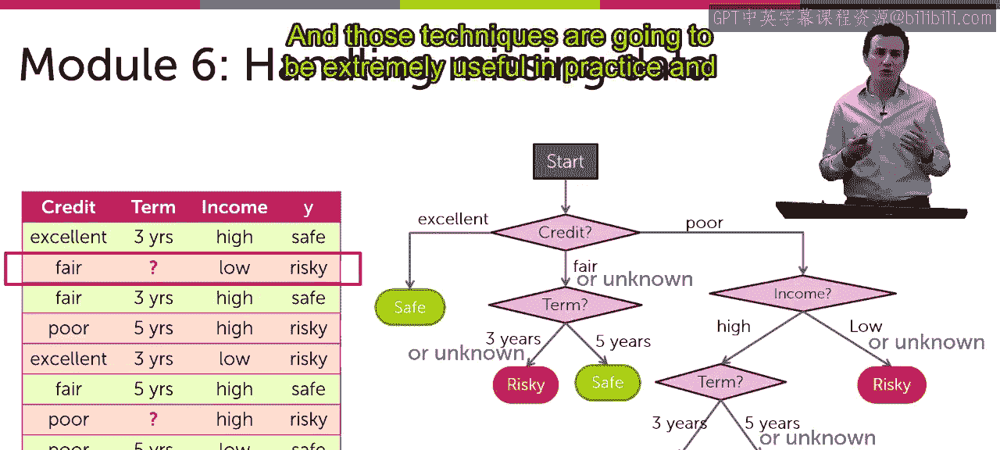
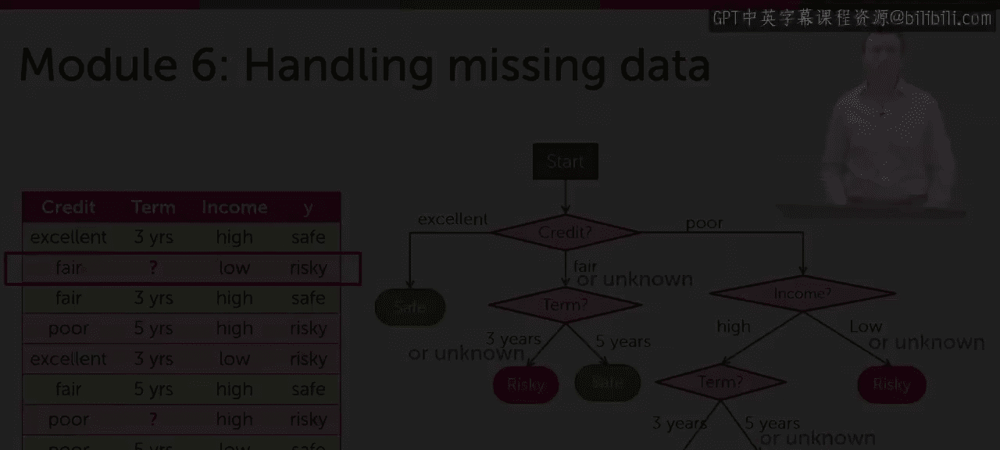
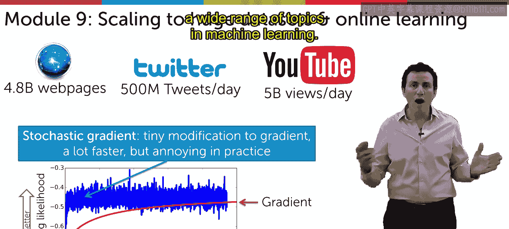

# 华盛顿大学《机器学习（分类，聚类和检索，第3-4课⧸共4课）｜Machine Learning》中英字幕 p06 5_课程后半部分大纲.zh_en -BV1Sr421F7N7_p6-

。

From here we're going to explore one of the most fundamental things that happens in practice of data。

 the issue of missing data， so here I have a data set。

 but unlike what we've done so far in this courses in the specialization we have seen that all data is observed but here if you look at the second row you have a question mark for that person you don't know if the loan they took was a three yearear loan or a five- yearear loan so what do we do when we have missing data when I talk about many ways to address that they're extremely practical including a modification of decision trees where the tree can be learned to take into account missing data to make decisions that depend not only on observed values like your credit was excellent fair or poor but what happens if your credit is unobserved what should you do and those techniques are going to be extremely useful in practice and widely applicable。

The seventh module is going be amazing。 We're gonna look at a question that was asked by currents and Valaliant in 1988。

 In fact Valent is touring award winners so this is a fundamental question the question was can you combine simple classifiers in a way that gives you performance of a really complex classifier and that question which is pretty theoretical was answered a couple years later by Shapir in the positive using something called boosting which is an amazing algorithm that has had an incredible impact in practice In fact。

 if you know for example where a kgo competition which is one of those online machine learning competitions more than half of the winners use boosting in their solution boostosing a simple technique that has really changed the world and we're gonna learn the fundamentals technique and you're going to be able to implement yourself we're going talk about one kind of boosting algorithm called a boost where you can take the input of a classifier for example this。

You know decision tree here might say that a loan is likely to be okay， safe plus one。

 but you might have another one that says， no it's risky minus1 and you have others that might say plus1 or minus1 and you have the vote of many classifiers in what's called an ensemble so both things about building the assembles or many classifiers vote。

And we do is want to learn the combinations of thisvault to get the best possible prediction。

 and by learning those combinations using a boosting algorithm。

 we're going to be able to start with very simple classifiers but come up with very complex decision boundaries。

😊，And this is exactly the technique that wins most of those cargo competitions。

In the eighth module we're going to step back and look at fundamental concepts in machine learning one's called precision and recall。

 let me tell you about an example of that say I own a restaurant and I want to increase the number of guests that I have the number of customers by 30% how do I do that well I'm gonna to start a marketing campaign but I don't want to be just like I want to be kind of an authentic nice marketing campaign so when I use the reviews of my restaurant and try to find great things to say and every time somebody enters a review on a website I get some sentence shown in my website saying how great my restaurant is so given the reviews I want to make a prediction as to what sentence were most positive like。

Easily the best sushi in Seattleto， and also who are great people that we should showcase that say great things about a restaurant。

When you have a setting like this。Accuracy is not good not a good metric what you really care about is what's called precision recall precisionion is going to say if I pick out a few sentences from the reviews and show on my website。

How likely is it that I was going to show a really negative sentence because if I show a bad sentence like the sushi was terrible。

 then that's really bad for my website， so precision make sure that I show only positive sentences。

And then we're gonna talk about recall， which is about finding all the great positive things that people are saying。

 so if a classifier has good precision and recall it means that I find all the great sentences and I only show great sentences about my restaurant and we' going talk about that in quite a lot of detail because precision recall is what you will use most likely if you build a classifier in practice it's what basically every company builds classifiers uses is its' core metric。

😊，And in the final module， we're going to address an issue of scalability。

 how do we scale to really massive data sets？And so as you can see。

 the number of web pages on the web is growing tremendously， there' iss about 4。

8 billion pages today。There's about 500 million tweets per day， hey， follow me on Twitter by the way。

 I send one， maybe less and if you think about YouTube。

 there's 5 billion page views on YouTube video views every day so there's tons of data out there and gradient type methods don't tend to scale very well when you have massive amounts of data。

And so what we're going to show is a technique called stochastic gradient which converges much faster than gradient to the solution。

 it's just a very small modificationification to gradient which gives you amazing performance so in this simple example from sentiment analysis we see over 100 times faster performance on the same data set however stochastic gradient is an extremely finicky technique to get to work right there' many practical problems that you need to address and make it work and so we're going to talk about the technique explain why it works。

 but also explain those practical issues that you must address in order to get it to work well。

So as you can see， it's going to be an action packed course that's going to cover a wide range of topics in machine learning。

