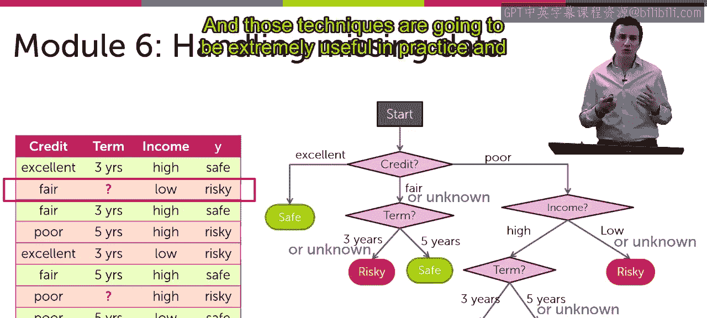
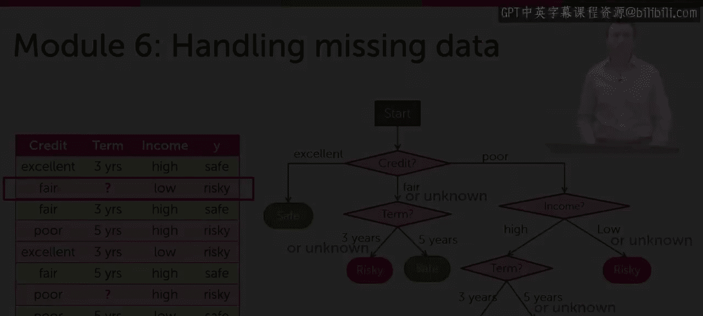
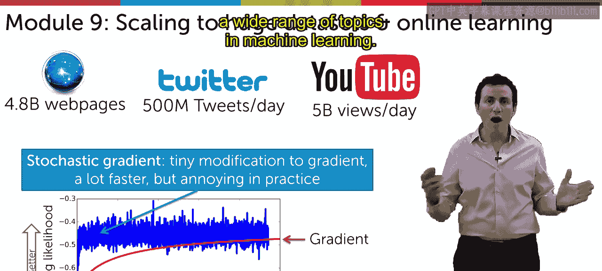

# 机器学习（分类，聚类和检索）：第3-4课：课程后半部分大纲

在本节课中，我们将要学习机器学习课程后半部分的核心内容。我们将探讨如何处理缺失数据、如何组合简单分类器以构建强大的预测模型、如何评估模型性能以及如何将算法扩展到海量数据集。这些主题都是机器学习实践中的关键环节。

## 缺失数据处理 🧩

上一节我们介绍了课程的整体结构，本节中我们来看看如何处理数据中常见的问题——缺失值。

在数据科学实践中，我们经常会遇到数据缺失的情况。例如，在一个数据集中，某些条目的信息可能未被记录，比如下图中第二行关于贷款年限的数据就是一个问号，我们不知道这笔贷款是三年期还是五年期。

当数据缺失时，我们需要采取方法来解决。我们将讨论多种极其实用的处理方法，包括对决策树算法的修改。修改后的决策树在学习时可以考虑缺失数据，其决策过程不仅依赖于已观测到的值（例如信用评级为优秀、良好或差），还能处理信用评级未被观测到的情况。这些技术在实践中非常有用且应用广泛。

## 集成学习与提升法 🚀

在掌握了处理缺失数据的方法后，我们将进入一个令人惊叹的模块：集成学习。

第七模块将探讨一个由Kearns和Valiant在1988年提出的基础性问题（Valiant是图灵奖得主）。这个问题是：能否以某种方式组合简单的分类器，从而获得一个复杂分类器的性能？几年后，Schapire从理论上正面回答了这个问题，他提出了一种名为“提升法”的卓越算法，该算法在实践中产生了巨大影响。

事实上，在Kaggle等在线机器学习竞赛中，超过一半的获胜方案都使用了提升法。提升法是一种真正改变了世界的简单技术，我们将学习其基本原理，并能够自己实现它。

我们将讨论一种称为AdaBoost的提升算法。在这种算法中，你可以组合多个分类器的输出。例如，一个决策树可能预测某笔贷款是安全的（标记为+1），而另一个决策树可能预测它是高风险的（标记为-1）。通过让许多分类器进行“投票”，我们构建了一个“集成”模型。

以下是构建集成模型的核心思想：
*   我们学习如何组合这些分类器的投票结果，以获得最佳的预测。
*   通过使用提升算法学习这些组合权重，我们能够从非常简单的分类器出发，最终形成非常复杂的决策边界。
*   这正是赢得大多数Kaggle竞赛的技术。

## 精确率与召回率 📊

在学习了如何构建强大模型之后，我们需要退一步，审视机器学习中的基础评估概念：精确率与召回率。

让我用一个例子来说明。假设我拥有一家餐厅，并希望将顾客数量增加30%。为此，我计划开展一场营销活动。我希望这是一场真实、友好的营销活动，因此我打算利用餐厅的评论，找出那些精彩的句子，并将其展示在网站上。

在这种场景下，传统的“准确率”并不是一个好的评估指标。我们真正关心的是“精确率”和“召回率”。

*   **精确率**关注的是：如果我从评论中挑选出一些句子展示在网站上，那么我展示出一个真正负面句子的可能性有多大？因为如果我展示了一个像“寿司糟透了”这样的差评，那对我的网站将非常不利。因此，精确率确保我只展示正面的句子。
*   **召回率**关注的是：我能否找出人们所说的所有精彩的正面评价？如果一个分类器同时具有良好的精确率和召回率，那就意味着我找到了所有精彩的句子，并且只展示了关于我餐厅的精彩句子。

我们将非常详细地讨论这两个指标，因为如果你在实践中构建分类器，很可能会用到精确率和召回率。这基本上是所有公司在构建分类器时使用的核心评估指标。

## 可扩展性与随机梯度下降法 ⚡

在最后的模块中，我们将解决一个可扩展性问题：如何将算法扩展到真正海量的数据集？

正如你所见，网络上的网页数量正在急剧增长，目前约有48亿个网页。每天大约有5亿条推文。以YouTube为例，每天有50亿次的视频观看量。外界存在着海量数据，而传统的梯度类方法在处理大规模数据时往往不能很好地扩展。

因此，我们将介绍一种名为“随机梯度下降”的技术。与标准梯度下降相比，它能以更快的速度收敛到解。这只是对梯度下降的一个非常小的修改，却能带来惊人的性能提升。

在一个简单的情感分析例子中，我们在相同数据集上看到了超过100倍的性能提升。然而，随机梯度下降是一种非常“挑剔”的技术，需要正确处理才能使其工作。我们将讨论这项技术，解释其工作原理，同时也会解释为了使其良好工作所必须解决的实际问题。

## 总结

本节课中，我们一起学习了机器学习课程后半部分的核心大纲。我们探讨了处理缺失数据的实用方法，学习了如何通过集成学习和提升法组合弱分类器来构建强大的预测模型。我们还深入了解了评估分类器性能的关键指标——精确率与召回率。最后，我们介绍了如何利用随机梯度下降法将机器学习算法高效地扩展到海量数据集。这些内容涵盖了机器学习从理论到实践、从基础到前沿的多个关键方面。