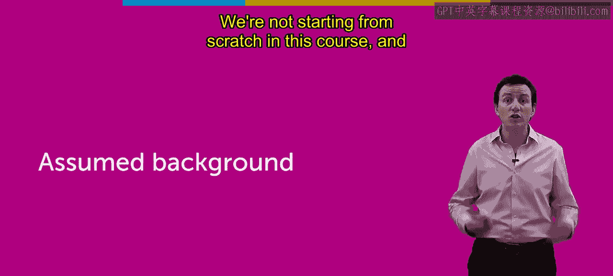
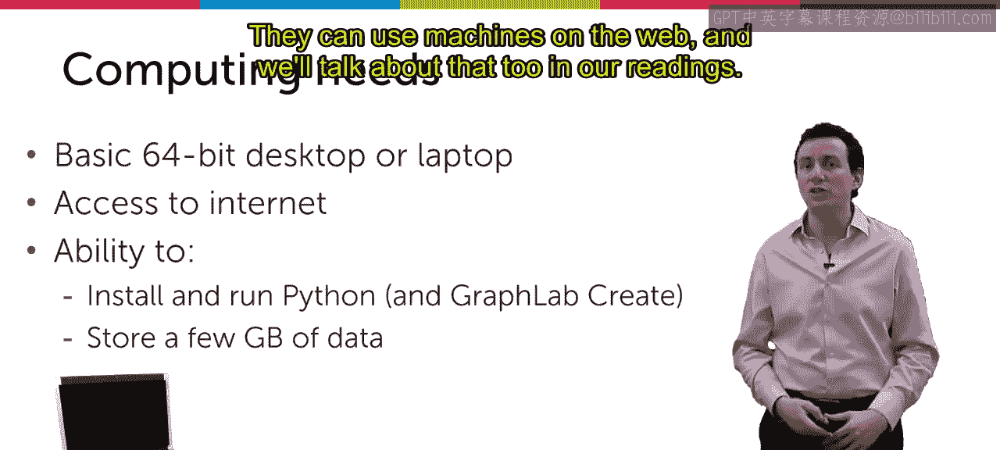
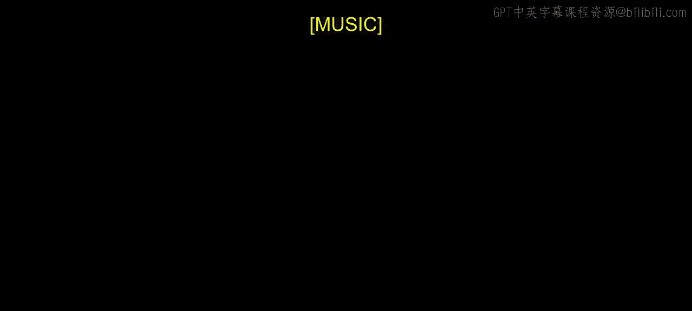

# 华盛顿大学《机器学习（分类，聚类和检索，第3-4课⧸共4课）｜Machine Learning》中英字幕 p07 6_假定的背景知识.zh_en -BV1Sr421F7N7_p7-

。

We're not starting from scratching the course and we going to assume some background from all of us in fact。

 we assume that you've taken the first two course in the specialization。

 this is really fundamental from the first course you've gained a wide view of what's possible to do with machine learning and if you already have that view it's okay but this is something that's going to be very helpful as well as facilitating kind your programming skills manipulating data and all that in the second we're also going assume you've taken the second course where you know recovery issues like what's a machine learning algorithm。

 gradient descent overfitting validation set and cross validation bias straightoff and regularization so we assume you remember those topics go back and review if you don't。

 if you haven't taken end of course but you know what those techniques are feel free to jump straight into the course。

 but we'll assume them throughout the course。

Just like the other courses we're going to assume some basic background。

 so you're going to take a few derivatives here and there。

 you should know what a vector is because when I use those and when I use some basic functions including exponiation and logarithmic。

 so if you need to take a little refresher on those basic functions， this is a good time to do it。

This is a hands on course for every module you're going to do some programming with real world data and get real world results。

 so you should expect that， but that doesn mean that you're going to have to do some programming we set up an infrastructure that makes it easy for you to do it if you know Python if you don't know Python you can catch up on Python pretty quickly just like you did in previous courses。

Or you can implement in whatever language you want， we don't assume they use a particular language。

 but it would be a lot easier if to you use Python。

Unlike this first course in the specialization we'll use a heavy use of GraphLb create because you a good black box to get started in this course we're gonna not rely heavily on GraphLb C we do suggest that you use Sframes which is the data manipulation open source library that was created by data but you can use other libraries like Py pandas if you prefer in Python and it will be some assignments where you using pre- implementedplement algorithm just try to understand how things behave before you implement them yourself for that we do suggest use GraLb C but you can use other libraries like Psyitle it's up to you it will be easier if you use Python and we'll give you some start of code that use S frame and some other things but you're welcome to use your own but then net result of this course is all about you implementing your own machine learning algorithms from scratch so that's what you should be prepared to do。

Now you will need a computer that has a little bit of power to it， a laptop should be fine。

 64 bit machine will make a big difference， you're going to need access to internet to download data sets and everything else on which watch these videos and you have to have the ability to install Python。

 maybe GraphLb C you choose to use it and start a few gigabytes of data on your machine。

 just like you did with previous courses， we'll also provide some other resources for those who don't have their own machines that can use machines on the web and we'll talk about that too in our readings。

