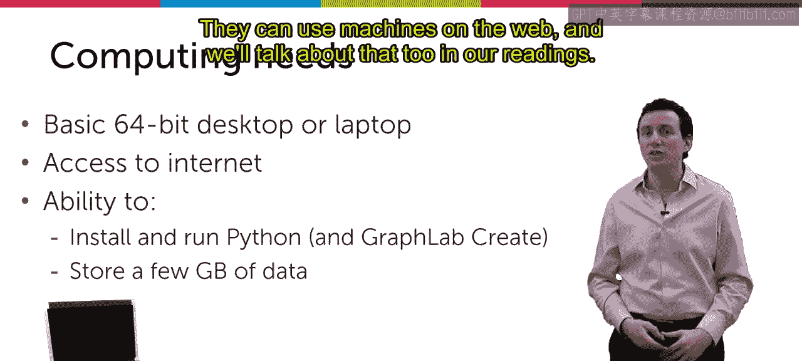

# 机器学习（分类，聚类和检索）：第0章：课程预备知识 📚

在本节课中，我们将要学习本课程开始前需要具备的背景知识、技能和工具。了解这些前提条件将帮助你更好地跟上课程进度，并顺利完成实践任务。

---

## 课程背景与先修知识

我们并非从零开始这门课程，而是假定所有学员都具备一些背景知识。

具体来说，我们假定你已经完成了本专项课程的前两门课程。这非常重要。从第一门课程中，你获得了关于机器学习可能性的广泛视野。如果你已经具备这种视野，那很好；但回顾这些内容将非常有帮助，同时也能提升你的编程技能、数据处理能力等。

在第二门课程中，我们同样假定你已经学习了相关内容，例如了解机器学习算法的基础概念、梯度下降、过拟合、验证集与交叉验证、偏差-方差权衡以及正则化等。我们假定你记得这些主题。如果你忘记了，请返回复习。如果你没有完成该课程，但已经掌握了这些技术，也可以直接开始本课程。我们将在整个课程中默认你已掌握这些知识。

---

## 数学与编程基础

与其他课程一样，我们假定你具备一些基础背景知识。

你需要在课程中计算一些导数。你应该知道什么是向量，因为我会使用这些概念。同时，你还需要了解一些基本函数，包括指数函数和对数函数。如果你需要复习这些基础知识，现在是一个好时机。

---

## 实践课程与编程要求

这是一门实践性课程。每个模块你都将使用真实世界的数据进行编程，并获得真实世界的结果。你应该对此有所预期。

但这并不意味着编程会很困难。我们建立了一个基础设施，使编程变得简单，特别是如果你会使用Python。如果你不会Python，可以像在前几门课程中那样快速学习。或者，你也可以使用任何你喜欢的语言来实现，我们不强制要求使用特定语言。但使用Python会方便很多。

---

## 工具与库的使用

与本专项的第一门课程不同，我们将大量使用GraphLab Create，因为它是一个很好的入门“黑箱”工具。然而，在本课程中，我们不会过度依赖GraphLab Create。

我们建议你使用SFrame，这是一个由Dato创建的开源数据操作库。但如果你更喜欢，也可以使用其他库，比如Python中的Pandas。在一些作业中，你会使用预先实现的算法，以便在自行实现之前理解其行为。对于这部分，我们建议使用GraphLab Create，但你也可以选择其他库，如Scikit-learn。这取决于你。

使用Python会更简单，我们会提供一些使用SFrame和其他工具的起始代码。当然，你也可以使用自己的工具。但本课程的最终目标是让你从头开始实现自己的机器学习算法，这是你需要准备好的。

---

## 硬件与软件要求

你需要一台性能尚可的计算机，笔记本电脑即可。64位机器会带来很大不同。

你需要能够访问互联网，以下载数据集、观看视频等。你需要有能力在你的机器上安装Python（以及GraphLab Create，如果你选择使用它），并存储几GB的数据。

就像在前几门课程中一样，我们也会为那些没有自己机器的学员提供一些在线资源，我们会在阅读材料中讨论这一点。

---

## 总结

本节课中，我们一起学习了开始本课程所需的预备知识。我们回顾了假定的先修课程内容、必要的数学与编程基础、课程的实践性质与编程要求、推荐的工具与库，以及所需的硬件与软件环境。确保你已准备好这些条件，将有助于你顺利开启机器学习算法实现的旅程。