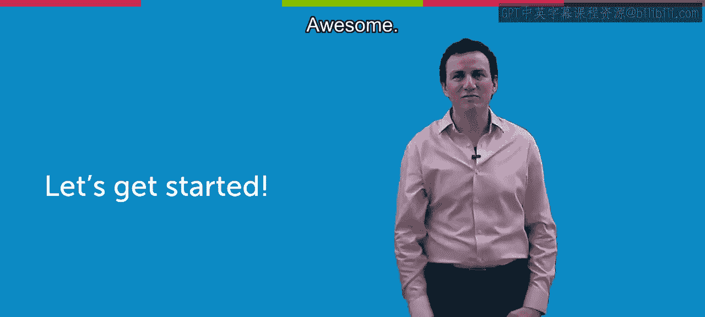

# 机器学习（分类，聚类和检索）：第1课：让我们开始吧 🚀

在本节课中，我们将开启机器学习课程的学习之旅。课程内容充实，充满乐趣，你将能够向潜在雇主或朋友展示令人惊叹的学习成果，并深入探讨算法原理。

## 课程概述

课程将涵盖分类、聚类和检索等核心机器学习主题。你将通过实践掌握关键概念，并能够深入讨论算法，这会使你在相关领域脱颖而出。

## 准备与后续信息

为了帮助你更好地准备并获取课程更新，建议你关注我的Twitter账号 `@Garon`。在那里，我会分享课程的最新动态、内部笔记以及未来课程的相关信息。

## 总结

本节课我们一起开启了机器学习的学习旅程，了解了课程的大致内容和获取后续信息的渠道。准备好迎接一段充满乐趣和收获的学习过程吧。