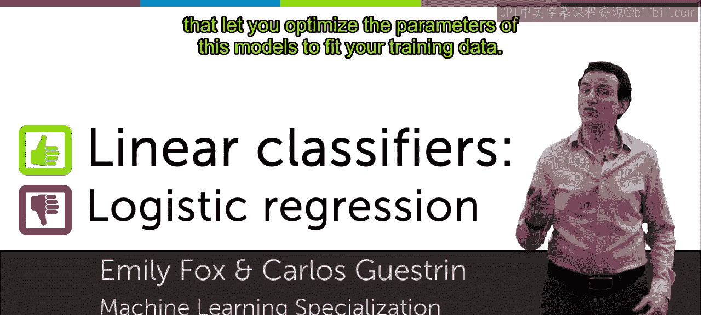
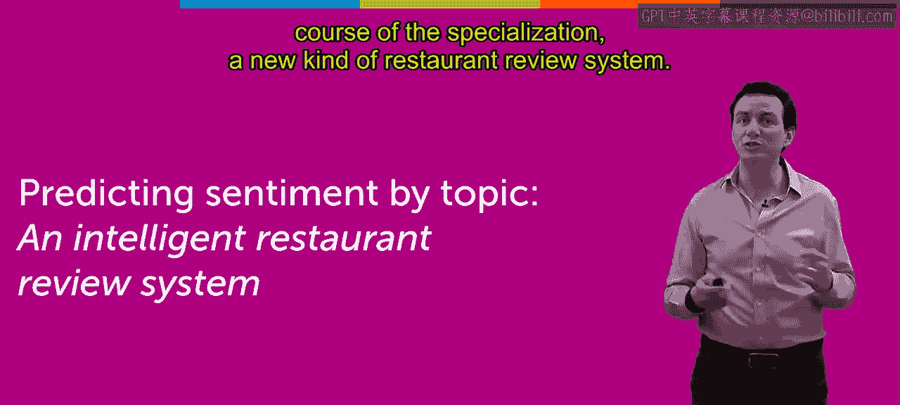
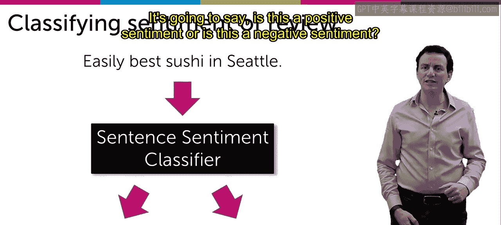

# 华盛顿大学《机器学习（分类，聚类和检索，第3-4课⧸共4课）｜Machine Learning》中英字幕 p09 8_线性分类器：一个激励性的例子.zh_en -BV1Sr421F7N7_p9-

。

Welcome to the first module of the classification course In this module。

 we're going to talk about linear classifiers， which are one of the most commonly users used classifiers out there。

 in particular we're going to talk about logistically regression which is again one of the most commonly used linear classifiers and one of the most useful ones the concepts you learn here will actually extend to a lot of other classification methods beyond linear classifiers you're going to learn the fundamental concepts but also。

😊，The underlying algorithms they let you optimize the parameters of these models to fit your training data。

We'll start for motivating example the same one we'll use in the first course of the specialization。

 a new kind of restaurant review system。

Now there's a special day coming up for me and I want to go out for some great Japanese foods。

 and I want a really great restaurant for it where I can eat amazing sushi。

 Seattle is a really great place where we have a ton of different highly rated Japanese restaurants。

 So how do I choose one。😊，Well， there are many aspects of restaurants and many aspects to make them great。

 What I really care about is amazing food and nice abiience。😊。

If I look at a restaurant review it will talk about different aspects of the restaurant。

 So for example， a specific review might have a sentence that says something like the experience there was excellent What does this tell me Well。

 if I look at this sentence， the sentence is positive about the experience of going to this restaurant。

😊，Then there might be a next sentence that says。My wife tried the ramen。

 and it was pretty forgettable。What does that mean the ramen there？Forgettable， don't want to eat it。

But I'm not going to the restaurant for ramen。 I don't care about this sentence in the review。

 On the other hand， the same restaurant might say the sushi there was delicious。

 it was the best sushi in Seattle。 Now that says a lot about the sushi。

 which is the thing I care about the most with respect to the restaurant I choose。😊。

So every review has different aspects in different sentences。

 I want to capture the sentiment of each sentence so I can understand if it's good with respect to sushi。

 which is what I care the most about。So every sentence。

 I'm going to feed it to a classifier that's going to say。

 is this a positive sentiment or is this a negative sentiment， and that's our task。😊。

