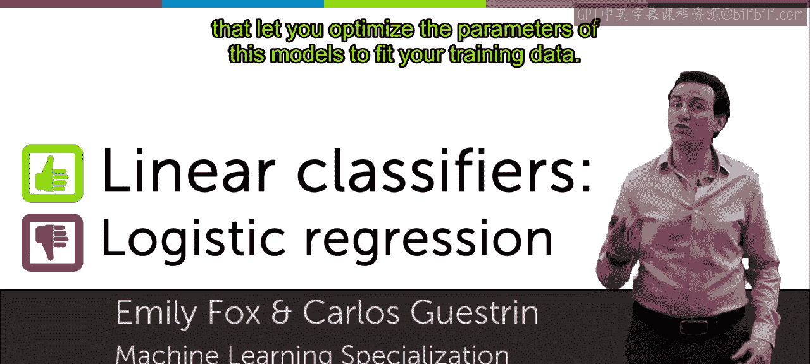
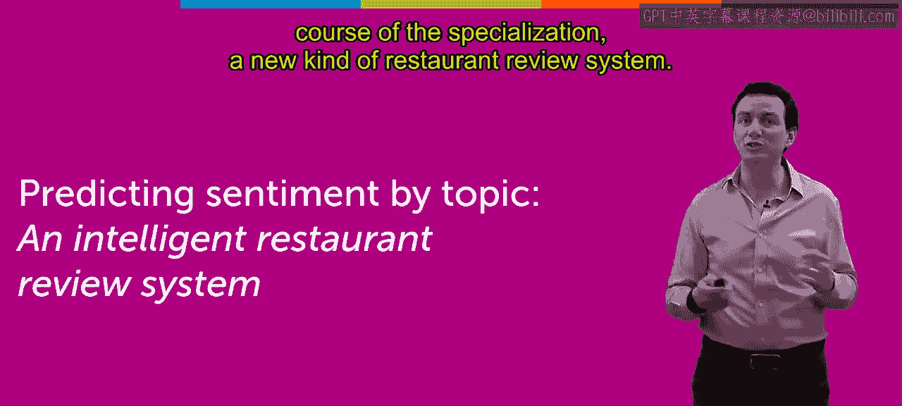
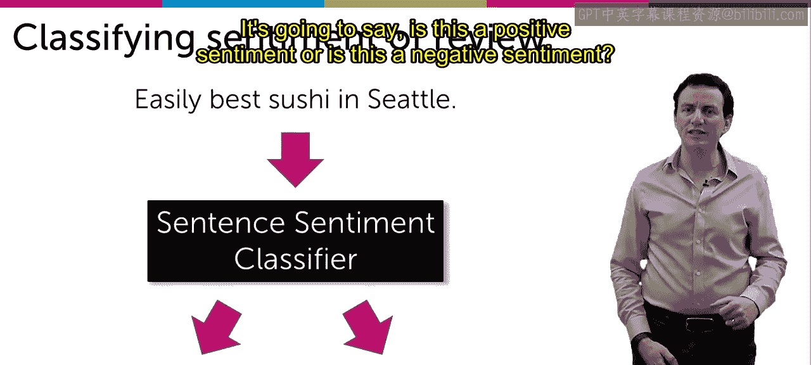

# 机器学习（分类，聚类和检索）：第3课：线性分类器：一个激励性的例子 🍣

在本节课中，我们将开始学习分类课程的第一个模块。我们将讨论线性分类器，这是最常用的分类器之一。特别是，我们将重点介绍逻辑回归，它是最常用且最有用的线性分类器之一。这里学到的概念将延伸到线性分类器之外的许多其他分类方法。你将学习基本概念，以及用于优化模型参数以拟合训练数据的底层算法。

## 一个激励性的例子：餐厅评论系统 🍜

我们将从一个激励性的例子开始，这也是本专项课程第一门课中使用的例子：一个新的餐厅评论系统。

假设我有一个特殊的日子即将到来，我想出去吃一顿美味的日本料理。我想找一家能吃到绝佳寿司的餐厅。西雅图有很多评价很高的日本餐厅，我该如何选择呢？

餐厅有很多方面可以使其变得出色。我最关心的是美味的食物和良好的氛围。如果我查看一条餐厅评论，它会谈论餐厅的不同方面。例如，一条具体的评论可能有一句话写道：“在那里的体验非常出色。” 这告诉我什么？这句话对去这家餐厅的体验持积极态度。

接下来可能还有一句话写道：“我妻子尝试了拉面，味道相当一般。” 这意味着什么？那里的拉面很一般，我不想吃。但我去餐厅不是为了吃拉面，所以我不关心评论中的这句话。

另一方面，同一家餐厅的评论可能说：“那里的寿司很美味，是西雅图最好的寿司。” 这句话对寿司的评价很高，而寿司是我选择餐厅时最关心的方面。

因此，每条评论的不同句子都涉及不同的方面。我希望捕捉每个句子的情感，以便了解它对我最关心的寿司方面是否持积极态度。所以，对于每个句子，我将把它输入一个分类器，该分类器将判断这是积极情感还是消极情感，这就是我们的任务。