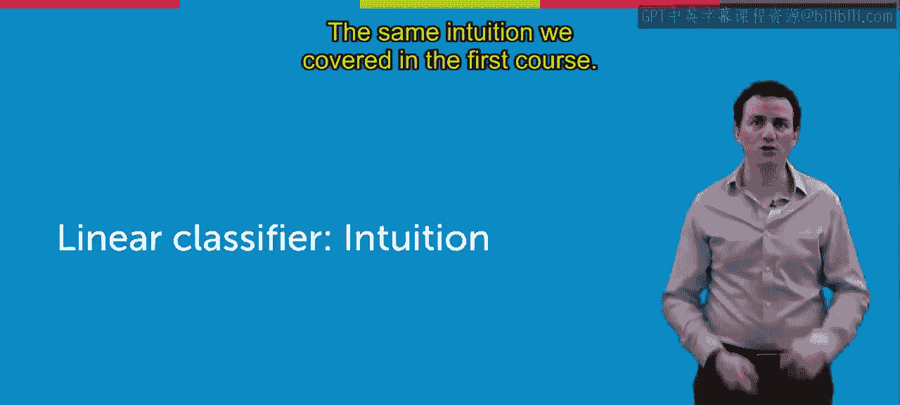
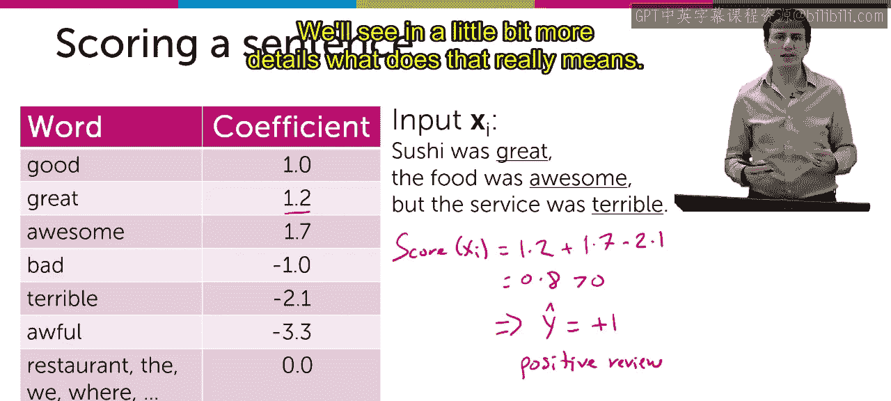
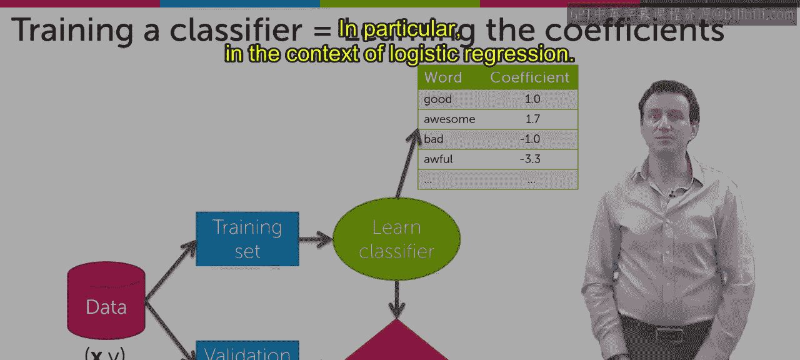

# 华盛顿大学《机器学习（分类，聚类和检索，第3-4课⧸共4课）｜Machine Learning》中英字幕 p10 9_线性分类器的直观理解.zh_en -BV1Sr421F7N7_p10-

。

Let's start by reviewing the intuition behind linear classifiers the same intuition we covered in the first course。

A linear classifier will take as in input some quantity X。

 which in our cases is sentences from reviews， is going to feed it through its classifier model and it's going to make a prediction Y that says。

 is this a positive review in which case y hat is plus1 or is it a negative review。

 in which case y hat is minus1？😊，That's what we're trying to figure out a linear classifier does a little bit more associates every word with a weight or coefficient which says how positively influential this word is or how negatively influential so good might have a coefficient of1 great might have a coefficient of 1。

5 awesome is awesome might have a coefficient 2。7 well on the negative side bad might have a coefficient of minus1 terrible minus 2。

1 but awful is just awful so minus 3。3 and then some words is not that relevant to the sentiment of the review might have 0 coefficient。

😊，Now let's see how these coefficients can be used to make a prediction of whether a sentence is positive or negative。

 so for example let's take this sentence that says the sushi is great。

 so how do we score the sentence let's compute this score of this input sentence XY。😊，X 1， X I。

 the set says the sushi is great。 So we look at the coefficient of sushi of great。 and we see it's 1。

2。 And now it says the food was awesome。 So the coefficient of that is 1。7。😊，And then says。

 but the service was terrible。Oh my God， the service was terrible。 So you subtract 2。1。

 And now we ask， what is the total score for this sentence， So some things are positive。

 some things are negative， The total score is 0。8， which is greater than 0。

And that implies that we're going to predict the y hat。

 the sentiment of her descend sentence is plus one。So it's a positive review。

And this is called a linear classifier because the output is the weighted sum of the inputs。

 So that's kind of what a linear classifier is。 We'll see in a little bit more details what that really means。

😊。

So more generally， a simple linear classifier is going to take as input coefficients associated with each word and then it's going to compute a score for that input。

 if that score is greater than0， we say that the output the prediction y hat is plus 1 and if the score is less than 0。

 we say that the prediction is minus-1。😊，Now what we need to do is train the weights of this linear classifiers from data。

 so given some input training data that includes sentences of reviews labeled with either plus1 or minus1。

 positive or negative， we're going to split those into some training set and some validation set。

Then we're going to feed that training set into some learning algorithm which' is going to learn the weights associated with each word。

 so 1。0 for good， 1。7 for awesome and so on。And then after we learn this classifier。

 we're going to go back and evaluate the autocracy on that validation set。

So our goal for for today is to explore that learning box。

 how do we learn this classifier from data and understand a little bit more deeply of what a linearar classifier is really about in particular in the context of logistic regression。

😊。

