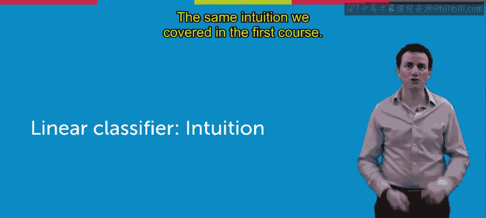
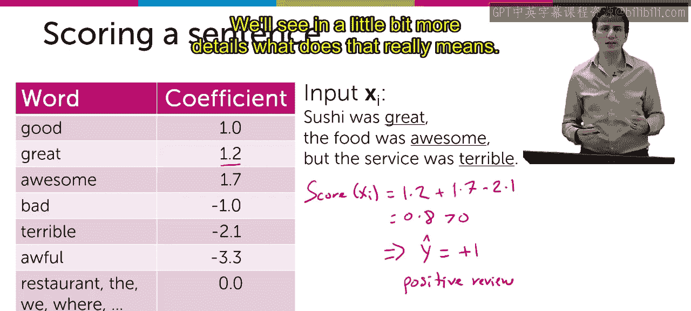
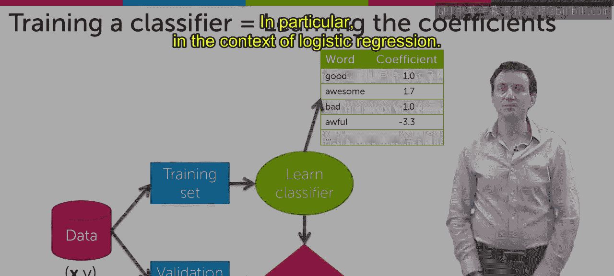

# 机器学习（分类，聚类和检索）：第3课：线性分类器的直观理解 🧠

在本节课中，我们将学习线性分类器的基本工作原理。我们将从一个直观的例子开始，理解线性分类器如何利用词语的权重来预测文本的情感倾向，并概述训练这样一个分类器的整体流程。

---

## 线性分类器回顾 📖

上一节我们介绍了分类问题的基本概念，本节中我们来看看线性分类器的直观理解。

线性分类器接收一个输入量 **X**。在我们的例子中，**X** 是来自评论的句子。分类器模型会处理这个输入，并做出一个预测 **ŷ**。**ŷ** 的值表示这是一个正面评论（**ŷ = +1**）还是一个负面评论（**ŷ = -1**）。这就是我们试图解决的问题。

线性分类器还会多做一步：它为每个单词关联一个权重或系数。这个系数表明了该单词对情感的正面或负面影响程度。

以下是单词及其假设系数的例子：
*   **good** 的系数可能是 **1.0**
*   **great** 的系数可能是 **1.5**
*   **awesome** 的系数可能是 **2.7**
*   **bad** 的系数可能是 **-1.0**
*   **terrible** 的系数可能是 **-2.1**
*   **awful** 的系数可能是 **-3.3**
*   一些与评论情感无关的单词，其系数可能为 **0**

---

## 如何使用系数进行预测？ 🔍

现在，让我们看看如何利用这些系数来预测一个句子是正面还是负面的。

我们以这个句子为例：“The sushi was great, the food was awesome, but the service was terrible.”

以下是计算该句子得分 **score** 的步骤：
1.  查看句子中每个重要单词的系数。
2.  “great” 的系数是 **1.5**。
3.  “awesome” 的系数是 **2.7**。
4.  “terrible” 的系数是 **-2.1**。
5.  将这些系数相加，得到句子的总得分：**1.5 + 2.7 - 2.1 = 2.1**。

这个总得分 **2.1** 大于 **0**。因此，我们预测这个句子的情感 **ŷ** 为 **+1**，即这是一个正面评论。

这被称为线性分类器，因为其输出是输入的加权和。用公式可以表示为：

**score = Σ (word_coefficient_i)**
**ŷ = +1 if score > 0, else ŷ = -1**

---

## 训练线性分类器 🏋️

更一般地说，一个简单的线性分类器接收与每个单词关联的系数作为输入，然后为输入句子计算一个得分。如果得分大于0，则预测输出 **ŷ** 为 +1；如果得分小于0，则预测 **ŷ** 为 -1。

我们需要从数据中训练出这个线性分类器的权重。以下是训练流程：

1.  **准备数据**：给定一些包含已标注（+1 或 -1）评论句子的输入训练数据。
2.  **划分数据集**：将这些数据划分为训练集和验证集。
3.  **训练模型**：将训练集输入到某个学习算法中。该算法将学习与每个单词关联的权重（例如，good 对应 1.0，awesome 对应 1.7 等）。
4.  **评估模型**：在学习到这个分类器之后，我们回到验证集上评估其准确性。

我们本节课的目标就是深入探索这个“学习”过程，理解如何从数据中学习分类器，并更深入地理解线性分类器（特别是在逻辑回归的背景下）的真正含义。

---

## 总结 ✨

本节课中我们一起学习了线性分类器的直观工作原理。我们了解到，线性分类器通过为每个特征（如单词）分配权重，并计算输入的加权和来做出决策。如果加权和为正，则预测为正类（+1）；为负则预测为负类（-1）。我们还概述了从标注数据中训练这些权重的标准流程，包括数据准备、模型训练和验证评估。