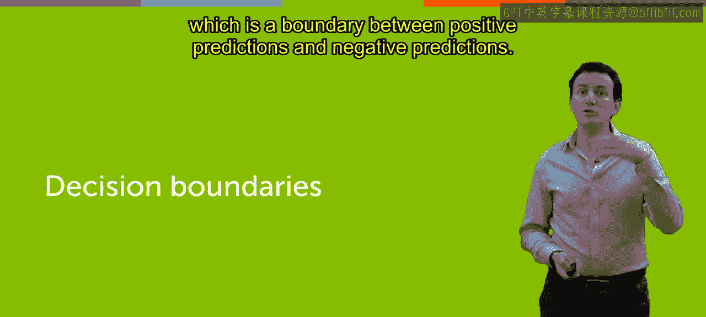
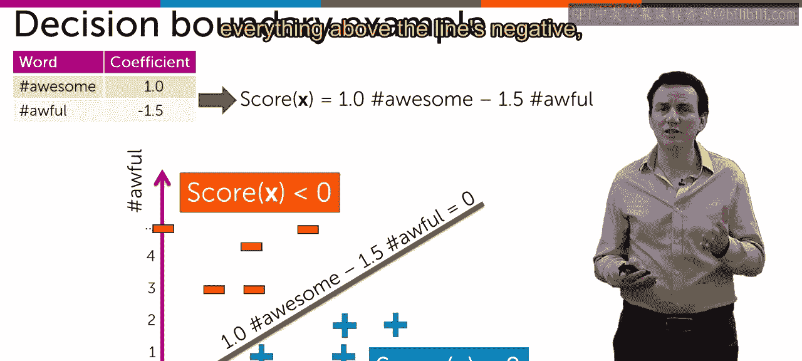
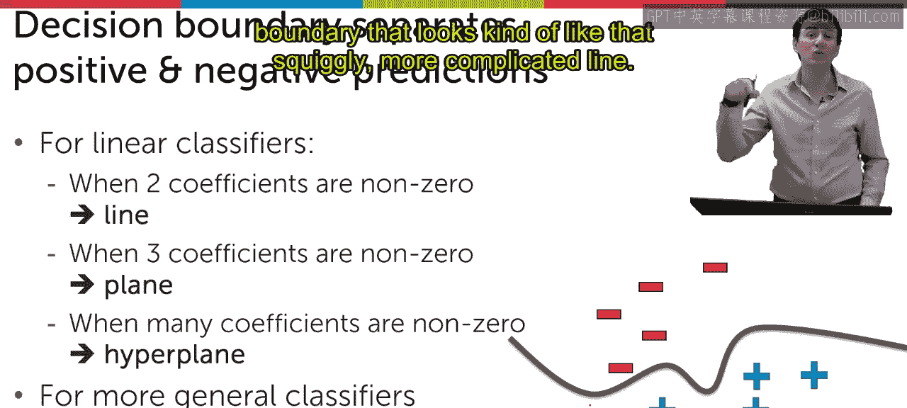

# 华盛顿大学《机器学习（分类，聚类和检索，第3-4课⧸共4课）｜Machine Learning》中英字幕 p11 10_决策边界.zh_en -BV1Sr421F7N7_p11-

。

In order to understand linear classifier a little better。

 let's reviewview the notion of decision boundary， which is a boundary between positive predictions and negative predictions。

Now let's say that I have taken my data and I trained my linear classifier and every word has zero weight。

 except for two of them， A has weighted 1。0 and awful has weighted minus 1。5。So what does that mean。

 That means that the score of any sentence is 1。0 times the number of times the word A shows up-1。

5 times the number times the word。😊，Awles shows up。

So let's plot that into a graph which depends for every sentence。

 the number of awesomes and the number of awfuls， so for example， for a sentence。

 the sushi was awesome， the food was awesome， but the service was awful。

Wherehy do I plot that into space where I'm going to have two awesomes and one awful。

 so guess plot in the two one。Point。And then every sentence that I might have in my training data or my prediction set might have say three offers in one awesome。

 three awesomes and no offers， and so on， and you have a data set like this。

The classifier that we train with the coefficients 1。0 and 1。

5 will have a decision boundary that corresponds to a line where 1。0 times awesome minus1。

5 times the number of offers is equal to 0。Everything below that line has score greater than0。

For any of those points。 And points on the up above that line are going have score less than 0。 So。

 for example， take the point three times three awesomes and0 offerss。😊。

That has a score greater than 0。 So we're going to classify that as plus one。Similarly。

 to all those points below the line。Now for the points above the line if you。😊，Check yourself。

 you see all of those have negative score， so we're going to label all of those as negative predictions。

And so there is that line， everything below the line， positive everything above the line is negative。

 that's what makes it a linear classifier， a linear decision boundary， really。😊。

Good， so we've seen that with two features or two coefficients。

 our decision boundary is really just align in this 2D plane。

Now in general we may have more coefficients than that。

 so if you have three features that have non zero value， non zero coefficient。

 then what we really have is a plane that tries to separate the positive points from the negative ones。

If you have more than three non zero coefficients， then we're in this high dimensional space in high dimensions。

 and we call that a hyperplan that tries to separate the positives from the negatives。

 That was a scifi reference， by the way。😊，And in general。

 if you visualize these hyperplanes in lower dimensional space。

 so if you use more complicated features or shapes。

 it might have a decision boundary that looks kind of like that squiggly more complicated line。

