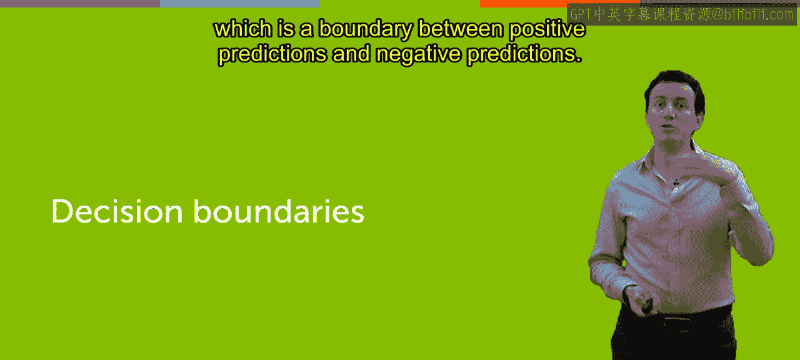
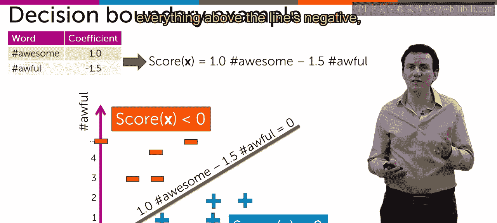
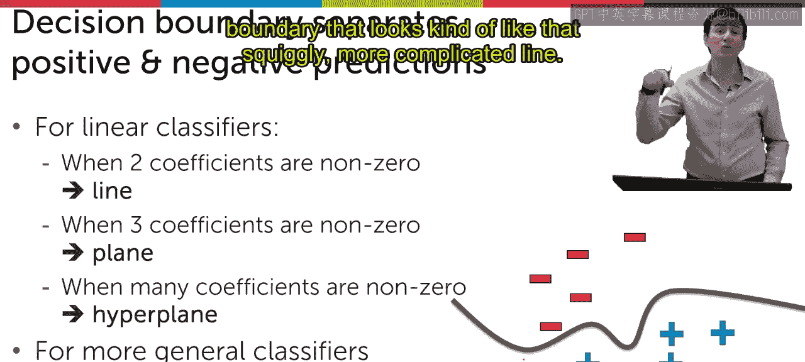

# 机器学习（分类，聚类和检索）：第3课：决策边界

在本节课中，我们将深入探讨线性分类器的一个重要概念——决策边界。决策边界是区分模型预测为正类（Positive）和负类（Negative）的分界线。理解它有助于我们直观地把握分类器是如何根据特征做出判断的。

## 决策边界的概念

为了更深入地理解线性分类器，我们先来回顾一下决策边界的概念。决策边界是正类预测和负类预测之间的分界线。

## 一个简单的例子

现在，假设我们处理完数据并训练了一个线性分类器。在这个模型中，除了两个词之外，所有词的权重都为零。具体来说，单词“awesome”的权重为 **1.0**，单词“awful”的权重为 **-1.5**。

这意味着，任何句子的得分（Score）计算公式为：
`得分 = 1.0 * (单词“awesome”的出现次数) - 1.5 * (单词“awful”的出现次数)`

我们可以将每个句子根据其包含的“awesome”和“awful”的数量绘制在一个二维图上。例如，对于句子“寿司很棒，食物很棒，但服务很糟糕”，它包含2个“awesome”和1个“awful”，因此我们将其绘制在坐标点 **(2, 1)** 上。

我们的训练数据或预测集中的其他句子可能包含不同的组合，比如 **(3, 0)** 或 **(1, 2)** 等，最终我们会得到一系列数据点。

## 绘制决策边界

我们训练的带有系数 **1.0** 和 **-1.5** 的分类器，其决策边界对应于一条直线，该直线满足方程：
`1.0 * (awesome的数量) - 1.5 * (awful的数量) = 0`

在这条直线**以下**的所有点，其得分都大于0。对于这些点，模型将预测为正类（+1）。例如，点 **(3, 0)** 的得分为 `1.0*3 - 1.5*0 = 3`，大于0，因此被分类为正类。

在这条直线**以上**的所有点，其得分都小于0。对于这些点，模型将预测为负类（-1）。你可以自行验证其他点。

因此，这条直线就是决策边界：线下为正，线上为负。这正是“线性”分类器的含义——它使用一条直线（或更高维度的平面）作为决策边界。

## 从二维到高维

以上我们看到了只有两个特征（或系数）时，决策边界是二维平面上的一条直线。

在更一般的情况下，我们可能拥有更多特征。以下是不同维度下的决策边界形态：

*   **三个特征**：如果恰好有三个特征具有非零系数，那么决策边界将是一个在三维空间中分隔正负样本的**平面**。
*   **更多特征**：如果拥有超过三个非零系数，我们就进入了高维空间。在高维空间中，这个分隔边界被称为**超平面**。它本质上是一个更高维度的“平面”，用于分隔正负样本。（顺便一提，这有点像科幻小说里的概念。）
*   **复杂特征**：如果我们使用更复杂的特征或形状，决策边界在低维空间中的投影可能看起来是弯曲的或不规则的复杂线条，而不仅仅是简单的直线或平面。

## 总结

本节课中，我们一起学习了决策边界的概念。我们通过一个具体的例子，看到了线性分类器如何利用特征的线性组合（公式 `得分 = w1*x1 + w2*x2 + ...`）在特征空间中定义一条直线（或平面、超平面）来区分正负样本。理解决策边界是理解线性模型工作原理的关键一步。