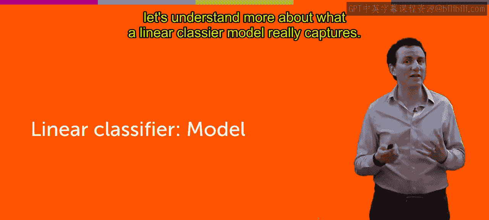
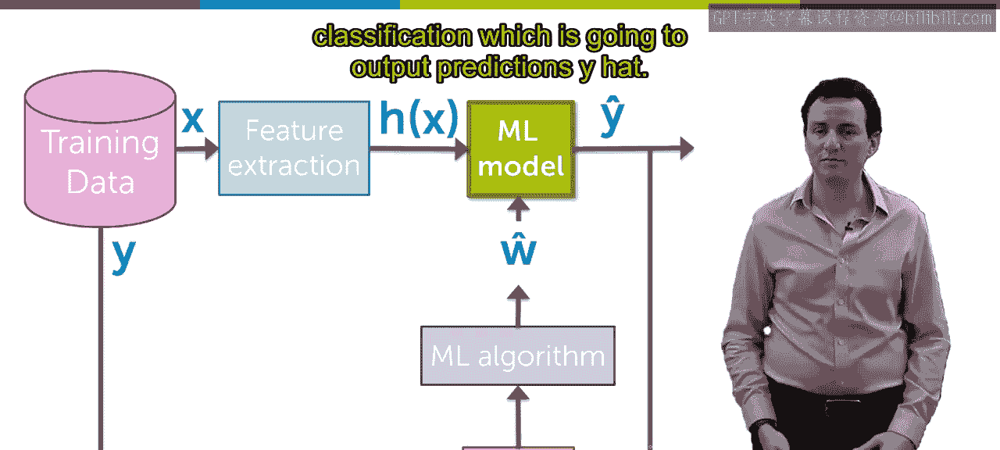
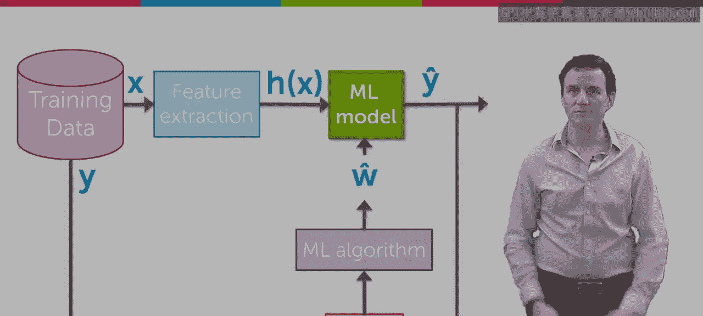
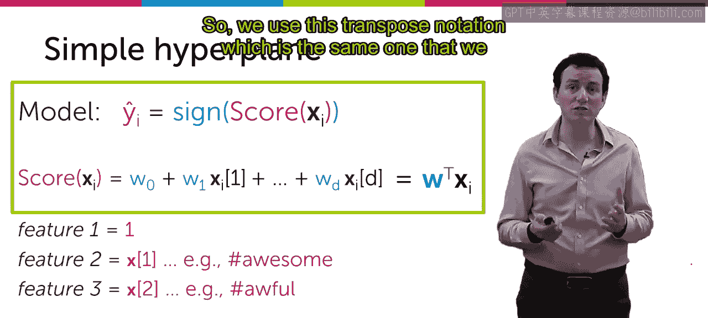
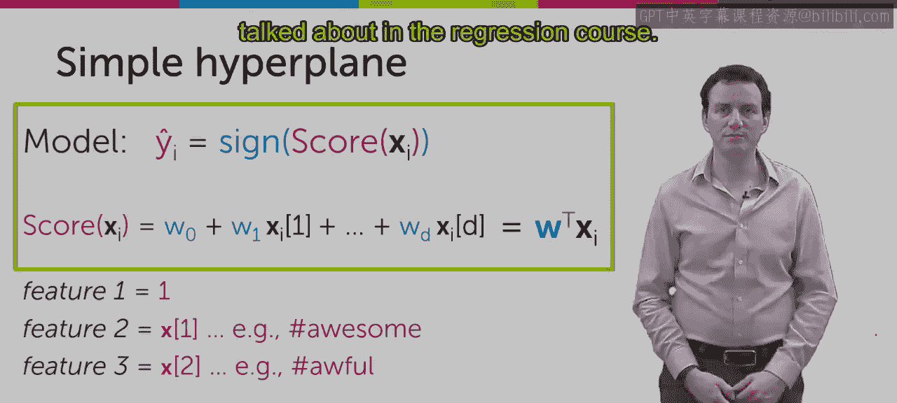

# 华盛顿大学《机器学习（分类，聚类和检索，第3-4课⧸共4课）｜Machine Learning》中英字幕 p12 11_线性分类器模型.zh_en -BV1Sr421F7N7_p12-

。

We've started with the intuition of a linear classifier using the sentiment analysis example。

 let's take a little bit of a next level dive and understand more about what the linear classifier model really captures。

In particular， we're going to take some data set。😊，Sori data set， which is gonna feed us Xs。

 We're gonna get features out of that， just like we did in the regression course。

 and we're gonna feed it that to the machine learning model for classification。

 which is gonna output the predictions why hat。😊。

And that model depends on some parameters W hat， which were not train from data。

Now， let's go back to that example that we had with just two features with non zero coefficients。

 A and awful。 Let's suppose that we had a third feature with non zero coefficient。

 Let's say that the word great。😊，Now， in this case。

 every data point is associated with a coordinate in this three dimensional space。 So， for example。

 this data point over here might have five awesomes。It might have。3 awfuls。 And it might have。

Two grades associated with it and what a linear classifier model is going to do is try to build a hyperplane that tries to separate the positives from the negative examples and the hyperplane is associated with this score function and the score function is going to be a weighted combination or of this coefficients W0 multiplied by the features that we have so w0 plus w1 times number of awesomes which in our case was5 plus w2 times the number falses which in our case is3 and finally W3 times number of grades which in our case was2。

😊，So for this data point over here， the score。Of X。

 I is going to be defined by w 0 plus 5 W 1 plus 3 W 2 plus。To W3。 And if this。

 depending on the coefficients， that score might be positive or negative。

 since this is a positive training example。 we want to choose the Ws that make that score positive。😊。

Now that we set up the classification problem and the task that we're after。

 let's do a quick review of notation for the course in this course。

 when I use the same notation that we used in the regression course。

 that was the second course in the specialization and here we had an output Y which is the thing we're trying to predict in the regression case that was realvalue but in our cases class and we have a set of inputs x which have little d dimensions x1 x to through Xd so x is really a D dimensional vector and y is an output we're trying to predict which in our case is either minus1 or plus1 in the binary classification setting which is where we're starting out today。

😊，No。Well use x J to denote the J of input， which is kind of a scalar value。

 We're going to use H J of x to denote the Jf feature。

And then we'll use x sub I very importantly to denote the IF data point。

And x sub i of j to denote a j of input of the I theta point。So's a little bit of a handful。

 but it's exactly the same as what we did in the regression course。Now。

With this empowered by this notation， we can go back and define our simple hyperplane。

 The one we just saw with0 awesomes and just say that in this case。

 why hat our prediction is the sign of the score that we have for this particular input。😊。

And the sine function just says that if this score is greater than0， predict plus one。

this score is less than0， predict -1， and then at 0。

 you have the choice of either predicting -1 or plus1 can make an arbitrary choice。

 The way I think about it is if it's 0， I predict plus1。

Now the score of an input X is w0 plus w1 times x1 of I。

 then plus w2 times x2 of I all the way to WD， the Dth coefficient times the D entry in the Xi vector。

And here the features input， the first one is one is that constant feature like we did with regression and x1 could be awesome。

 number of awesomes， x2 could be number of awfuls and say the last one XD could be the number of times the word ramen shows up。

Which to me might be associated with a negative review， but it might be kind of indifferent。

 Depend on what coefficient you have there。So our goal is to optimize the score， fit the score。

 and I'm going to use W transpose X I。As a shorthand。

 so I don't have to always write W0 plus w Y X 1 plus W2 x 2 and so on。

 So we use this transpose notation， which is the same one that we talked about in the regression course。

