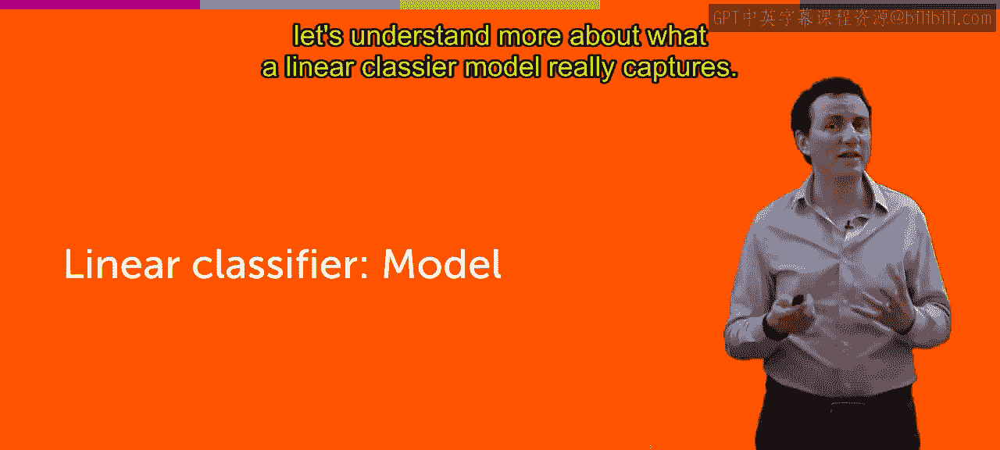
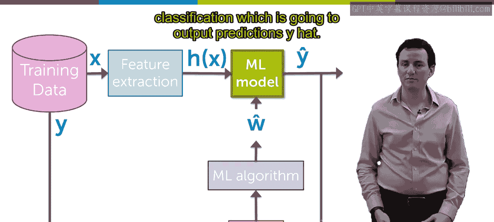
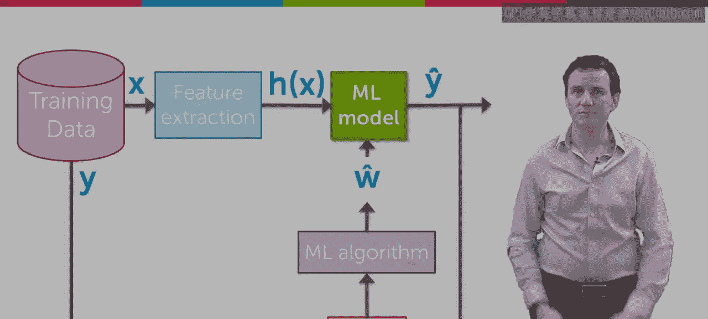
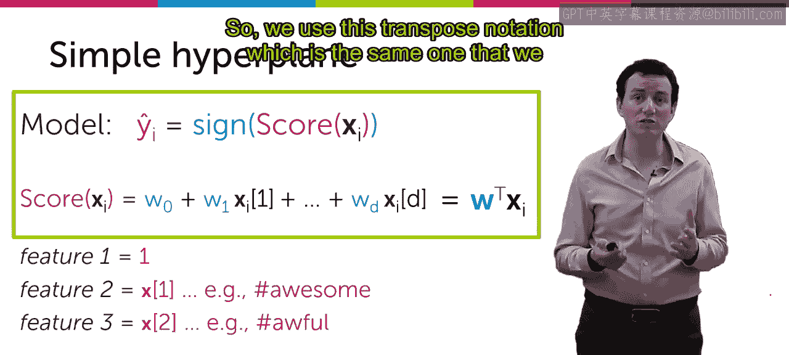
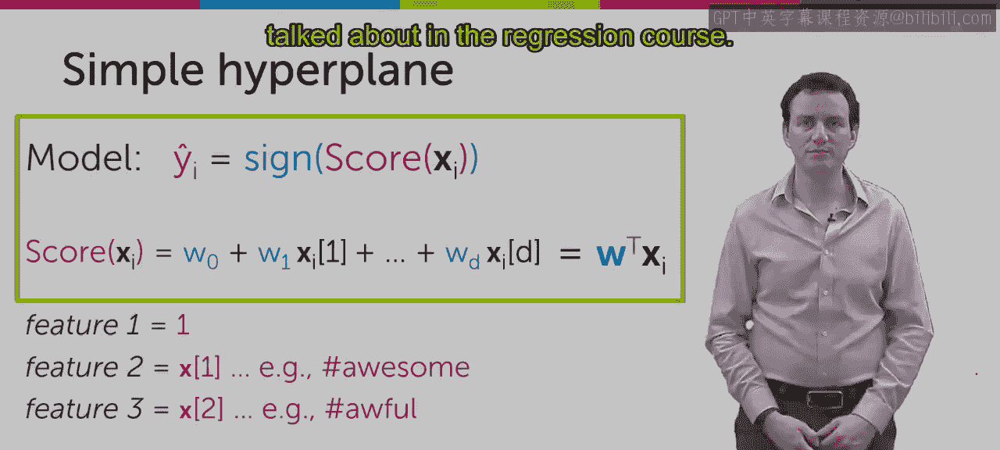

# 机器学习（分类，聚类和检索）：第3课：线性分类器模型 🧠

在本节课中，我们将深入学习线性分类器模型，理解其如何捕捉数据特征并进行分类预测。我们将从情感分析的例子出发，逐步构建模型，并介绍相关的数学表示。

---

上一节我们通过情感分析的例子建立了线性分类器的直观理解。本节中，我们将更深入地探讨线性分类器模型究竟捕捉了什么。

具体来说，我们将处理一个数据集，从中提取特征 `X`，就像在回归课程中所做的那样。然后，我们将这些特征输入到用于分类的机器学习模型中，模型将输出预测值 `ŷ`。

该模型依赖于一些参数 `Ŵ`，这些参数将从数据中学习得到。

现在，让我们回到之前那个只有两个非零系数特征（“awesome”和“awful”）的例子。假设我们增加第三个具有非零系数的特征，例如“great”。在这种情况下，每个数据点都关联着这个三维空间中的一个坐标。例如，某个数据点可能有5个“awesome”、3个“awful”和2个“great”。

线性分类器模型的目标是构建一个超平面，试图将正例和负例分开。这个超平面与一个评分函数相关联，该评分函数是这些特征的加权组合。

对于一个数据点 `X_i`，其评分 `score(X_i)` 定义为：
`score(X_i) = w0 + w1 * (awesome的数量) + w2 * (awful的数量) + w3 * (great的数量)`
对于上述例子，即：
`score(X_i) = w0 + 5*w1 + 3*w2 + 2*w3`

根据系数 `w` 的不同，这个评分可能是正数或负数。由于这是一个正例训练样本，我们希望选择能使该评分为正的 `w` 值。

---

在建立了分类问题及其任务框架后，让我们快速回顾一下本课程将使用的符号表示法。本课程使用的符号与回归课程（专项课程的第二门课）一致。

我们有一个输出 `y`，即我们要预测的目标。在回归中它是实数值，但在我们的分类场景中是类别。我们有一组具有 `d` 维的输入 `x`，即 `x1, x2, ..., xd`。因此，`x` 实际上是一个 `d` 维向量。在二元分类（我们今天讨论的起点）中，我们要预测的输出 `y` 是 `-1` 或 `+1`。

*   `x_j` 表示第 `j` 个输入（一个标量值）。
*   `h_j(x)` 表示第 `j` 个特征。
*   `x_i` 非常重要，它表示第 `i` 个数据点。
*   `x_i(j)` 表示第 `i` 个数据点的第 `j` 个输入。

符号有点多，但这与我们在回归课程中所做的完全相同。

---

借助这些符号，我们可以回过头来定义我们简单的超平面模型。在这个模型中，我们的预测 `ŷ` 是特定输入 `X` 的评分 `score(X)` 的符号。

符号函数 `sign` 定义如下：如果评分大于0，则预测 `+1`；如果评分小于0，则预测 `-1`；在等于0时，可以任意选择预测 `-1` 或 `+1`。我的处理方式是，如果等于0，我预测 `+1`。

输入 `X_i` 的评分是：
`score(X_i) = w0 + w1 * x_i(1) + w2 * x_i(2) + ... + w_d * x_i(d)`
这里的特征输入中，第一项 `x_i(1)` 通常是常数特征1（就像回归中一样）。`x_i(1)` 可以是“awesome”的数量，`x_i(2)` 可以是“awful”的数量，而最后一项 `x_i(d)` 可以是“ramen”这个词出现的次数（对我来说这可能与负面评价相关，但也可能无关紧要，具体取决于你赋予它的系数）。

我们的目标是优化这个评分函数。为了书写简便，我将使用 `W^T * X_i` 作为简写，这样我就不必总是写出 `w0 + w1*x1 + w2*x2 + ...` 了。这个转置记号与我们在回归课程中讨论的相同。

---

本节课中，我们一起学习了线性分类器模型的核心概念。我们从直观例子出发，定义了数据点、特征空间和分离超平面。我们引入了评分函数 `score(X) = W^T * X`，它通过特征的加权和计算每个数据点的得分。预测 `ŷ` 则由该得分的符号 `sign(score(X))` 决定，从而完成分类任务。我们还统一了与回归课程一致的数学符号表示法，为后续的模型训练和优化奠定了基础。