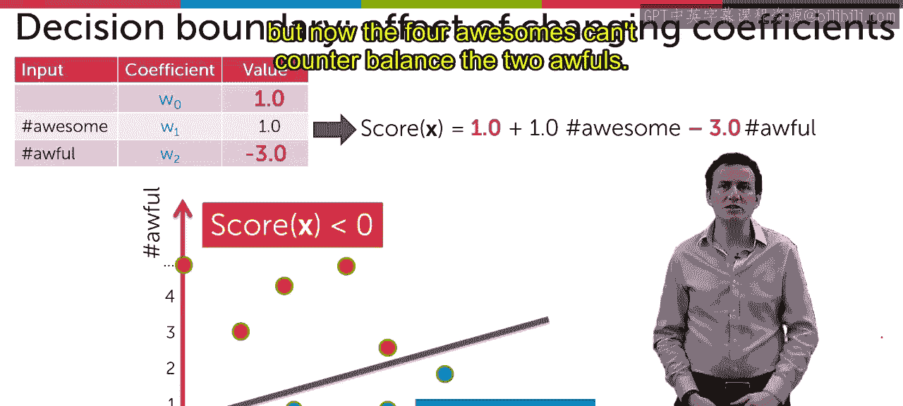

# 华盛顿大学《机器学习（分类，聚类和检索，第3-4课⧸共4课）｜Machine Learning》中英字幕 p13 12_系数值对决策边界的影响.zh_en -BV1Sr421F7N7_p13-

。

Now that we've defined a notation， let's go back to a decision boundary example and look at the impact of those coefficients that we learned on the actual decision boundary that we obtained so in the example that we had the score was defined by 1。

0 times awful awesome minus1。5 times awful that means that w1 was 1。0 W2 was minus 1。

5 and here w0 was 0 I didn't even show that 0 there but it was kind of equivalent say w00。😊。

And that's how we got that the serial boundary where。The score。

Belong the line was greater than0 and the score above the line was less than0。

 and that's what made our predictions be positive on one side negative on the other。Now。

 let's say that instead I had learned that the coefficient W0 was 1。0。Instead of zero。

What does that mean， that means that our score function now has this extra term 1。0。Plus1。

0 times awesome minus1。5 times often。 So what happens to the line to that decision boundary。

 what that line gets shifted up。And so if you look at that point on the lower left。😊。

Which is close to 0。0， which before we predicted as being a negative review。

 after we make that change， we now predict it to be a positive review。

 So it turns from orange to blue。 On the other hand， if you take the coefficient of， which is now-1。

5， and we increase it， we say it's-3。0。 So offs are just really awful。What happens to equation？ Well。

 the -1。5 gets replaced by -3。0。 So it becomes1 1。0 plus 1。0 number of awesomes。

3 times number ofs and that curve。Tillts down。A little bit。

 So if you look at that blue point that was on the positive prediction side。

It gets shifted to the other side of the decision boundary and it turns from orange。

 some some blue to orange。 and that's because you had two offs in it and offs are just offs。

 and before they were counterbalanced by the four awesomes in that data point。

 but now the four awesomes can't counterbalance the two offs。

