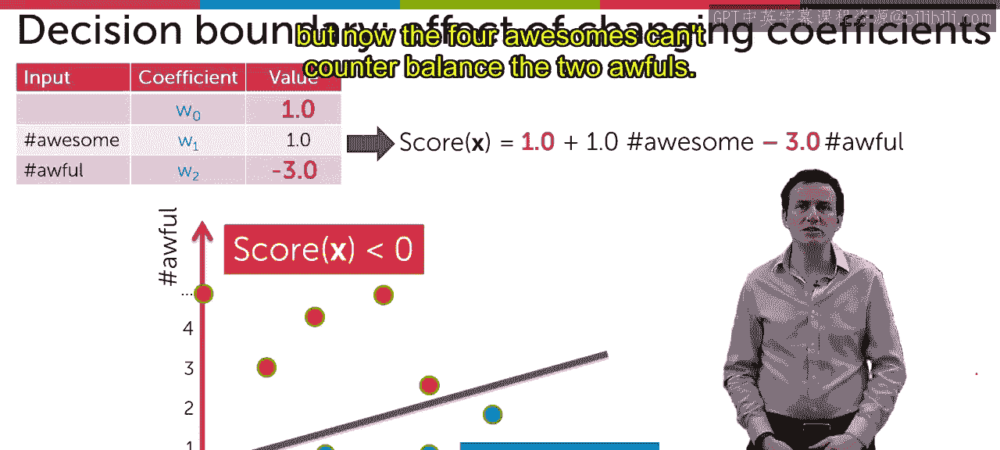

# 机器学习（分类，聚类和检索）：第3-4课：系数值对决策边界的影响 📊

在本节课中，我们将探讨在分类模型中，学习到的系数值如何直接影响决策边界的位置和形态。我们将通过一个具体的例子，展示系数 `w0` 和 `w2` 的变化如何改变决策边界，从而影响模型的预测结果。

---

上一节我们介绍了分类模型中的评分函数和决策边界。本节中，我们来看看系数 `w0` 和 `w2` 的具体数值变化会如何影响这条边界。

首先，回顾我们之前定义的评分函数。在示例中，评分由以下公式定义：
**`score = 1.0 * awesome - 1.5 * awful`**
这意味着系数 `w1 = 1.0`，`w2 = -1.5`，而 `w0 = 0`（虽然未显式写出，但等同于 `w0 = 0`）。

基于此，我们得到了决策边界：位于这条线上方的点评分小于0，下方的点评分大于0。这使得模型在边界一侧预测为正类（例如正面评价），另一侧预测为负类（例如负面评价）。

现在，假设我们学习到的系数 `w0` 不是0，而是 `1.0`。这意味着我们的评分函数增加了一个常数项：
**`score = 1.0 + 1.0 * awesome - 1.5 * awful`**

这个变化对决策边界有何影响？边界线会整体向上平移。

以下是具体影响：
*   观察左下角靠近 `(0, 0)` 的数据点。在 `w0 = 0` 时，它被预测为负面评价（橙色）。
*   当 `w0` 变为 `1.0` 后，该点现在被预测为正面评价（蓝色），即从橙色变为蓝色。

另一方面，如果我们改变系数 `w2`（对应“awful”一词），将其从 `-1.5` 增加到 `-3.0`（意味着“awful”一词的负面影响更强），评分函数变为：
**`score = 1.0 + 1.0 * awesome - 3.0 * awful`**

这个变化对决策边界有何影响？边界线会向下倾斜。

以下是具体影响：
*   观察一个原本在正类预测区域（蓝色）的数据点，它包含4个“awesome”和2个“awful”。
*   当 `w2` 变为 `-3.0` 后，由于“awful”的权重加倍，4个“awesome”已无法抵消2个“awful”的负面影响。
*   该点因此被划到决策边界的另一侧，预测结果从正类（蓝色）变为负类（橙色）。

---

本节课中我们一起学习了系数值对决策边界的影响。我们看到，截距项 `w0` 的变化会导致决策边界平行移动，而特征系数（如 `w2`）的变化则会改变边界的倾斜角度。理解这种关系对于解释模型行为和调试模型至关重要。