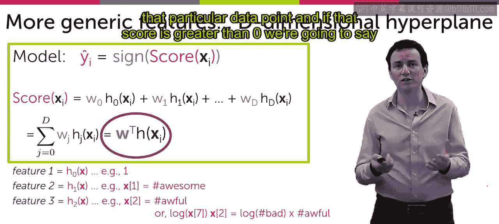
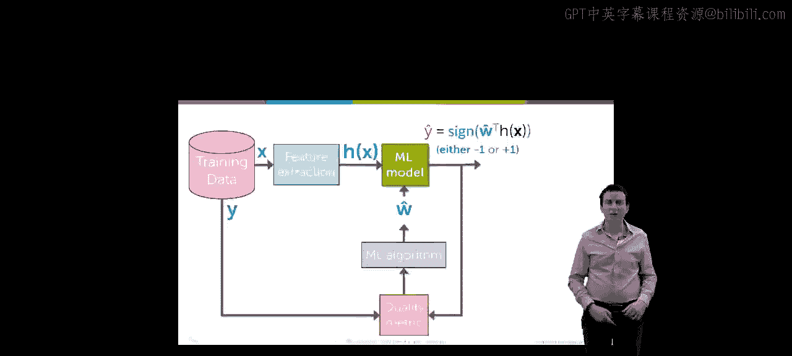
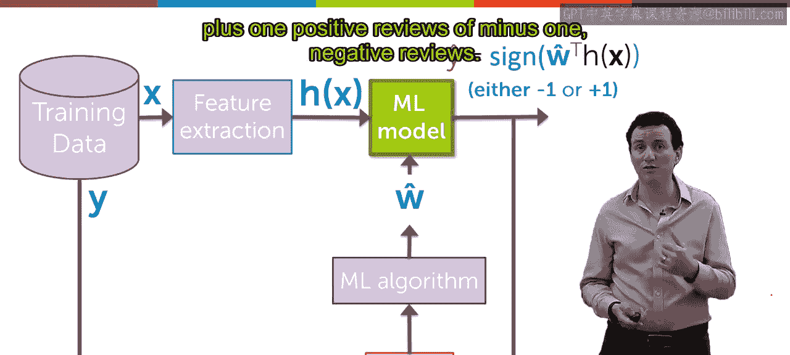

# 华盛顿大学《机器学习（分类，聚类和检索，第3-4课⧸共4课）｜Machine Learning》中英字幕 p14 13_使用输入的特征.zh_en -BV1Sr421F7N7_p14-

。

The notation we so far is without features associated with it， but just like the regression course。

 we're going to focus on introducing features from the very beginning。

 so we're going to have these functions H1 through H cap to D。

 they've defined some features we might extract from the data。

And we're going to encode the constant function as H0。So in particular。

We're gonna to have that the score is W0 H0 plus W1 H1 W2 H2 all the way to W capital DHD。

 so a feature could be a constant for H0， it could be number of awesomes for H1 number ofs for H2。

 it could be some transformation like log of number of awesomes times number of bads or more realistically it could be the TF IDF of number of of which help us emphasize more words which are more distinctive or important that we looked at TFIDF in the first course and explore that quite a bit and we're going to revisit that in the next course。

So now we have this prediction score which is based on sum over the features of w the coefficient。

 w Wj times the feature Hj and we're going to use shorthand w transpose H of X to denote the score so you see me do that a lot。

 w transpose h of X denotes the score for that particular data point and if that score is greater than0。

 we're going to say it's positive and if that score is less than0， we're going to say it's negative。

Very good。 so now we will introduce our model in a little bit more detail and I'm always going to take the input data x。

😊，Feed it through the feature generating function， which might be counting the number of awesome or creating a TF IDF model。

 And we're going gonna feed that to the machine learning model， which is gonna multiply the features。

With the learn weights W hat， and output a value score。

 which we're going to throw through the sine function and output either that y hat is plus one。

 positive reviews or minus1 negative reviews。

🎼。