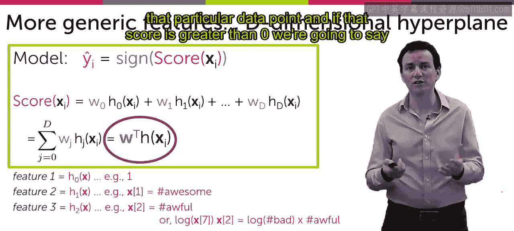
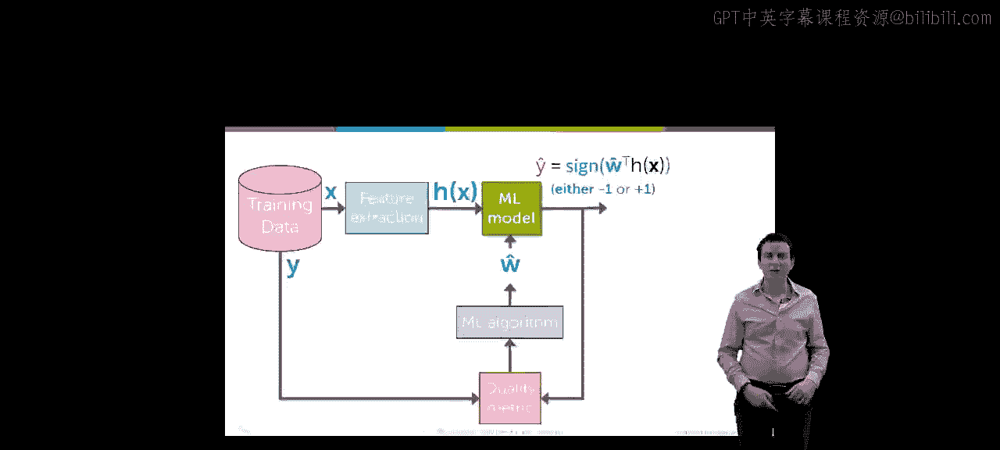
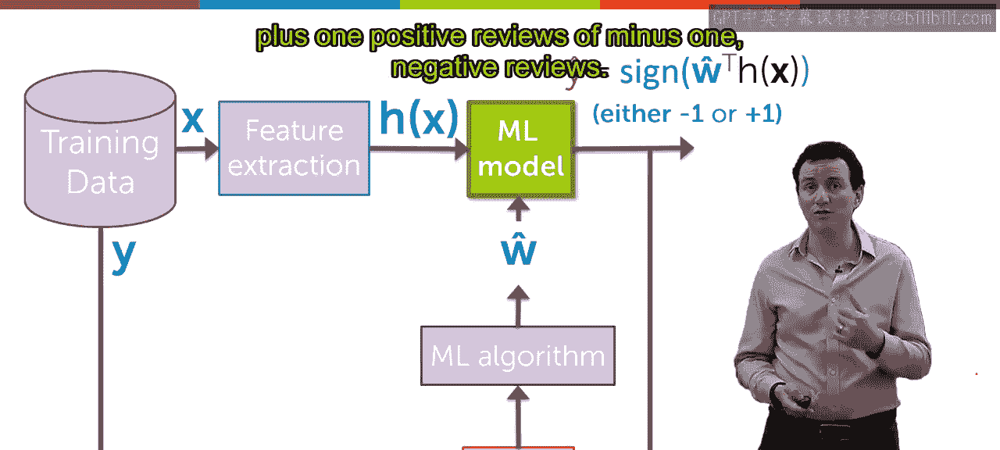

# 机器学习（分类，聚类和检索）：第3-4课：使用输入的特征

在本节课中，我们将学习如何在分类模型中引入和使用特征。我们将从基础的评分公式开始，逐步理解特征如何被提取、加权，并最终用于预测文档的情感倾向（正面或负面）。

---

## 特征与评分公式

到目前为止，我们使用的符号没有关联特征。与回归课程类似，我们将从一开始就重点介绍特征的引入。

我们将定义一系列从数据中提取的特征函数，记作 **H₁** 到 **H_D**。同时，我们将常数函数编码为 **H₀**。

具体而言，一个数据点的预测评分（score）计算公式如下：

**score = w₀H₀ + w₁H₁ + w₂H₂ + … + w_DH_D**

其中，**w_j** 是与特征 **H_j** 对应的系数（权重）。

### 特征示例
*   **H₀**：可以是一个常数（例如，截距项）。
*   **H₁**：可以是文档中“awesome”（很棒）这个词出现的次数。
*   **H₂**：可以是文档中“awful”（糟糕）这个词出现的次数。
*   更复杂的特征：可以是某些转换，例如“awesome”出现次数的对数乘以“awful”的出现次数。更实际的特征可以是**TF-IDF**值，它能帮助我们强调那些更具区分度或更重要的词语。我们在第一门课程中学习过TF-IDF，并将在后续课程中再次探讨。

---

## 模型的向量化表示与决策规则

为了简化表示，我们使用向量化的记法。将所有权重 **w_j** 组成的向量记为 **w**，将所有特征 **H_j(x)** 组成的向量记为 **h(x)**，那么评分可以简洁地表示为两者的点积：

**score = wᵀ h(x)**

这里，**wᵀ h(x)** 就表示针对特定数据点 **x** 的评分。

基于这个评分，我们制定一个简单的决策规则：
*   如果 **score > 0**，我们预测该文档为正面评价（**ŷ = +1**）。
*   如果 **score < 0**，我们预测该文档为负面评价（**ŷ = -1**）。

---

## 模型工作流程详解

现在，让我们更详细地介绍整个模型的工作流程。这个过程可以清晰地分为几个步骤：

以下是模型从输入到预测的完整步骤：

1.  **特征提取**：首先，将输入的原始数据 **x**（例如一段评论文本）送入特征生成函数。这个函数会执行诸如统计“awesome”一词出现的次数，或计算整个文档的TF-IDF向量等操作。
2.  **线性组合**：接着，将生成的特征向量 **h(x)** 输入到机器学习模型的核心部分。模型会将每个特征 **H_j(x)** 与其对应的已学习权重 **w_j** 相乘，并将所有乘积求和，得到一个单一的**评分（score）**值。
3.  **决策输出**：最后，将这个评分值通过符号函数（sign function）处理。根据结果是正还是负，模型输出最终的预测标签 **ŷ**，即 **+1**（正面评价）或 **-1**（负面评价）。

---

## 本节总结

本节课中，我们一起学习了如何为分类模型引入特征。我们定义了从数据中提取特征的函数，并建立了基于特征加权求和的评分公式 **score = wᵀ h(x)**。我们明确了利用该评分的决策规则，并梳理了模型从原始输入到最终预测的完整工作流程：**输入数据 → 特征提取 → 线性加权评分 → 符号函数决策 → 输出预测**。理解这个流程是构建更复杂分类器的基础。