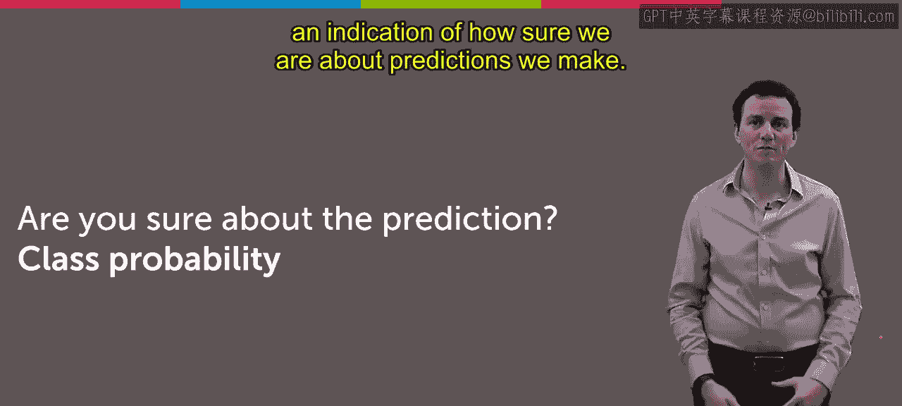
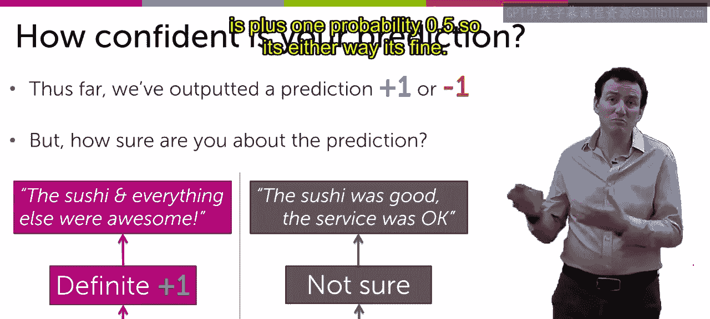

# 华盛顿大学《机器学习（分类，聚类和检索，第3-4课⧸共4课）｜Machine Learning》中英字幕 p15 14_预测类别概率.zh_en -BV1Sr421F7N7_p15-

。

What we've covered so far is mostly a review of what you saw in the first course of the specialization。

At this point we're going to go much deeper into fundamental concepts which are associated with logistic regression in particular in logistic regression。

 we don't just predict plus1 or minus1， we predict a probability how likely is this review to be positive how likely is it to be negative and those proes are extremely useful because they give us an indication of how sure we are about predictions we make。

😊。

So in particular， so far we've talked about taking the score， throwing it through the sine function。

 deciding， is this a positive or a negative review， so plus one or minus1？However。

 not all reviews are created the same， so for example， Rea says the sushi at everything was awesome。

😊，That's a definite plus one， I feel really good about that。Everyone says， the sushi is good。

 the service was okay。I don't know what people think about that。 It could be plus1。 It could be -1。

 If a person is really nice。 They might feel bad about writing negative reviews。

 They might write that when they really mean it's a negative review。

 So how can I capture the fact that for the first one， I'm sure that why hat is plus one。

 Well for the one on the right， I might say。😊，You know。

 why hat I don't know if it's plus 1 or minus-1， so I'm going to say why hat is plus one probability 0。

5。

Either way， it's fine。