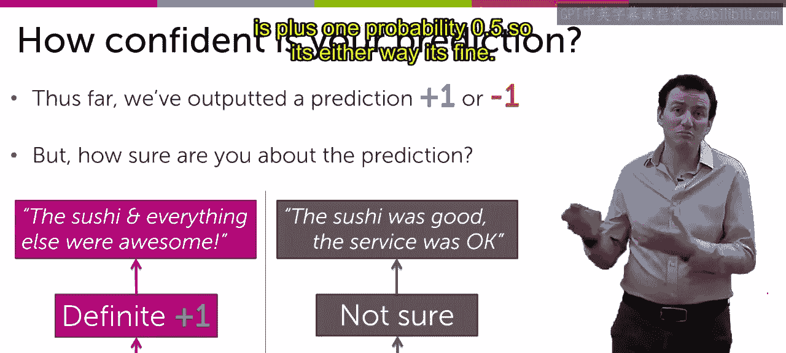

# 机器学习（分类，聚类和检索）：第3-4课：预测类别概率


在本节课中，我们将深入探讨逻辑回归的一个核心概念：预测类别概率。我们将学习如何不仅预测类别标签（如+1或-1），还能输出一个概率值，用以表示我们对预测结果的置信程度。

## 概述

到目前为止，我们讨论的内容主要是对专业课程第一门课知识的回顾。从此刻起，我们将更深入地探讨与逻辑回归相关的基本概念。在逻辑回归中，我们不仅仅预测+1或-1，我们预测的是一个概率——例如，这条评论是积极的可能性有多大，是消极的可能性有多大。这些概率极其有用，因为它们能指示我们对所做预测的把握程度。

## 从分数到概率

上一节我们介绍了如何获取分数并通过符号函数来决定一条评论是积极的（+1）还是消极的（-1）。然而，并非所有评论都具有相同的确定性。

例如，有一条评论说：“这家店的寿司太棒了。”这是一个明确的+1，我们对此非常有把握。另一条评论说：“寿司不错，服务一般。”我们不太确定这条评论的倾向，它可能是+1，也可能是-1。如果评论者为人友善，他们可能不愿写负面评价，即使内心认为是负面的，也可能写出这样的评论。

那么，如何捕捉第一种情况我们确信预测为+1，而第二种情况我们不确定是+1还是-1的事实呢？对于右边的情况，我们可能会说：预测的类别标签是+1，但概率只有0.5。

## 核心概念：逻辑函数


为了将分数（一个实数）转换为一个介于0和1之间的概率值，我们使用逻辑函数（或称Sigmoid函数）。这个函数能将任何实数映射到(0, 1)区间。

其公式如下：

**P(y=+1 | x) = σ(score) = 1 / (1 + e^{-score})**

其中，`score = w^T * x + b`（即特征的加权和加上偏置项），`e`是自然常数。

以下是该函数的代码描述：

```python
import math

def logistic_function(score):
    """
    将分数转换为概率。
    参数:
        score: 线性模型的输出值（实数）。
    返回:
        一个介于0和1之间的概率值。
    """
    return 1 / (1 + math.exp(-score))
```

逻辑函数的输出可以解释为给定特征`x`时，目标`y`为+1类的概率。相应地，预测为-1类的概率就是`1 - P(y=+1 | x)`。

## 概率的解释与应用

通过引入概率预测，我们的模型输出变得更加丰富和实用。

以下是概率的几个关键用途：

*   **衡量预测置信度**：概率值越接近1或0，表示模型对预测为正类或负类越有信心；概率值接近0.5则表示模型不确定性很高。
*   **制定差异化决策**：在实际应用中，我们可以根据概率设定不同的行动阈值。例如，对于高置信度的正面评论可以优先展示，而对于概率接近0.5的评论则可以交给人工审核。
*   **作为其他模型的输入**：这些概率值可以作为更复杂集成模型或下游任务的特征。

## 总结



本节课中，我们一起学习了逻辑回归中预测类别概率的核心思想。我们了解到，通过使用逻辑函数，可以将线性模型输出的分数转换为一个具有明确概率解释的值。这使我们不仅能做出分类决策，还能评估每个决策的置信水平，为更精细和实用的机器学习应用奠定了基础。