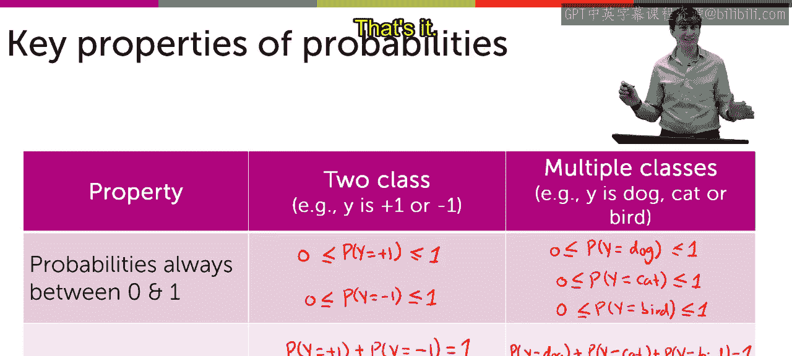

# 华盛顿大学《机器学习（分类，聚类和检索，第3-4课⧸共4课）｜Machine Learning》中英字幕 p16 15_概率基础知识回顾.zh_en -BV1Sr421F7N7_p16-

。

At the very core。Offer。Measuring how sure we are about a prediction is a notion of probability。

 so let me do a very very very very very quick review of probabilities here and how theyre useful throughout this module and throughout the course。

😊，Okay， now you see I will see a very quick review of probability。

 which is just showing a few examples and interpreting what probability means。

 So if I say the probability that I review is positive 0。7 So that means like in general 0。

7 is the probability associated with people writing positive reviews。

 what does that mean Well if I take my data set of reviews。😊，I would expect。On average。

 the 70% of the rowsier will have positive reviews。And the other 30% would be negative。 Of course。

 a data set is kind of a finite sample or observation of the underlying。Space of reviews。

 so it's not going to be exactly 70%， but it's about 70%。That's how we interpret probabilities。

Now we can associate probabilities with what's called degrees of beliefs or degrees of sureness。

 so for example， let's look at the probability that y is plus1。

 so this is the notation that we'll say that we'll use so probability。😊，It is that。Y。

 which is the thing we're trying to predict output。Is。Positive。And let's interpret that。

 that output can range from0 to one。So if the output is zero， that means that I'm absolutely sure。

Every single review in the world is positive。That's what it means。So。

What this is saying is that the probability that y equals plus 1 is equal to1。Which。

What does that imply Well we have that the probability that y is minus1 that reviews are negative is1 minus the probability that reviews are positive y equals plus1。

 which means that it is zero， that means a zero chance that they are negative reviews。

 which is not true。And so on the other hand， if I say that the probability of y equals plus1 is0。

 that means say I'm absolutely sure that every review in the world is not positive。

 which in our case would say that the probability that y equals plus1 is0。

 and that implies that the probability that y is minus1。Is one。

 that means that every review out there is negative。And the truth is not that somewhere in between。

 so for example if you say the probability is 0。5， that means that I'm not sure if reviews are positive or negative in general。

 they can be 50，50， say on average half or positive half or negative and so this would say that the probability that y is equal plus1 is equal to the probability that y is equal to minus1 which is 0。

5。😊，In other words， the world is fair and balanced。50，50。

So let's discuss some fundamental properties of probabilities which I've hinted at in the examples before so first of all。

😊，Probabilities are always between0 and1。 So there are no negative probabilities。 In fact。

 I've taught classes where I've had students submit assignments that had negative probabilities in them。

😊，Not true， can happen。So the probability that y is plus one。Is somewhere between。Z and1， similarly。

 probably the y is minus1。Is always greater than equal to 0 and is always less than equal to one。

Fundamental property， the other fundamental property of proities is the probabilities add up to one。

😊，So the probability， the y equals plus  one。Plus the probability the y is equal to minus1。

 these are two possibilities for views that are either positive or negative， nothing else can happen。

Then that adds up to one。So two things to remind ourselves。

 Now we just talked about the binary classification case， but you can have multiple classes。

 So for example， we can why if it's an image， maybe it can be either dogs， cats or birds。

 This is the only three things can happen in the world。 let's say。 And in that case。

 we have that the probability， the three possibilities are the probability of y is a dog to the image of the dog。

 the probability that y is a cat。And the probability of the why is a bird。

And we have that all of these are between0 one， so they're all written than zero。And less than one。

 But that's not enough to capture what happens。 The。

 the last important part is that these probabilityities add up to one。 That is。

 if that's the only thing that images can be dogs， cats and birds。 if the other things could be。

 then you have to add all those in。 But in our case， there's only three possibilities。

So we have the probability that y equals。Dog。Plus， the probability that y is equal to cut。Plus。

 probability of Y is equal to bird。Is equal to one。And there you go。

 now you know everything you ever need to know about probabilities。😊，That's it。

