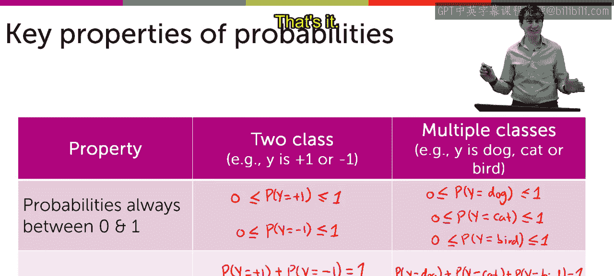

# 机器学习：第3-4课：概率基础知识回顾

在本节课中，我们将学习概率论的基础知识。概率是衡量我们对预测结果确信程度的核心概念，在分类、聚类和检索等机器学习任务中至关重要。本节将快速回顾概率的基本定义、解释和性质，为后续学习打下基础。

## 概率的解释

上一节我们提到了概率的重要性，本节中我们来看看如何具体解释一个概率值。

概率可以表示事件发生的长期频率。例如，如果我说“评论为正面”的概率是0.7，这意味着在大量评论数据中，平均有70%的评论是正面的，其余30%是负面的。数据集是对真实评论世界的一个有限样本观察，因此比例可能不会精确等于70%，但会大致接近。

概率也可以表示我们对某件事的**确信程度**或**信念强度**。我们使用符号 `P(y = +1)` 来表示输出 `y` 为正面（+1）的概率。这个概率值在0到1之间。

*   如果 `P(y = +1) = 1`，表示我们绝对确信所有评论都是正面的。
*   如果 `P(y = +1) = 0`，表示我们绝对确信所有评论都不是正面的（即全是负面的）。
*   如果 `P(y = +1) = 0.5`，表示我们完全不确定评论的倾向，认为正面和负面的可能性各占一半。

## 概率的基本性质

理解了概率的含义后，我们来看看概率必须遵守的几个基本数学性质。

以下是概率的两个核心性质：

1.  **非负性与有界性**：任何事件的概率都介于0和1之间（包含0和1）。不存在负概率或大于1的概率。
    *   公式表示为：`0 ≤ P(事件) ≤ 1`
2.  **归一性**：所有可能互斥事件（即不会同时发生的事件）的概率之和必须等于1。

在二元分类（如正面/负面评论）的例子中，只有两种互斥的可能结果。因此，正面概率和负面概率之和为1。
公式表示为：`P(y = +1) + P(y = -1) = 1`

## 扩展到多类别情况

上一节我们以二元分类为例，本节中我们来看看当输出有多个类别时，概率的性质如何扩展。

考虑一个图像分类问题，图像可能属于“狗”、“猫”或“鸟”三类，且仅此三类。此时，每个类别的概率仍然在0到1之间。

此外，所有可能类别的概率之和必须为1。因为图像必定属于这三类中的某一类。
公式表示为：`P(y=狗) + P(y=猫) + P(y=鸟) = 1`

如果存在更多类别，则需要将所有类别的概率相加，总和仍为1。

---

本节课中我们一起学习了概率的基础知识。我们了解了概率的两种解释（频率与信念），掌握了概率必须满足的**非负性**、**有界性**和**归一性**，并看到了这些性质如何从二元分类推广到多类别分类。这些概念是理解后续机器学习算法中不确定性度量的基石。