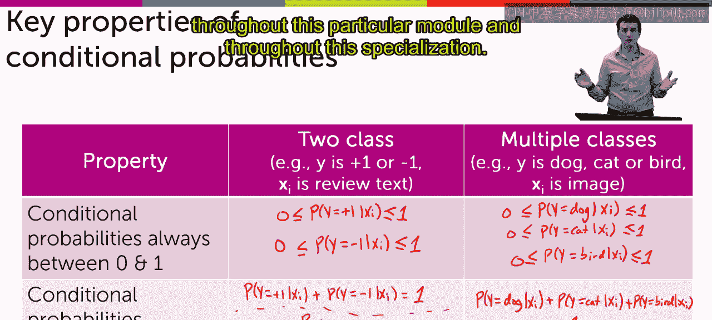

# 华盛顿大学《机器学习（分类，聚类和检索，第3-4课⧸共4课）｜Machine Learning》中英字幕 p17 16_条件概率基础知识回顾.zh_en -BV1Sr421F7N7_p17-

。

Now let's talk about a slightly more advanced concept， the concept of conditional probabilities。

 and this is what we're going to use a lot today， so it's a good thing to review and a good thing to really keep in mind and understand。

😊，Now， a sentence here might say the probability that a review that has three awesomes in it and one awful is positive is 0。

9。So I'm mouth， what does that mean？Let's interpret it by look at a little bit of data。

 So let's say that I have my data set， and I'm just highlighting here awesomes and awfuls。 in fact。

 I'm highlighting the sentences that had three awesomes。😊，And one awful。

So if I go and mark of those and I just look at those rows where the condition。😊。

This part up here is called the condition。And that's why it's called conditional probability。

 three awesomes and one awful， so out of the rows they have three awesomes and one awful。

 I expect on average the 90% of those。Are going to be positive reviews and that makes sense if you have three awesomes and one awful。

 very likely to be a positive review。😊，So this is how we interpreted。

 I expect 90% of the rows are going to have a plus one in them。

You see there's one here that has a minus1， but in general， you have lower plus ones。

Now we can again interpret their conditional probabilities in terms of degrees of beliefs about how feel about the reviews。

 but this is not how we feel about reviews in general， how do feel about reviews specifically。

 so for example， if I have a condition XI and input XI that says all the sushi was delicious。😊。

What's the probability that the review is positive in that condition， so here we have。😊。

The probability。Of the output。Being positive。And we use the word given。

 this little bar here means given。Or conditioned on。The input。Which in our case was。

 oh the sushi was delicious。It was delicious。And so if that initial probability has value。嗯。

I wrote it on top of my own labels， but I hope it makes sense。 that's the output label input centers。

 and these are all the parts of the probability。No。If I say that that output has probability one。

 given this input also she was delicious， then that means that I'm still absolutely sure that it。

Review， all the sushi was delicious is opposed review。 I feel pretty good about that。

 So we're going to denote it by。😊，Probability of y。Equals plus 1。Given X， I。

This is a shorthand year notation。Is equal to one。What does that imply？By the way。

 is it the probability that y is equal to minus1 given X I is1 minus the probability of y equals plus  one given X I。

Which in our case would be 0。 So what does I mean that if this。

 the probability that this is a positive review， given that the input sentence is all social des is one。

 then the probability that it's。Negativeivity is 0。Similarly。

 if we output the probability y co plus 1 is0， that means absolutely sure that the review all the sushi was delicious is negative。

 I actually I'm not sure that， but in that case it would mean that。😊，And。

That means that the probability of y equals plus1 given the input X。Is 0 and。That would imply that。

We believe that it's a negative review。We've given this input with probability one。

You could be somewhere in between so for example， let's say they see the probability of y equals plus one given the input all the sushi is delicious is 0。

5 that instead I'm not sure。😊，If that view is positive or negative。

 so what I'm saying is that the probability of y is plus 1 given X is the same as the probability of y cos minus1 given X。

 which is 0。5。So I would believe that it's 5050 in reality for this input。

 I believe you know will be somewhere around here so the probability will be very。

 very high that is a positive review。So let's talk about a few important properties of conditional probabilities。

First， if we have two classes， conditional probabilities are always between 0 and 1。

 so the probability that y is equal to plus 1 given an X。Is somewhere between zero。And1， similarly。

 the probability that y is -1 given X I。Is somewhere between 0 and1。Now。

 interestingly and importantly。The condition probability。

 conditional probabilities add up to one over y over the left side of the conditional。

 So the probability that y。Is equal to plus1， given X I。If I add it with the probability。

 the y is equal to minus1， give an X。That adds up to one。However。But。

It's not true if you sum the right side， if you sum over the sentences or over X or anything like that。

 So， for example， if you said。Some over all possible sentences of the probability of y equals plus 1 given x that is。

Not required to be one。Or for example， let's say that you summed over all the data points and you might have end of them。

Of the probability of y equals plus 1 given X。Again， that is not one。Not required to be one。

So they add up to one on the left side， on the overwise。Now we talked about the binary case。

 let's talk about multiple classes。So in this case。Same example as before， so y can be dog。

 but now we conditioned it on the image Xi。Or or why can be。Cat。

With a particular image X as input or Y can be bird。With a particular input X， and we have that。

These are between 0。Or one。And that's our input output here。Now， similarly with multiple classes。

 we have the probabilities add up to one over if you sum over possible values of ys。

 so we have the probability that y is equal to dog。For this particular image， Xi。

Anyway add that the probability is that y is equal to CA。For this particular image X I。

 And you add the probability that y is equal to bird。For this particular。Xi。

 and you add all those together and you get one。And here go。

 now we've covered very quickly a summary of the key properties of probabilities and conditional probabilities。

 and we're going to use them at a high level throughout this particular module and throughout the specialization。

😊。

