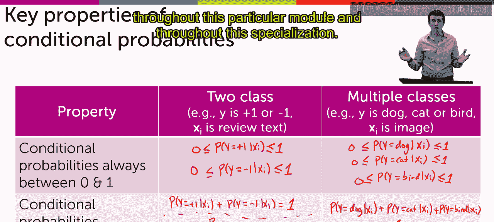

# 机器学习（分类，聚类和检索）：第3-4课：条件概率基础知识回顾

在本节课中，我们将学习条件概率这一核心概念。条件概率是理解许多机器学习算法的基础，尤其是在处理分类问题时。我们将通过简单的例子来阐述其定义、性质及其在机器学习中的应用。

## 条件概率的定义

上一节我们介绍了概率的基本概念，本节中我们来看看条件概率。条件概率描述了在某个特定条件或事件发生的情况下，另一个事件发生的可能性。

例如，考虑这样一个陈述：“**一篇包含三个‘awesome’和一个‘awful’的评论是正面评论的概率为0.9**”。这意味着，在所有满足“包含三个‘awesome’和一个‘awful’”这个条件的评论中，我们预计平均有90%是正面评论。

我们可以通过数据来理解这一点。假设我们有一个数据集，我们只关注那些满足“包含三个‘awesome’和一个‘awful’”条件的行。在这些行中，我们预计大约90%的评论标签是正面的（+1）。这很直观，因为有三个正面词和一个负面词，评论很可能是正面的。

## 条件概率的符号表示

在机器学习中，我们经常关心在给定输入特征 `X` 的情况下，输出类别 `y` 的概率。我们用以下符号表示：

`P(y = +1 | X = x_i)`

其中：
*   `P` 表示概率。
*   `y = +1` 是我们关心的输出事件（例如，评论是正面的）。
*   `|` 表示“在...条件下”或“给定”。
*   `X = x_i` 是给定的条件（例如，输入句子是“所有的寿司都很美味”）。

这个表达式读作：“**在输入为 `x_i` 的条件下，输出 `y` 为 +1 的概率**”。

## 条件概率的解释

条件概率的值反映了我们对特定条件下事件发生的信念强度。

*   如果 `P(y = +1 | X = x_i) = 1`，那么我们**绝对确信**在给定输入 `x_i` 时，输出是正面的。
*   如果 `P(y = +1 | X = x_i) = 0`，那么我们**绝对确信**在给定输入 `x_i` 时，输出是负面的。
*   如果 `P(y = +1 | X = x_i) = 0.5`，那么我们**完全不确定**，认为正面和负面的可能性各占一半。

对于二元分类（两个类别），一个重要的关系是：
`P(y = +1 | X = x_i) + P(y = -1 | X = x_i) = 1`
这意味着，在给定相同输入的条件下，输出为正面和负面的概率之和必须为1。

## 条件概率的重要性质

以下是条件概率的几个关键性质，对于理解后续内容至关重要。

首先，条件概率的值始终在0和1之间：
`0 ≤ P(y | X) ≤ 1`

其次，对于所有可能的输出类别 `y`，在**给定同一个输入 `X`** 的条件下，它们的概率之和为1。这在二元和多类别情况下都成立。

*   **二元情况（两个类别）**：
    `P(y = +1 | X) + P(y = -1 | X) = 1`

*   **多类别情况（例如，图像分类为狗、猫、鸟）**：
    `P(y = 狗 | X) + P(y = 猫 | X) + P(y = 鸟 | X) = 1`

**重要提示**：这个求和性质是**针对输出变量 `y` 的所有可能取值**，并且是在**同一个输入条件 `X` 下**。如果我们对不同的输入 `X` 求和，其结果**不一定等于1**。例如，对所有数据点求和 `Σ P(y = +1 | X_i)` 的结果可以是任意值，没有总和为1的限制。

## 总结

本节课中我们一起学习了条件概率的基础知识。我们明确了条件概率 `P(y | X)` 表示在已知输入特征 `X` 的情况下，预测输出为 `y` 的可能性。我们了解了它的取值范围在0到1之间，并且对于给定的同一个输入 `X`，所有可能输出类别的条件概率之和为1。掌握这些性质，是我们后续构建和理解逻辑回归、朴素贝叶斯等分类模型的重要基石。