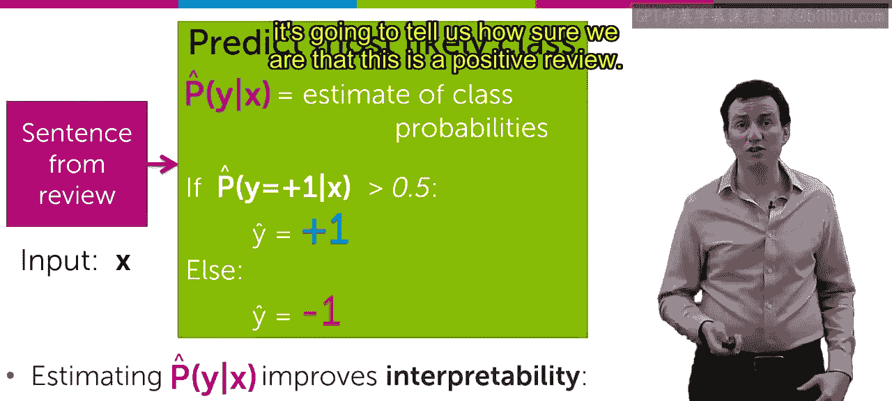

# 华盛顿大学《机器学习（分类，聚类和检索，第3-4课⧸共4课）｜Machine Learning》中英字幕 p18 17_在分类中使用概率.zh_en -BV1Sr421F7N7_p18-

。

Now that we had a chance to review the basics of probability。

 let's figure out how it can be useful in the classification problem。So if we take our two sentences。

 one where was plus one， defin positive， the solution and everything were awesome。

And the other one I was not sure the sushi was good， the service was okay for the first one。

 we could say that the probability that it's a positive review for this sentence is very high。

 so the probability of the y cos plus one given the sentence。😊，Is 0。99。On the other one， though。

 the probability of y cos plus  one given the sentence， given x equals the sushi was good。

The service was okay， that's only 0。55。And in general。

 many classifiers output this degree of beliefs or this probabilitybabilities is the probability of the y output level y。

 given input x， and it's going to be extremely useful in practice。

So let's go through a little bit of an example of what that means。

So let's say we're given an input data set with n data points， they have inputs， number of awesome。

 number of authorss in the labels why。And I use it to train a classifier， the outputs。

 these probabilities， the predictions we're going to call a P hat。Our estimate of the predictions。

 which is going to depend on the parameters W hat or the coefficientus w hat of our model。And so。

P hatt is going to be useful for predicting why hat the predictive class which in our case is the sentiment of a sentence。

 so let's see how that works we're going to do is learn this P hat estimated from data and use it to predict the most likely class so in particular if I' giving you some input sentence and and I compute the probability the y is plus one is a positive review given the sentence and if that's greater than 0。

5 I say the Y hat is plus one。It's positive sentence。 And if you say that it's less than 05。

 then we say it's a negative sentence。 So y hat is -1。But when not just going to get that。

 P hatt is going to give us more kind of an interpretable output。

 so it's not going to say just that plus1 and minus1。

 but it's going to tell us how sure we are that this is a positive review。

