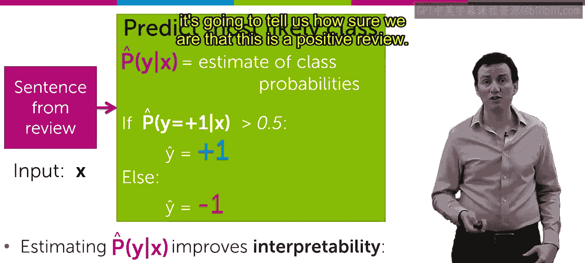

# 机器学习（分类，聚类和检索）：第3-4课：在分类中使用概率

在本节课中，我们将学习概率如何应用于分类问题。我们将探讨如何利用概率来评估分类模型对预测结果的置信度，并理解其在实践中的重要性。

## 概率在分类中的应用

上一节我们回顾了概率的基础知识，本节中我们来看看它如何在分类问题中发挥作用。

假设我们有两个句子。第一个句子是“definitely positive, the solution and everything were awesome”。第二个句子是“I was not sure the sushi was good, the service was okay”。

对于第一个句子，我们可以说它是正面评论的概率非常高。具体而言，给定该句子，其标签 `y` 为 `+1`（正面）的概率 `P(y=+1 | 句子)` 为 0.99。

对于第二个句子，给定句子“the sushi was good, the service was okay”，其标签 `y` 为 `+1` 的概率 `P(y=+1 | x)` 仅为 0.55。

通常，许多分类器会输出这种置信度或概率，即给定输入 `x` 时输出标签 `y` 的概率 `P(y | x)`。这在实践中非常有用。

## 概率分类器的工作流程

让我们通过一个例子来理解这意味着什么。

假设我们有一个包含 `n` 个数据点的输入数据集。每个数据点有输入特征（例如“awesome”一词出现的次数）和标签 `y`。我们使用这个数据集来训练一个分类器。

分类器的输出是概率预测，我们称之为 `P_hat`。这是我们对预测概率的估计，它取决于我们模型的参数 `W_hat` 或系数 `w_hat`。

因此，`P_hat` 将用于预测 `y_hat`，即预测的类别。在我们的例子中，`y_hat` 代表句子的情感倾向。

## 如何进行预测

我们将学习如何从数据中估计 `P_hat`，并用它来预测最可能的类别。

具体操作如下：给定一个输入句子，我计算 `P(y=+1 | 句子)`，即给定该句子，其标签为正面（`+1`）的概率。

如果这个概率大于 0.5，我们就说预测的 `y_hat` 是 `+1`，这是一个正面句子。

如果这个概率小于 0.5，我们就说预测的 `y_hat` 是 `-1`，这是一个负面句子。

## 概率输出的优势

然而，`P_hat` 不仅仅给出 `+1` 或 `-1` 的预测。它为我们提供了更具解释性的输出。

`P_hat` 会告诉我们，我们对这个评论是正面评价的把握有多大。例如，一个概率为 0.99 的预测比一个概率为 0.55 的预测要确定得多。

## 总结

本节课中，我们一起学习了概率在分类问题中的应用。我们了解到，分类器可以输出给定输入时属于某个类别的概率 `P(y | x)`，而不仅仅是硬性的类别标签。我们通过设定一个阈值（如 0.5）来做出最终的类别决策（`y_hat`）。这种基于概率的方法不仅提供了预测结果，还给出了模型对该预测的置信度，使模型的输出更具信息量和实用性。