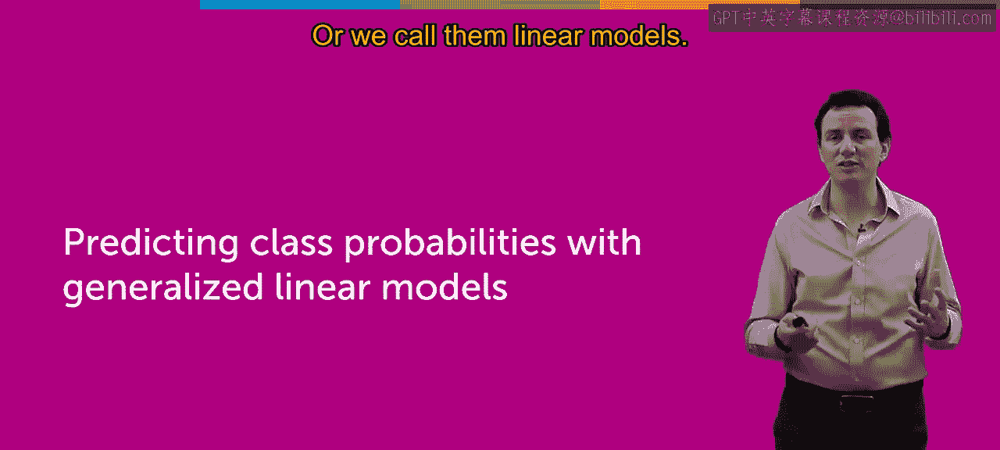
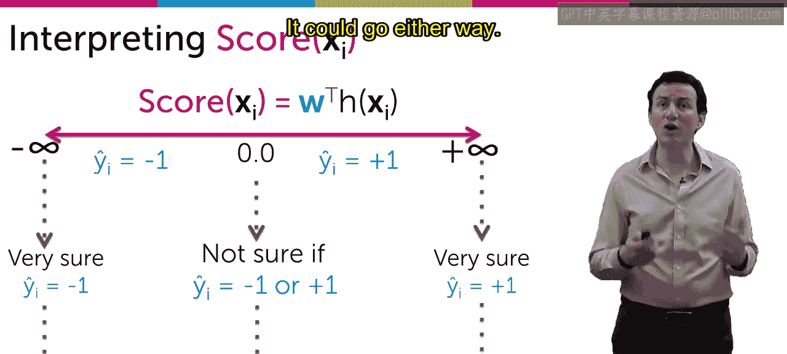
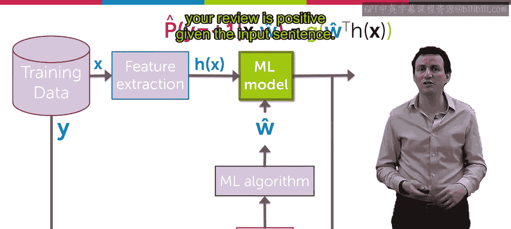

# 华盛顿大学《机器学习（分类，聚类和检索，第3-4课⧸共4课）｜Machine Learning》中英字幕 p19 18_使用广义线性模型预测类别概率.zh_en -BV1Sr421F7N7_p19-

。

Now let's take a deep dive and understand how we're going to predict the probability that a sentence is positive or negative。

 using linear classifiers， or we're calling linear models。

So now we're taking some input data x when the compute some features H。

 and we're going to output this P hatt， the probability that the label is positive or negative。

Now if you go back to our example of a decision boundary。

 we computed this score of every data point as w times plus h of x or w0 H0 plus w1 h1 plus w2 H2 plus w3 H3 and so on Everything below the line had score greater than0。

 everything above the line has score less than0， but we don't know how far it's like a law less than0。

And a lot greater than zero potentially and how do we relate these scoress。

 which could be somewhere between minus infinity and positive infinity with the probability that the output is plus one and probability the sentence is plus one。

And that's the task that we're going to try to do today。In fact， we have the W transpose age。

 the score can range from minus infinity to plus infinity。If it's positive greater than0。

 we're going to output plus1， and if it's negative less than  zero， we're going to put minus1。Now。

 what we want to say is if that score is really， really， really， really big， it's like infinity。

 then we're very sure the y hat is plus one， so we're going to say that the probability。

 the y co plus one， given the input is one。😊，On the other end of the spectrum， if this score very。

 very， very negative minus infinity， we're very sure that Y hat is minus-1。

And then we should output that the probability of y is plus1 is 0。For this particular input X。Now。

 if the score is zero， or write at that decision boundary。Where we're neither positive or negative。

 So we're kind of indifferent in predicting whether y hat is plus 1 or minus1。

 so if we're indifferent。With probabilities， we can interpret that。

 we can see the probability the y hat， the y is plus one， given the input is 0。5。

5050 to go either way。

So that's our goals to predict those probabilities from the scores。

So we have the scores， the scores range from minus infinity plus infinity。

 and they're this weighted combination of the features。And probabilities are between 0 and1。

If it's minus infinity the score， I want probability that output is0。

 if it's plus infinity the score I want the output that I predict to be1。😊，And if the score is 0。

 I want to say the probability is 0。5。Scores range from infinity to plus infinity。

B built this rage between0 and1。The question is， how do I relate score？

In minus infinity to plus infinity， so probability in 0 and1， how do I link these two things？😊。

And now we're going to see some magic。The magic that glues， that links this。

Range minus infinity plus infinity to the range01。It's called a link function。2 links the two。

I'm going to take this score， which is between minus profinity。

'm going to push it through a function G。That squeezes that huge line into the interval01。うんうん。And。

 and uses it to predict the probability of y co plus1。And when you。Taking a linear model。

 W transpose H。Minusfinity to plusfinity and you're squeezing it into 01 using link functions。

 you're building what's called a generalized linear model。

 So if somebody stops in the street today and asks you， what's the generalized linear model。

 see no problem，s like a regression model。But you squeeze it into 01 by pushing it through a link function。

So it' was a little abstract， we're going to talk about in the context of logistic regression。

 which uses a specific type of link function。😊，Now I talked about generalized linear models of squeezing myfinity to plus infinity to the interval 01。

 that's true for classifiers and for most kinds of classifiers。

 there are other types of generalized linear models that non-s between 0 and1。

 but for our purposes you can think about them in that context。😊，So in this context。

 our goal now becomes taking your training data， pushing it through some feature extraction。

 which gives us the Hs， theFIDF or whatever else you're representing data， number of awesome。

And now we build a linear model W transpose H， we push it through the link function。

 that squeezes it to interval01， and use that to predict the probability that your sentiment of your review is positive given the input sentence。

😊。

