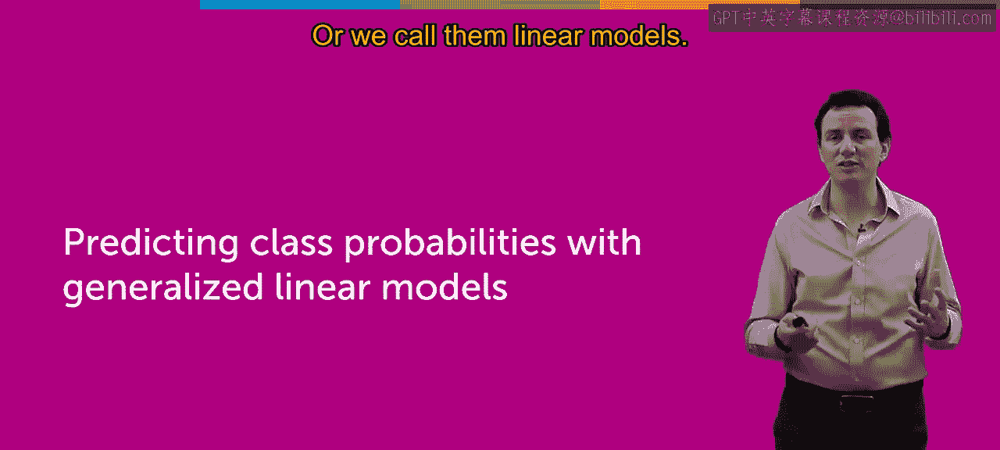
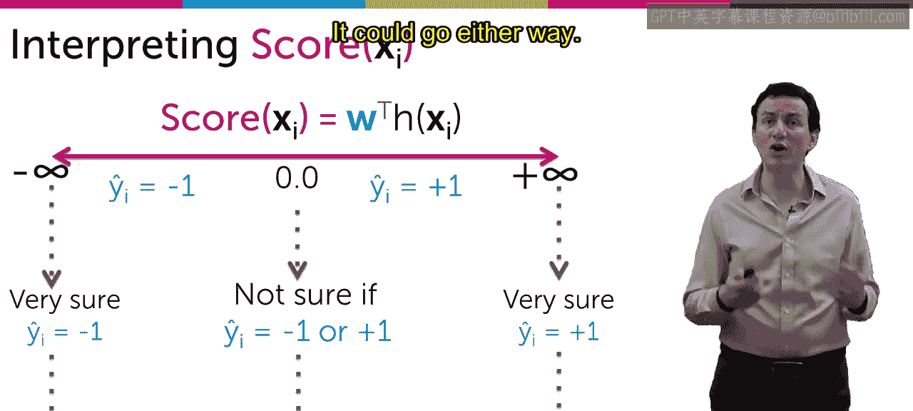
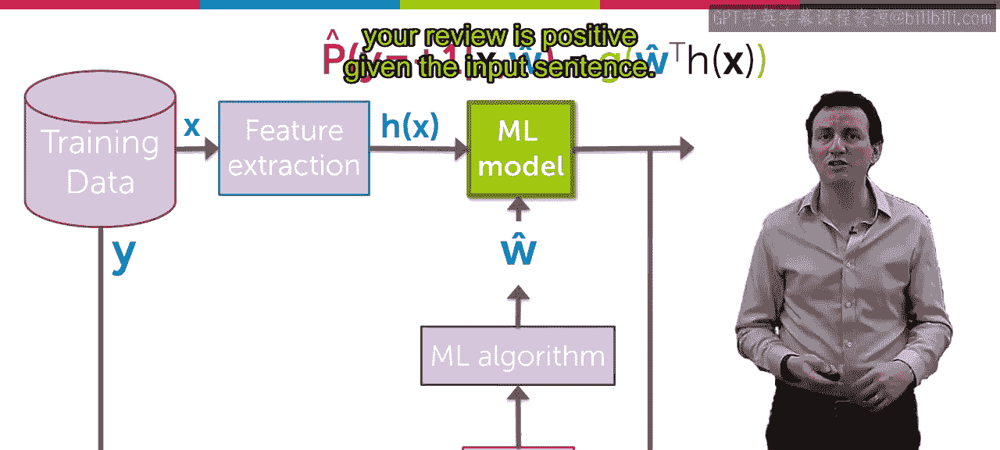

# 机器学习（分类，聚类和检索）：第3-4课：使用广义线性模型预测类别概率 📊

在本节课中，我们将深入探讨如何利用线性分类器（或称线性模型）来预测一个句子是正面或负面的概率。我们将学习如何将线性模型输出的分数（范围从负无穷到正无穷）转换为一个介于0到1之间的概率值。

---

上一节我们介绍了线性分类器的决策边界和分数计算。本节中，我们来看看如何将这些分数解释为具体的概率。

现在，我们接收一些输入数据 **x**，计算其特征 **h**，并输出预测概率 **P̂**，即标签为正或负的概率。

回顾决策边界的例子，我们为每个数据点计算了分数：**wᵀh(x)** 或 **w₀h₀ + w₁h₁ + w₂h₂ + w₃h₃ + ...**。决策边界以下的数据点分数大于0，以上的分数小于0。但我们不知道这些分数具体有多大或多小，它们可能分布在负无穷到正无穷之间。我们的任务就是将这些分数与输出为+1（正面）的概率联系起来。

实际上，分数 **wᵀh** 的范围是负无穷到正无穷。如果分数为正（>0），我们输出+1；如果为负（<0），则输出-1。现在，我们希望表达的是：如果分数非常大（趋近于正无穷），那么我们非常确信预测值 **ŷ** 是+1，因此应输出概率 **P(y=+1 | x) = 1**。反之，如果分数非常小（趋近于负无穷），我们非常确信 **ŷ** 是-1，则应输出概率 **P(y=+1 | x) = 0**。如果分数恰好为0，即位于决策边界上，我们对预测 **ŷ** 为+1或-1没有倾向性，因此可以解释为概率 **P(y=+1 | x) = 0.5**，即五五开。

所以，我们的目标就是从分数中预测出这些概率。

---

以下是我们的核心挑战：分数范围是负无穷到正无穷，而概率范围是0到1。如何将两者联系起来？

现在我们将看到一种“魔法”，它能将负无穷到正无穷的范围“粘合”或“链接”到0到1的范围。这被称为**链接函数**。它的作用是将分数通过一个函数 **g** 进行转换，将这个巨大的数轴“挤压”到区间[0, 1]内，并用它来预测 **y=+1** 的概率。

当你取一个线性模型 **wᵀh**（其输出范围是负无穷到正无穷），并通过一个链接函数将其挤压到[0, 1]区间时，你构建的就是所谓的**广义线性模型**。所以，如果有人今天在街上拦住你问“什么是广义线性模型？”，你可以轻松回答：它就像一个回归模型，但通过一个链接函数将其输出映射到了0到1之间。

这听起来有点抽象，我们将在逻辑回归的背景下具体讨论，因为它使用了一种特定类型的链接函数。虽然广义线性模型不仅限于将输出映射到0和1之间（还有其他类型），但就我们的分类目的而言，可以这样理解。

因此，在此背景下，我们的目标变为：获取训练数据，通过特征提取得到特征向量 **h**（例如TF-IDF或“awesome”等词的计数），然后构建线性模型 **wᵀh**，再通过链接函数将其挤压到[0,1]区间，最后用这个值来预测给定输入句子后，其情感为正面（积极）的概率。

---

本节课中，我们一起学习了如何将线性分类器的分数输出转化为概率预测。我们引入了**链接函数**的概念，它负责将分数从（-∞, +∞）映射到概率区间[0, 1]。这种通过链接函数扩展线性模型以处理概率预测的框架，就是**广义线性模型**的核心思想。下一节，我们将具体探讨逻辑回归中使用的链接函数——逻辑函数（或Sigmoid函数）。