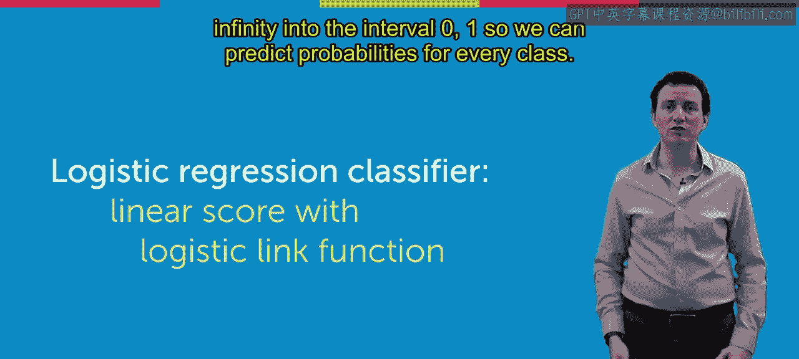
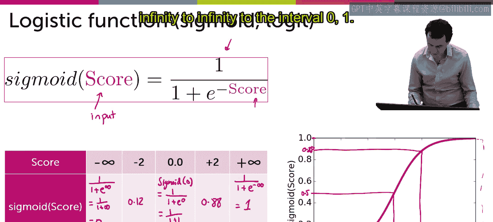

# 华盛顿大学《机器学习（分类，聚类和检索，第3-4课⧸共4课）｜Machine Learning》中英字幕 p20 19_Sigmoid或logistic链接函数.zh_en -BV1Sr421F7N7_p20-

。

Very good Now we learn this abstract concept of squeezing the score into the interval 01 and we call the generalized linear models。

 it was pretty abstract logistic regression is a specific case of that where we use what's called the logistic function to squeeze minus infinity to plus infinity into the interval01 so we can predict probabilities for every class。

😊。

For logistic regression， the link function we use is called the logistic function。

 sometimes called sigmoid， sometimes called Loit。😊，And thiss a slightly scary function over here。

 which takes the score as input。😊，And says the score， sorry。

 the output of sigmoid is one divided by1 plus e to the minus score， so it shows up over here。

And this each to the power of something， you know I learned about that function as an undergrad。

 I didn't think it was that interesting a function between turns out to be extremely useful。

 And here we'll see an example of how it's useful。 So at the bottom here。

 I'm plotting the score which can range from minus infinity。😊，To plus infinity。

And let's see what happens when you take that score and push it through the sigmoid。So for example。

 if you take the score at zero。It actually hits 0。5。

Which is cool because this is exactly what we're hoping for。 If the score is 0。

 the probability should be 0。5。 So actually let's do that explicitly。

 So if I if I compute the sigmoid。😊，The sigmoid of0， that is one divided by1 plus e to the0。

 and as a little cheat sheet here at the bottom， e to the0， is exactly1。 So that's good。

 So this is one divided by 1 plus1， which is equal to 0。5。QE D。

 So now we have that if it score of  zero input， you get an output to 0。5。 That's super exciting。

 So let's look at the positive end of the spectrum。

 You see that the curve keeps going up and up and up and eventually it hits one。😊。

So the score of plus infinity。Which is somewhere out here。

 turns out to be sorry the sigma plus infinity turns out to be one， which again。

 what we wanted if the score is plus infinity， we not put probability 1。 So let's actually do that。

 So let's see what happens to sigmma of plus infinity。

That's one over1 plus equal to the power of minus infinity。

And cheat sheet here E to the minus infinity。Is the equal2？

Zero and so this thing here directly gives you the output1。Okay， let's go to the other extreme。

E to them， let's look at minus infinity。 So if the score is minus infinity， as you can see down here。

 it looks like you hit 0 there。 And that's exactly what you want。 If the score is very negative。

 then we want the probability that y cos plus  one to be 0。😊，And we can plug it into here。

 one divided by1 plus e to the minus minus infinity is e to the infinity， and cheat sheet down here。

 each to infinity is infinity and so this is equal to1 over1 plus infinity and1 over one plus infinity。

Is zero。Exactly what we want。 So the sigmoid has this property that it goes from 0。To 0。5 to one。

 really the way we want。 Now what really is important here is the places in between。So for example。

 if the score is2。We will see that。Were hit at 0。88。Over here。And if the score were minus2。

🤧We have 0。12。It's a symmetric function that ranges from  zero to one。

And so it provides exactly the mapping from minus infinity to infinity。To the interval，0。

Wen。

