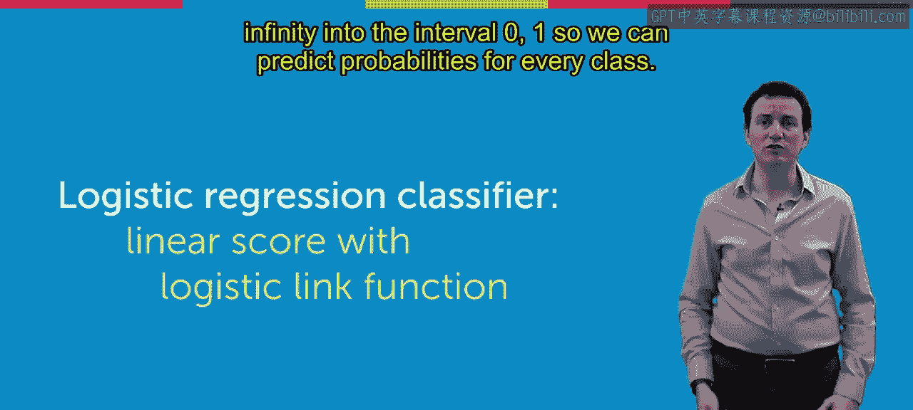
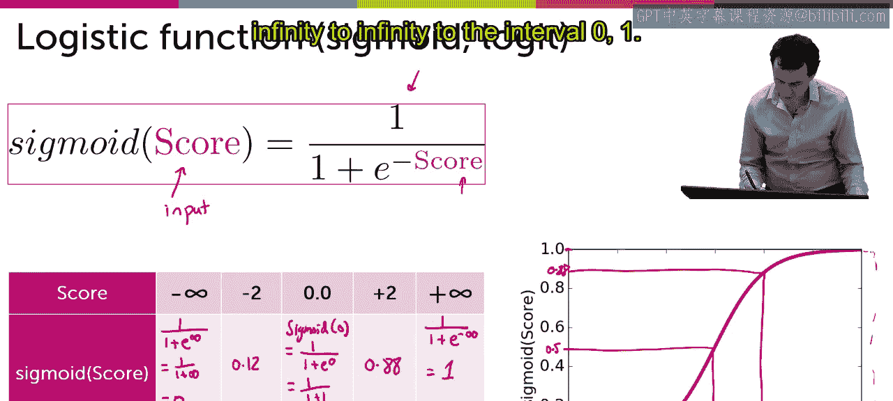
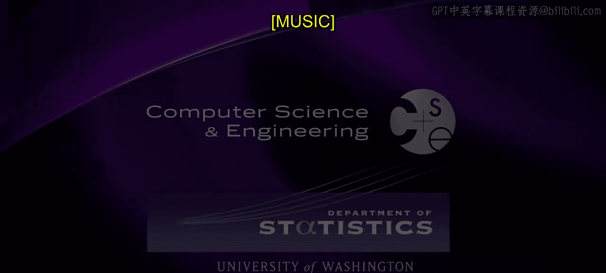

# 机器学习（分类，聚类和检索）：第3-4课：Sigmoid或Logistic链接函数

在本节课中，我们将学习如何将线性模型的得分“压缩”到0到1的区间内，以预测概率。我们将重点介绍逻辑回归中使用的特定链接函数——Sigmoid函数或Logistic函数。

上一节我们介绍了将得分映射到概率区间的抽象概念，本节中我们来看看逻辑回归中具体使用的函数。

## Sigmoid函数定义

对于逻辑回归，我们使用的链接函数称为Logistic函数，有时也称为Sigmoid函数或Logit函数。

这是一个以得分为输入的函数，其数学表达式如下：

**公式：** `σ(score) = 1 / (1 + e^(-score))`

其中，`e`是自然常数。这个函数可能看起来有些复杂，但它极其有用，能够完美地将得分从负无穷到正无穷的区间映射到0到1之间。

## 函数特性分析

以下是Sigmoid函数在几个关键点上的行为分析，这有助于我们理解其工作原理。

*   **当得分为0时：**
    *   计算过程：`σ(0) = 1 / (1 + e^0) = 1 / (1 + 1) = 0.5`
    *   结果解释：当线性模型的得分为0时，预测概率恰好为0.5，这符合我们的直觉。

*   **当得分为正无穷时：**
    *   计算过程：`σ(+∞) = 1 / (1 + e^(-∞)) = 1 / (1 + 0) = 1`
    *   结果解释：当得分趋近于正无穷大时，预测概率趋近于1，表示模型对该类别有极高的置信度。

*   **当得分为负无穷时：**
    *   计算过程：`σ(-∞) = 1 / (1 + e^(+∞)) = 1 / (1 + ∞) ≈ 0`
    *   结果解释：当得分趋近于负无穷大时，预测概率趋近于0，表示模型认为该类别极不可能。

## 函数曲线与中间值

理解函数在极端值处的行为后，我们再来看看中间值的情况。Sigmoid函数是一条平滑的S形曲线。

例如：
*   当得分为+2时，函数输出约为0.88。
*   当得分为-2时，函数输出约为0.12。

该函数关于点(0, 0.5)对称，其输出值始终在0和1之间。因此，它完美地实现了将任意实数得分映射到(0,1)概率区间的目标。

本节课中我们一起学习了逻辑回归的核心——Sigmoid链接函数。我们了解了它的数学定义，分析了它在关键点（0、正无穷、负无穷）的输出特性，并认识到它是一条平滑的S形曲线，能够将线性模型的得分有效地转化为概率预测。