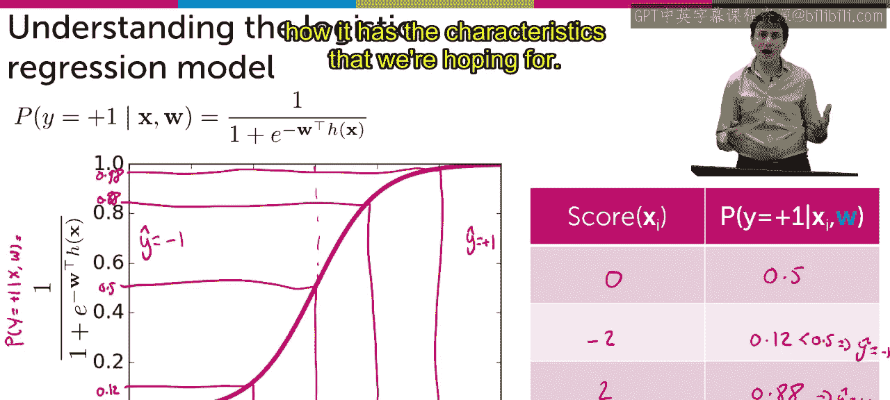

# 华盛顿大学《机器学习（分类，聚类和检索，第3-4课⧸共4课）｜Machine Learning》中英字幕 p21 20_Logistic回归模型.zh_en -BV1Sr421F7N7_p21-

。

Now we're ready to describe our logistic regression model。 It takes a score。

As input arranges from minusfinity to plus infinity， and it's actually W transpose H of X。

It pushes it through the sigmoid function。To estimate the probability that y is equal to plus 1 given an X I andW。

So。What does that mean more explicitly is that this probability is equal to。

1 over one plus each of the minus score。Of X， I。Which is the same as saying1 over one plus e to the minus。

W transpose H of X I。 And we can just for fun， write out that W transpose。Age explicitly。

 So it's one plus。E to the power of minus。W 0， H 0 of X I plus W 1， H1。Of X， I。Plus。Dot， do， dot。

 plus。W capital D。H D of X I。Zop。And now we have it。

 that's what a logistic regression model looks like。

 it predicts the output was a probability of a positive sentiment given the input x and the parameters w。

😊，Now let's take a moment to understand the logistic regression model a little bit better。

So as input， we have the score。Of a sentence X or any other input that we have and as output。

 we have the probability that the label is plus1 given the input X and the parameters W。

And that's the one over each the power of a minus w transpose h of xx。No。If the score is zero。

And I'm going to draw it like this， we have that this probability is 0。5。So if the score is 0。

 the probability is 0。5。Now what do I observe firsthand is everything to the left of0 has score less than 0。

 so we should be predicting that this points on the left have y hat equals minus1 and everything to the right of0 has score greater than0。

 so we should be predicting that y hat on the right side is equal to plus1 so let's see that in action so for example let's say that。

We had a score of minus2。What would happen。To a prediction。

 So we say the probabilityative y co plus 1 is actually 0。12， you plug that in， so -2。Gives you 0。12。

If you had plus two。And you push it to the right side， you get 0。88。So if the score is plus 2 is 0。

88。Is there a surprise to you that 0。12 plus 0。8 adds up to one？

It's not a surprise because probability of y cos plus1 minus probability plus the probability of y cos minus 1 adds up to 1 and sigma is symmetric function。

 so everything is working out exactly the way we hope for。Now， if the score is bigger。

Let's see this core is four。We should still output a y co plus one， but we should be more sure。

So let's push that through。 If the score 4， look， we're getting really big here and the。

Prediction of the probability is 0。98。In other words。For the point where the score is less than 0。

 you see that the probability is。Less than 0。5 of being y equal plus1。

 which implies that we've output put a y hat。Of minus1。

 well for the ones where this score is positive， we're going to output y hat is equal to plus1。

And here we see in action the logistic regression model and how it has the characteristics that we're hoping for。

