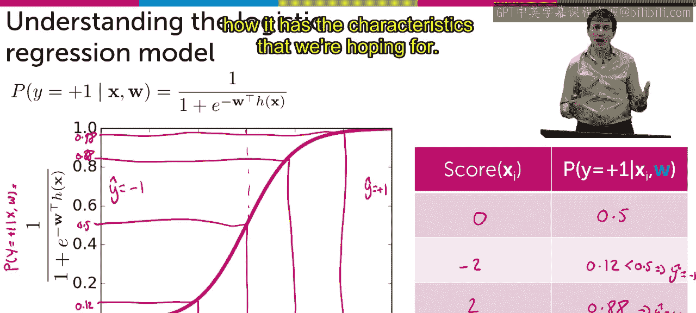

# 机器学习（分类，聚类和检索）：第3-4课：Logistic回归模型 🧮

在本节课中，我们将要学习Logistic回归模型。这是一种用于分类任务的强大工具，它能够将输入特征映射为一个概率值，从而预测样本属于某个类别的可能性。我们将详细探讨其数学形式、工作原理以及如何通过模型进行预测。

---

## 模型描述

上一节我们介绍了分类问题与线性模型的基础。本节中，我们来看看Logistic回归模型的具体形式。

Logistic回归模型接收一个分数作为输入。这个分数的范围从负无穷到正无穷，其具体形式是特征向量的线性组合，即 **WᵀH(X)**。模型将这个分数通过一个称为Sigmoid的函数进行处理，以估计在给定输入 **Xᵢ** 和参数 **W** 的条件下，标签 **y** 等于 **+1** 的概率。

更明确地说，这个概率等于：

**P(y = +1 | Xᵢ, W) = 1 / (1 + e^(-score(Xᵢ)))**

这等同于：

**P(y = +1 | Xᵢ, W) = 1 / (1 + e^(-WᵀH(Xᵢ)))**

为了更清晰地展示，我们可以将 **WᵀH(Xᵢ)** 展开写出来：

**P(y = +1 | Xᵢ, W) = 1 / (1 + e^(- (w₀h₀(Xᵢ) + w₁h₁(Xᵢ) + ... + w_D h_D(Xᵢ))))**

这就是Logistic回归模型的样子。它根据输入 **X** 和参数 **W**，预测输出为正类（例如正面情感）的概率。

---

## 模型理解

现在，让我们花点时间更好地理解Logistic回归模型。

模型的输入是一个句子 **X**（或任何其他输入）的分数。模型的输出是在给定输入 **X** 和参数 **W** 的条件下，标签为 **+1** 的概率，即 **1 / (1 + e^(-WᵀH(X)))**。

为了更好地可视化，我们可以观察Sigmoid函数的特性。如果分数为0，那么对应的概率是0.5。这意味着模型对正类和负类的判断是模糊的。

以下是关于模型预测行为的关键观察：

*   当分数小于0时（即位于0的左侧），模型预测 **y_hat** 为 **-1**。
*   当分数大于0时（即位于0的右侧），模型预测 **y_hat** 为 **+1**。

让我们通过几个例子来具体看看：

*   如果分数为 **-2**，代入公式计算，得到概率约为 **0.12**。由于概率小于0.5，模型预测为负类（**y_hat = -1**）。
*   如果分数为 **+2**，计算得到概率约为 **0.88**。由于概率大于0.5，模型预测为正类（**y_hat = +1**）。
*   如果分数为 **+4**，计算得到概率约为 **0.98**。此时模型不仅预测为正类，而且对此预测的“信心”或“确定性”更高。

值得注意的是，对于分数为 **-2** 和 **+2** 的情况，其概率值（0.12 和 0.88）相加等于1。这并非巧合，因为 **P(y = +1)** 和 **P(y = -1)** 之和必须为1，而Sigmoid函数恰好具有这种对称性。

---

## 总结

本节课中，我们一起学习了Logistic回归模型。我们首先描述了模型的核心公式，它通过Sigmoid函数将线性分数转换为概率。接着，我们深入探讨了模型的行为：分数为0时预测不确定（概率0.5），分数为负时预测为负类，分数为正时预测为正类，并且分数的绝对值越大，模型对预测结果的信心就越强。这个模型具备了我们在分类任务中所期望的特性：输出是易于解释的概率，并且决策边界清晰。