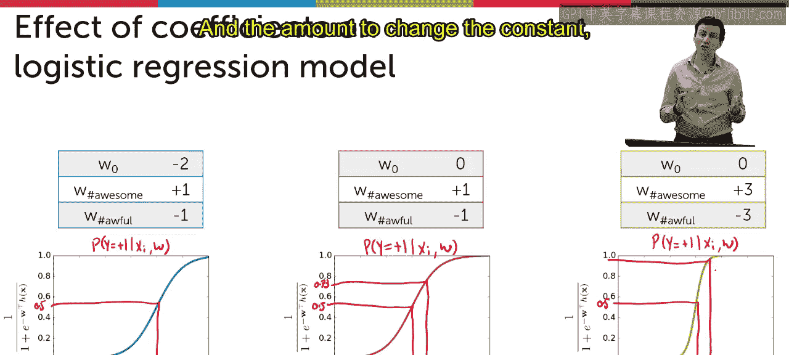
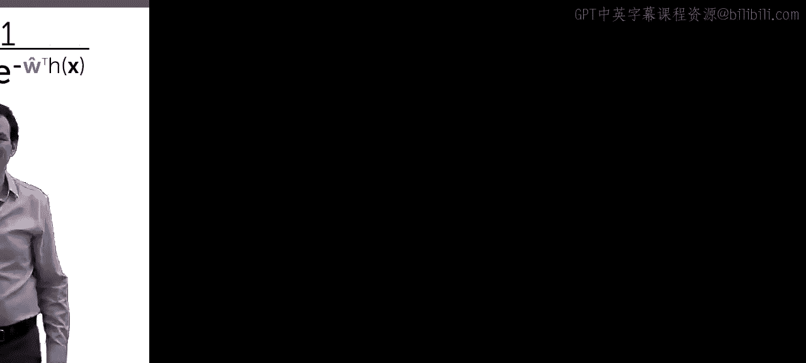
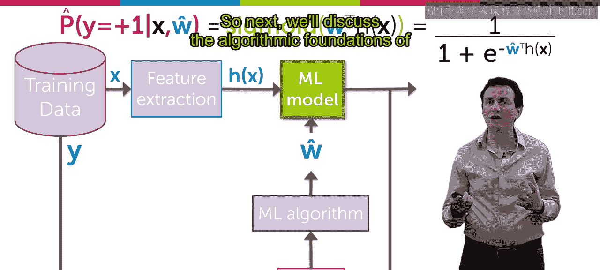

# 华盛顿大学《机器学习（分类，聚类和检索，第3-4课⧸共4课）｜Machine Learning》中英字幕 p22 21_系数值对预测概率的影响.zh_en -BV1Sr421F7N7_p22-

。

Let's take a moment to explore the decision boundary that we played with quite a bit in this lecture。

 so this is one where 1。0 times number of awesomes minus 1。5 times number of offers is equal to 0。

In this case， all the points to the bottom of the line have score。Of Xi greater than0。

 So they're all labeled as positive and all the ones。On the other side， have score。

Of X I less than 0。 So we label them as negative。 But let's。

 let's think about the probabilities a little bit more。 So if， if we take。

This point over here is close to the boundary。But it's on the positive side。

 so it should be outputting probabilities that are greater than 0。5 but not that much greater than 0。

5 so let's see what the score looks like for this one。😊。

So I looked at a score of X for this one and we can measure directly。

 so it has four awesome so those counts four and it has two awful。 so this kind as minus-3。

 So you have the score is 4 minus。1。5。Times 2， which gives you a total of1。

 and if you push that through the sigmoid。You you realize that the probability that y is equal plus one given this particular X is equal to。

0。73 and you can read that from the graph as well， so if I go like this。And I push it to the right。

 I should get 0。73。Now， if you take another example that's further away from the boundary like this one over here。

 where I feel more sure， more confident the probability of y copho should be higher。

 So in this case here， this score of X I is3， it has。😊，Three awesomes， no awfuls。

 which implies that they prediction。Let's say P hat of y equals plus 1 given X。Is 0。95。

Which is much larger than the one that was closer to boundary。

 So it's something that it's more like this。0。95。Very good。

Now let's take a final data point on the other side of the an。

 so if you take this data point over here and it computes its core。So it has one awesome。

 so the score of X has one awesome， so that count as one， but has three awfuls。

 so that counts as minus1。5 times 3。So that total score is-3。5。 So it's very negative。

 We should be pre very sure that it's a negative example。 So the probability that。Y equals plus 1。

Given this particularxii should be really low， so we're at minus3 here。

 the probability should be really low， you can see from the graph and it turns out that that probability is 0。

03。😊，When you push it through the sigmoid。Extremely low probability。It makes sense。

 a review with three offerss is just awful。Now that we've explored the decision boundaries that come from a logistic regression model and the notions of probability。

 let's explore a little bit more the facts of the coefficients that we learn from data both on the boundary and also on the confidence or the sureness that we have about a particular prediction and the actual probabilities that we predict so if we take a very simple model with just two features number of awesome。

 the number of os and we look at the coefficients of those features as well as the constant w0。

 let's see what happens so if that w0 has coefficient zero then what we have is that the probability。

😊，Of y is equal to plus one given。X I and W， this particular w0 is given by the curve below。

 so we see that if the number of awesomes is exactly equal to the number of os。

 then the score of the two cancel out and we have a score of X to be exactly equal to 0。

So that gives you a predict probability of 0。5 just like we saw。Now。

 if you have one more awesome than you have awfuls， then that difference becomes one。

And your prediction now of the probability of being a positive review。

 just by having that extra awesomeness。Is 0。73？Now let's see what happens if you change the constant。

Now， if you change the constant W 0 to -2 and keep everything the same。

 you see that the line has shifted to the right。 So now what happens is I need the number awesomes。

To be to have two more than number ofs for that prediction to be 0。5。

 So for the probability that y equals plus1。Given X， I and W to be 50，50。So in this case。

 awfuls count a lot more negatively than the awesomes。Or at least that has that extra constant。Now。

 if I keep w0 to0， but I increase the magnitude of the parameters， I get a curve on the right。

 which similar to the curve in the middle， so if the difference between the two is 0。

I still predict 0。5。 however， it grows much， much more steeply。 So in other words。

 if that if you just have one more awesome， then you have offerss。

 you're gonna say that the probability of y cos plus one given。😊，X， I and Ws is almost one。

So the bigger you make the parameters in magnitude， the more sure you get more quickly。

And the amount to change the constant， you kind of shifting that line to the left and to the right。

Now we can see our logistic rational learning problem， save some training data。

 which have some features， we have this ML model that says。

A probability that a review positive is given by the sigmoid of the score W transpose H。

 which is1 over1 plus each to the minus W transpose H and when I learn a W hat。

 that really fits the data well。So next， we'll discuss the algorithmic foundations of how do we fit the WHs from data？

