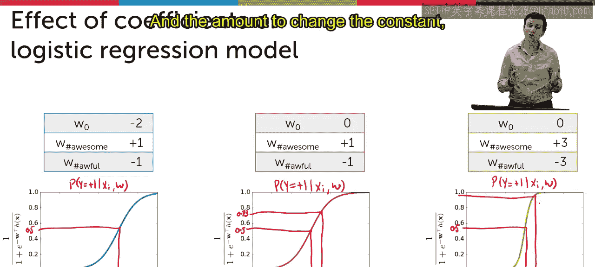
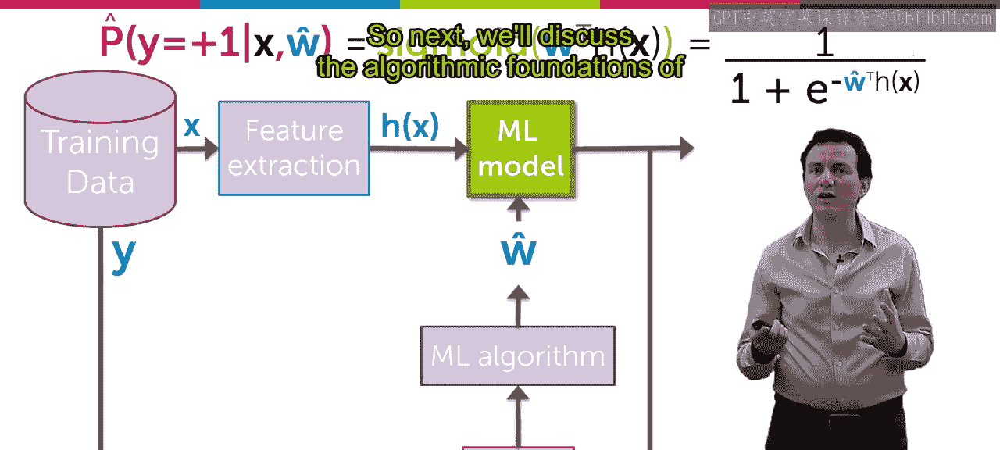

# 机器学习（分类，聚类和检索）：第3课：系数值对预测概率的影响 📊

在本节课中，我们将深入探讨逻辑回归模型中系数（权重）如何影响模型的决策边界和预测概率。我们将通过具体的例子和图示，直观地理解系数 `w0` 和特征权重 `w1`、`w2` 的变化如何改变模型的预测行为。

## 决策边界与概率回顾

上一节我们介绍了逻辑回归模型如何通过决策边界进行分类。本节中，我们来看看边界附近的点与远离边界的点，其预测概率有何不同。

考虑一个简单的决策边界方程：**1.0 × (awesome数量) - 1.5 × (awful数量) = 0**。在这条线上方的点，其得分 `score(Xi) > 0`，被预测为正类；线下方的点，其得分 `score(Xi) < 0`，被预测为负类。

然而，逻辑回归输出的不是硬分类，而是概率。让我们通过几个具体数据点来观察。

以下是三个不同位置的数据点及其对应的预测概率：

*   **靠近边界的点**：例如，一个评论有4个“awesome”和2个“awful”。其得分为 `4 - 1.5 × 2 = 1`。通过sigmoid函数计算，预测其为正面评论的概率 `P(y=+1|X) ≈ 0.73`。这个概率大于0.5，但并非远大于0.5，反映了模型对该点分类的不确定性。
*   **远离边界的点（正侧）**：例如，一个评论有3个“awesome”和0个“awful”。其得分为 `3 - 1.5 × 0 = 3`。预测概率 `P(y=+1|X) ≈ 0.95`。这个概率远高于边界附近的点，表明模型对这个预测非常有信心。
*   **远离边界的点（负侧）**：例如，一个评论有1个“awesome”和3个“awful”。其得分为 `1 - 1.5 × 3 = -3.5`。预测概率 `P(y=+1|X) ≈ 0.03`。这个概率极低，表明模型非常确信这是一个负面评论。

## 系数如何影响预测

现在，让我们更系统地探讨从数据中学到的系数（包括常数项 `w0` 和特征权重 `w1`， `w2`）如何影响决策边界和预测的置信度。

我们以一个仅包含两个特征（“awesome”数量 和 “awful”数量）的简单模型为例。

### 情况一：常数项 `w0 = 0`

当常数项 `w0` 为0时，模型的决策由特征权重决定。预测概率公式为：
`P(y=+1 | X, W) = sigmoid( w1 * (#awesome) + w2 * (#awful) )`

假设 `w1 = 1`， `w2 = -1`。那么：
*   当 `#awesome` 与 `#awful` 数量相等时，得分 `score(X) = 0`，预测概率为 `0.5`。
*   当 `#awesome` 比 `#awful` 多一个时，得分 `score(X) = 1`，预测概率跃升至约 `0.73`。

### 情况二：改变常数项 `w0`

如果将常数项 `w0` 改为 `-2`，而保持特征权重不变，决策边界会向右平移。

这意味着，现在需要 `#awesome` 比 `#awful` 多两个，才能使预测概率达到 `0.5`。常数项 `w0` 的作用是整体偏移决策边界，相当于模型对正类有一个先验的“偏见”或“阈值”。

### 情况三：增大特征权重的幅度

如果保持 `w0 = 0`，但增大特征权重 `w1` 和 `w2` 的绝对值（例如，`w1 = 5`， `w2 = -5`），sigmoid曲线的形状会变得更陡峭。

此时：
*   当 `#awesome` 与 `#awful` 数量相等时，得分仍为0，预测概率仍是 `0.5`。
*   但是，只要 `#awesome` 比 `#awful` 多一个，得分 `score(X) = 5`，预测概率会急剧增加到接近 `1`。

**系数幅度越大，模型从“不确定”（概率0.5）到“非常确定”（概率接近0或1）的变化就越快、越陡峭。**

## 逻辑回归学习问题总结

本节课中我们一起学习了逻辑回归模型系数的核心作用。

我们看到了逻辑回归的学习问题：给定带有特征和标签的训练数据，我们的模型定义正类的预测概率为 `P(y=+1|X, W) = sigmoid( W^T * X )`。我们的目标是找到一个最优的权重向量 **W_hat**，使得这个概率模型能够最好地拟合观测到的数据。

具体来说：
*   **常数项 `w0`**：平移决策边界，改变模型做出正类预测所需的“基础门槛”。
*   **特征权重 `w1, w2, ...`**：决定了每个特征对最终得分（及概率）的贡献方向和强度。权重的**符号**影响贡献方向（正或负），**绝对值大小**影响贡献的强度以及模型做出确信预测的速度。

下一节，我们将讨论如何从数据中拟合出这个最优权重 **W** 的算法基础。