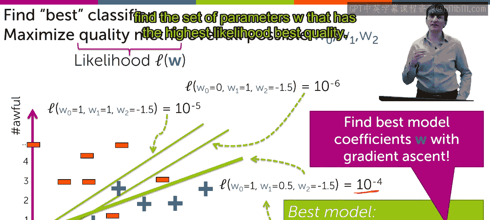

# 华盛顿大学《机器学习（分类，聚类和检索，第3-4课⧸共4课）｜Machine Learning》中英字幕 p23 22_Logistic回归模型学习概述.zh_en -BV1Sr421F7N7_p23-

。

Now that we've seen the logistic regression model and we understand that in quite a bit of detail。

 let's give a quick overview of what learning means for this model。

 although in the next module we're going to go into quite a lot of detail of the learning algorithm。

 this is just a little primer teaser for what's coming in the next module。😊。

Now we're going to start from some data and that data has inputs x and outputs either plus1 or minus1。

 as we said we're going to split that into a training set and a validation set and from the training set we're going to run a learning algorithm that will output the parameter estimates。

 W hatt and that those WHs are going to be plugged into the model to estimate the probability that an input sentence is either positive or negative。

And of course， we can use the learn model to take the validation set and estimate how good it is。

 what the quality metrics are， what the error is。😊，Now to find the best classifier。

 we're going to define a quality metric in this case。

 the quality metric is going to be called the likelihood function。

 So for a possible parameter set of coefficients W， for example。

 w0 w1 and w2 we're going to be able to score it according to L of w to figure out how good it is。

 So for example， if I take this data set of pluses and minuses and learn the lines shown green we might get。

😊，A particular likelihood， so for example， if the parameter w0 is0， w1 is 1， but w2 is minus1。5。

 the likelihood might be 10 to the minus6， pretty small。

These numbers actually tend to be pretty small for this alternative line where w0 is now1 W1 is still1 W2 is minus1。

5。 the likelihood functions a little better，10 to the minus5 instead still 10 to minus6。

But perhaps for this best line over here， where w0 is 1， w1 is 0。5 and w2 is minus 1。5。

 you get the best likelihood 10 to the minus4， and so we would like an approach that will actually search for the possible values of W to find that best line。

And as we will see in the next module， we Greece use a gradient ascent algorithm to find the set parameters w that has the highest likelihood。

 the best quality。

