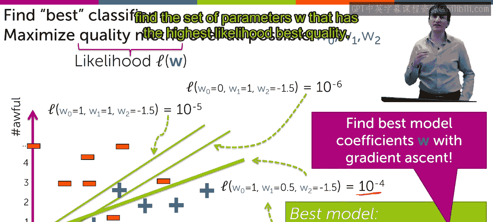

# 机器学习（分类，聚类和检索）：第3-4课：Logistic回归模型学习概述 🧠

在本节课中，我们将要学习Logistic回归模型的学习过程。我们已经详细了解了Logistic回归模型本身，现在让我们快速概述一下对于这个模型而言，“学习”意味着什么。尽管在下一个模块中，我们将深入探讨学习算法的细节，但本节内容是为下一个模块所做的一个简要介绍和铺垫。

## 学习流程概览

上一节我们介绍了Logistic回归模型，本节中我们来看看如何让模型从数据中学习。

我们将从一组数据开始，这组数据包含输入 `x` 和输出（`+1` 或 `-1`）。正如之前所说，我们会将数据分为训练集和验证集。然后，我们将对训练集运行一个学习算法，该算法将输出参数估计值 `W`。

这些估计出的 `W` 将被代入模型中，用于估计一个输入句子是正面或负面的概率。

当然，我们可以使用学习到的模型，在验证集上评估其性能，计算质量指标和错误率。

## 定义质量指标：似然函数

为了找到最佳的分类器，我们需要定义一个质量指标。在本例中，这个质量指标被称为**似然函数**。

对于一个可能的参数集 `W`（例如，包含系数 `w0`、`w1` 和 `w2`），我们可以根据似然函数 `L(w)` 对其进行评分，以判断其好坏。

以下是几个参数集及其对应似然值的例子：

*   例如，对于参数 `w0=0`， `w1=1`， `w2=-1.5`，其似然值可能非常小，为 `10^-6`。
*   对于另一组参数 `w0=1`， `w1=1`， `w2=-1.5`，似然函数值稍好一些，为 `10^-5`。
*   而对于最佳的那条线，其参数可能是 `w0=1`， `w1=0.5`， `w2=-1.5`，此时我们得到最佳的似然值 `10^-4`。

因此，我们需要一种方法来搜索可能的 `W` 值，以找到那条最佳的线（即最大似然值对应的参数）。

## 寻找最佳参数：梯度上升法

正如我们将在下一个模块中看到的，我们将使用**梯度上升算法**来寻找具有最高似然值（即最佳质量）的参数集 `W`。

## 总结

本节课中我们一起学习了Logistic回归模型学习过程的概述。我们了解到，学习过程始于将数据分为训练集和验证集，并通过算法从训练集中估计模型参数 `W`。我们引入了**似然函数**作为评估参数好坏的质量指标，并指出目标是找到使似然函数最大化的参数。最后，我们预告了下一个模块将使用**梯度上升算法**来实现这一目标。