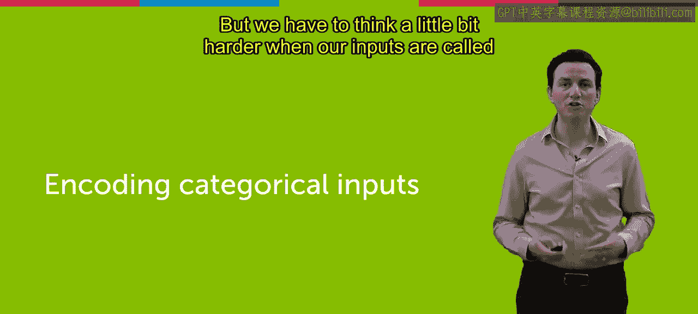
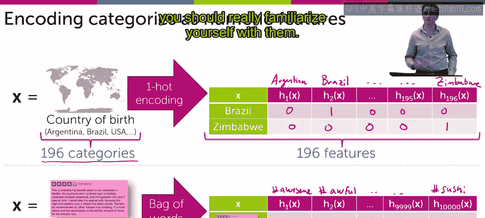

# 华盛顿大学《机器学习（分类，聚类和检索，第3-4课⧸共4课）｜Machine Learning》中英字幕 p24 23_编码分类输入.zh_en -BV1Sr421F7N7_p24-

。

So we've seen the logistic regression model and explored quite a bit。

 and we hinted at what learning means finding the best parameters for these models。However。

 we have talked about features in a kind of abstract way we said we have number of awesomes。

 number of awfuls and so on。But we have to think a little bit harder when our inputs are what called categorical variables。

😊。

So let's take a little example， if our inputs x were numeric values like the number of awesomes。

 somebody's age， somebody's salary， it's kind of natural to multiply that by a particular coefficient。

 so 1。5 times the number of awesomes makes sense or 17 times your salary kind of makes sense as a numeric value in that score function。

However， few categorical inputs like male， female the country of birth or the postal code which in the US is called a zip code in the US the postal code or zip code is defined by three by five numeric numbers so for example10005 or 98195 so these are numeric numbers that you can imagine multiplying by coefficient however they don't really behave like numeric values they behave more like categorical values so for example 98195 is's not 9 times bigger the 10005 it's just a different part of the country。

😊，So if even numbers， if they don't behave like a continuous scale。

 but behave more like an indicator of location， like in this example， an indicator of category。

 then we still have to encode them in interesting ways if we're going to multiply them by some coefficient。

😊，So the question is， how do we multiply？A coefficient like 1。5 minus 2。

7 with this categorical variables。And to do this we need to use what's called an encoding。

 and encoding takes an input which is categorical， for example。

 country of birth and tries to encode it using some kind of numerical values that are naturally multiplied by some coefficients。

 so for example country of birth， there might be 196 possible countries or categories that that value comes from。

And so one way to encode this is using what's called one hot encoding。

 where you create one feature for every possible country， so for example。

 there might be a feature for Argentina。A feature for Brazil。And so on。

 all the way to a feature for Zm。Bobwe。And so for example， if somebody is born in Brazil。

 then the feature for Argentina has value zero， the feature for Brazil has value 1 and all the other features have value zero。

 so only one of these features has value1 at a time， everything else is  zero。

 that's what it's called one hot， it's from electrical engineering that means one on or one active encoding。

 Similarlyly if somebody's born in Zimbabwe we're going to get0000 and just one in the feature H196 which corresponds to Zimbabwe birth。

So that's one kind of encoding and implicitly。😊，In this module we've actually explored a different kind of encoding for text data and we discussed that in the first course。

 what's called a bag of four is encoding， so a review is defined by text and text can have say 10。

000 different words that come from it or more， many more millions and so what bag of four does is take that text。

And then quotes as counts。 So for example， I might associate H1 with the number of awesomes。

A2 with the number of awful。And so on， other the way to say age 10，000。

 which might be the number of sushis。So the number of times the word sushi appears and a particular data point might have two awesomes。

 zero offers， zero bunch of different things， and maybe3 sushis。And so it becomes a really。

 really sparse 10，000 dimensional vectors。In both of these case cases。

 we've taken a categorical feature， categorical input and defined a set of features one for each possible category to contain either a single value on or account and we can feed this directly into the logistic regression model that we've discussed so far this type of encoding is really fundamental in practice and you should really familiarize yourself with them。

😊。

