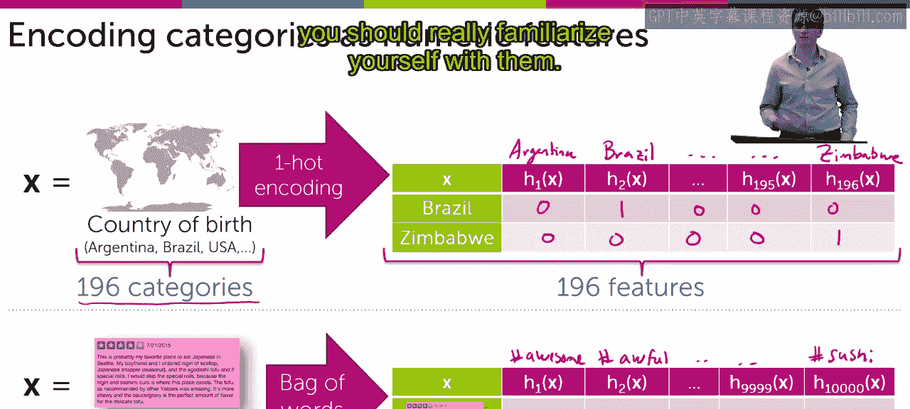

# 机器学习（分类，聚类和检索）：第3课：编码分类输入 📝

在本节课中，我们将要学习如何处理逻辑回归模型中的分类输入变量。我们已经了解了逻辑回归模型，并探讨了如何通过学习找到模型的最佳参数。然而，之前我们是以一种抽象的方式讨论特征的，例如“好评数量”、“差评数量”等。当我们的输入是所谓的**分类变量**时，我们需要更深入地思考如何表示它们。

## 分类变量与数值变量的区别

上一节我们介绍了逻辑回归模型的基本形式，本节中我们来看看如何处理不同类型的输入数据。如果输入 `x` 是数值，例如好评数量、年龄或薪水，将其乘以一个特定的系数是很自然的。例如，在评分函数中，`1.5 * 好评数量` 或 `17 * 薪水` 作为数值是有意义的。

然而，对于分类输入，如性别（男/女）、出生国家或邮政编码（在美国称为ZIP码），情况则不同。虽然邮政编码由数字组成（例如10005或98195），你可以想象将其乘以一个系数，但它们的行为并不像连续的数值。例如，98195并不比10005“大9倍”，它只是代表国家的一个不同地区。

因此，即使输入是数字，如果它们不代表连续尺度，而是像本例中一样代表类别或位置的指示符，我们仍然需要以有趣的方式对它们进行编码，以便能够与系数相乘。

## 编码方法：独热编码

那么，我们如何将像 `1.5` 或 `-2.7` 这样的系数与分类变量相乘呢？为此，我们需要使用一种称为**编码**的技术。编码接收一个分类输入（例如出生国家），并尝试使用某种数值来表示它，这些数值可以自然地与系数相乘。

以下是处理分类变量的一种核心方法：

一种编码方法是使用**独热编码**。在这种方法中，为每个可能的类别创建一个特征。例如，对于出生国家，可能有196个可能的类别。那么，你会为阿根廷创建一个特征，为巴西创建一个特征，依此类推，直到为津巴布韦创建第196个特征。

具体来说，如果某人出生在巴西，那么“阿根廷”特征的值是0，“巴西”特征的值是1，所有其他特征的值都是0。因此，在任何时候，只有一个特征的值是1，其他都是0。这就是“独热”的含义（源自电气工程，表示一个“开启”或“激活”的编码）。同样，如果某人出生在津巴布韦，我们会得到一串0，只有在代表津巴布韦出生的第196个特征上值为1。

## 另一种编码：词袋模型

在本模块中，我们实际上已经探索了另一种针对文本数据的编码方法，我们在第一门课程中讨论过，即**词袋模型**编码。一条评论由文本定义，文本可能包含成千上万个不同的单词。

以下是词袋模型的工作原理：

词袋模型接收文本，然后将其转换为计数。例如，我可能将特征 `H1` 与“好评”一词的出现次数关联，`H2` 与“差评”一词的出现次数关联，依此类推，直到第10，000个特征 `H10000`，可能与“寿司”一词的出现次数关联。一个特定的数据点可能有2个“好评”、0个“差评”、许多其他词的0次出现，以及3个“寿司”。因此，它变成了一个非常稀疏的10，000维向量。

## 编码的核心思想与应用

在上述两种情况下，我们都将一个分类特征（分类输入）转化为一组特征，每个特征对应一个可能的类别，其值要么是单一的“开启”值（1），要么是一个计数。我们可以直接将这种编码输入到我们目前讨论的逻辑回归模型中。

这种类型的编码在实践中至关重要，你应该熟悉它们。它们是将非数值信息转化为模型可以处理的数值形式的基础。

---

本节课中我们一起学习了如何处理逻辑回归中的分类输入。我们探讨了分类变量与数值变量的关键区别，并介绍了两种核心的编码方法：**独热编码** 用于一般的类别变量，以及**词袋模型** 用于文本数据。通过将分类数据转换为数值特征，我们能够将它们有效地整合到逻辑回归等机器学习模型中。