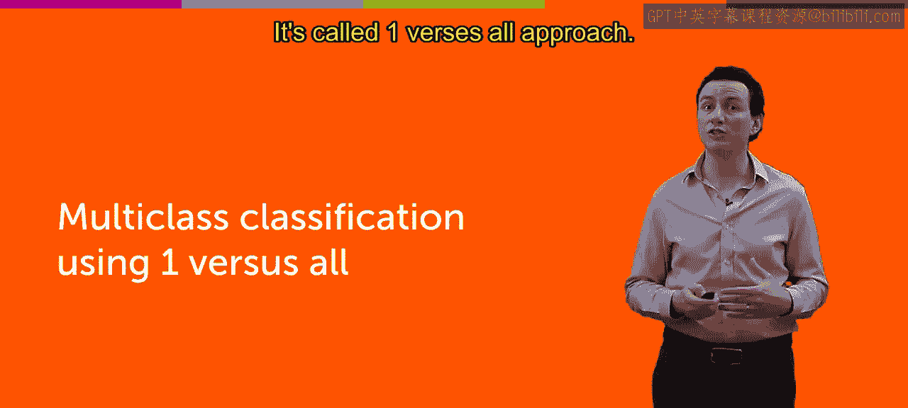
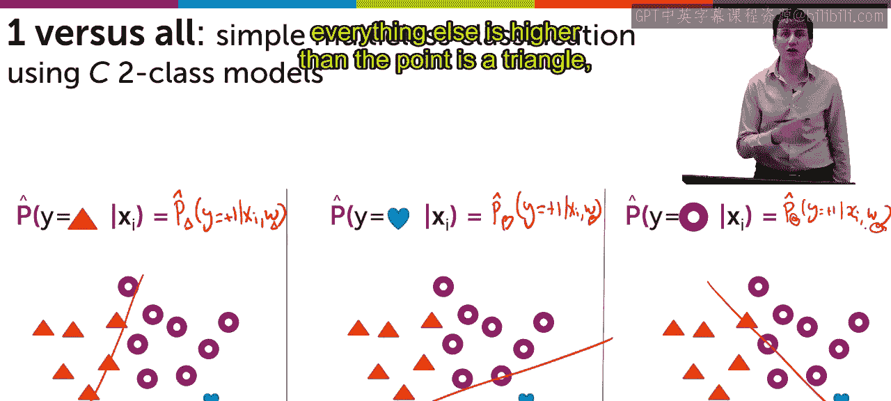
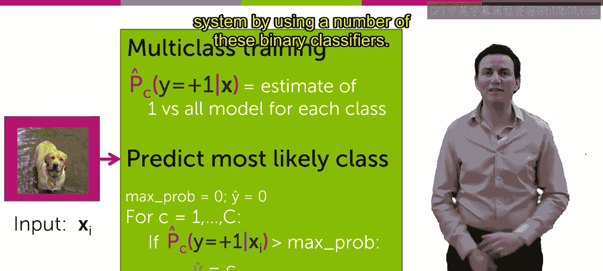

# 华盛顿大学《机器学习（分类，聚类和检索，第3-4课⧸共4课）｜Machine Learning》中英字幕 p25 24_一对多多类分类.zh_en -BV1Sr421F7N7_p25-

。

Finally， let's talk about multiclass classification and in particular we're going to talk about perhaps the simplest but extremely useful approach for doing multiclass classification。

 it's called one versus all approach。😊。

So let's say here's an example multiclass classification I give you an image of some object maybe it's an image of my dog and I feed it through the classifier to try to predict what object is in that image。

 so the output Y is the object in the image might be a labbrador retriever go the retriever table monitor camera and so on so that's the prediction task that were going to do and it has more than two classes is not just plus one minus1。

 but maybe I have100 different categories so how do we solve a problem like this and many approach to do in it let's talk about a very simple but super useful approach called one versus all。

😊，And I'm going to use the following example where we have three classes， triangles。

 hearts and donnus。But of course， you might have many more classes and I' be using capital C to denote the total number of classes。

 capital C in this case is three， but it could be 10，000 in a different case。

And we still have n data points， and now for each data point， we have associated with it。

 not just x1， x2 and so on， but also the category Y， which is sub being just plus 1 minus1。

 in this case， its triangles， hearts or donuts。And what I'd like to know is for a particular input。😊。

X1， what is the probability that this input corresponds to a triangle to a heart or to a donut。

 or in the case of the image， whether this input corresponds to a Labrador retriever。

 golden retriever or a camera？The one versus all model is extremely simple。

 and its exactly what you expect of the words one versus all。 Here's what you do。

 You train a classifier for each category。 So， for example。

 you train one that says the plus one category。😊，Is going to be all the triangles and the negative category is going to be everything else in our example。

 hearts and donuts。 And what you're trying to do is learn a classifier that separates most of the triangles from the hearts and the donuts。

So in particular， we're going to train a classifier then when I denote by P hat of triangle。

 which outputs plus one if the input x is more likely to be a triangle than everything else。

 donut or。Hard。And then the way that we estimate the probability that an input X I is a triangle is just by saying it's。

P hat of triangle with y equals plus  one。 So in our picture on the right。

 heres what a classifier is gonna do。 It's gonna assign score of X I to be greater than 0 on the triangle side。

Score of X， I。To be less than zero on the donuts and heart side， hopefully。

 which is going to mean that on the triangle side， the probability。That y is equal to triangle。

Given the input X I and the parameters W is going to be greater than 0。5 and on the other side。

 the probability that y is equal to triangle， given the input X I and the parameters W is going to be hopefully less than 0。

5。So this lets me take a data point and say， is this more likely to be a triangle than a donut to heart？

But that doesn't tell me how to do multiclass classification in general。

 how do you do multi class classification in general？

And so what we'll do is we'll learn a model for each one of these cases。

 so it's going to be one versus all for each one of the classes。

So we will learn a one versus all that tries to compare triangles against donuts and hearts。

 which is going to be defined by P hat sub triangle that y equals plus1 given X I and W。

 We're going to learn a model for hearts that tries to separate hearts form triangles and donuts。

 which is going to be P hat and we learn on a different dataset set So it's going to be subhars That's an ugly heart I want pretty hards here。

That's slightly prettier， only slightly。The probability that it's plus  one given the input X and the parameters W。

And。Lastly， we have for a donut， the probability according to the donut model。Of y equals plus one。

 given。X I。And W。 and one last little note is that the w is for each one of these models here I'm separating donuts from everything else。

 The ws for each one of these model is different。 you can see by the lines being different。

 So in the first one is w of triangles and the second one is W of heart and then the last one is w of donuts。

So we train this one versus all models and what we output as a prediction。

 we just say whatever classes highest probability wins， so in other words。

 if the probability that input is a heart against everything else is harder than the point is a triangle higher than input is a donut。

 you say that the class is hard。

More explicitly in multiclass classification we're going to train a model to ask for each class what's the probability that it wins against everything else。

 the probability of y equals1 given X and you estimate one of those for each class and then when we given in particular input XI for example this image of my dog what we're going to do is compute the probability that every class estimates and output the maximum and I just written out here the kind of natural algorithm so we start with the maximum probability being0 and y hat being this non-category0 and we go class by class and ask is the probability the y equals1 according to the model for this class the model for Labrador retriever。

 the model for go the retriever， the model for camera is that higher than the max probability I've seen so far if it's higher that means that classes looks like it's winning so we say that the y hat is whatever this class is and we update the maximum probability。

😊，To be the problem according to this class and as I iterate over each one of these。

 the maximum is going to win。 so this is just kind of an algorithmic statement for exactly what you'd expect。

 you check how each model believes whether believes it's a dog， a leverage door retriever。

 got the retriever， a camera， what the probabilities are and you just output put the object that has the highest probability。

😊，And with that simple， simple algorithm， we now have a multiclass classification system by using a number of these binary classifiers。

