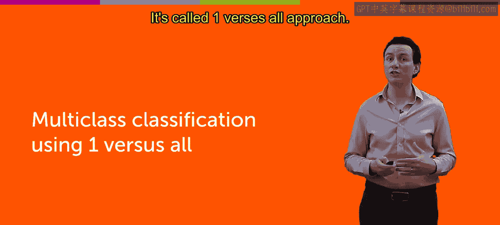
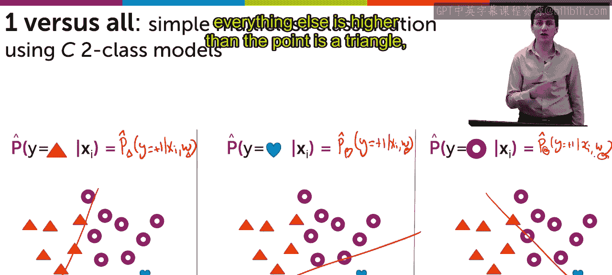
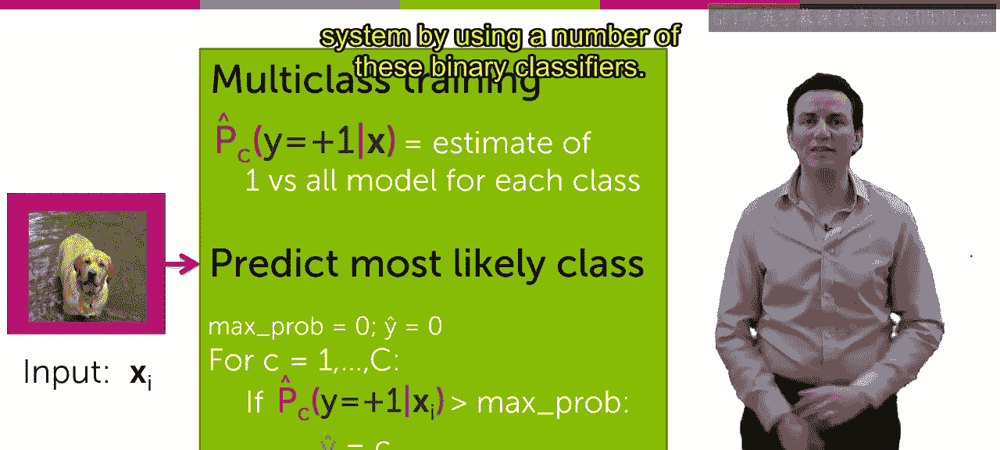

# 机器学习（分类，聚类和检索）：3-4：一对多多类分类




在本节课中，我们将要学习多类分类问题，并重点介绍一种简单但极其有效的方法——一对多方法。

## 概述

多类分类是指预测任务中存在两个以上类别的情况。例如，给定一张图片，我们需要判断其中的物体是拉布拉多犬、金毛寻回犬、桌子还是相机。我们将学习如何使用多个二元分类器来解决这类问题。

## 一对多方法原理

上一节我们介绍了二元分类，本节中我们来看看如何将其扩展到多类场景。一对多方法的核心思想是为每个类别训练一个独立的二元分类器。

假设我们有 `C` 个类别（例如，三角形、心形、甜甜圈）。对于每个类别 `c`，我们训练一个分类器，其任务是区分“属于类别 `c`”和“不属于类别 `c`”（即所有其他类别）。

对于类别 `c`，我们学习一个模型，其输出是给定输入 `x` 时，`y` 属于该类别的概率估计：
`P_hat_c(y = +1 | x, w_c)`

请注意，每个类别 `c` 都有自己独立的参数 `w_c`。

## 训练与预测流程

以下是使用一对多方法进行多类分类的具体步骤。

首先，我们需要为每个类别训练一个二元分类器。

1.  **为每个类别训练分类器**：对于总共 `C` 个类别中的每一个，将其所有样本标记为正例（`y=+1`），将所有其他类别的样本标记为负例（`y=-1`），然后训练一个标准的二元分类器（如逻辑回归）。
2.  **获得概率估计**：训练完成后，每个分类器 `c` 都能对新的输入 `x` 输出一个概率值 `P_hat_c`，表示 `x` 属于类别 `c` 的置信度。



接下来，在预测阶段，我们使用所有训练好的分类器对新样本进行判断。

1.  **初始化**：设置最大概率 `max_p = 0`，预测类别 `y_hat` 为 `None`。
2.  **遍历所有类别**：对于每个类别 `c`，计算其分类器给出的概率 `p_c = P_hat_c(y=+1 | x, w_c)`。
3.  **比较与更新**：如果 `p_c > max_p`，则更新 `max_p = p_c`，并将 `y_hat` 设置为当前类别 `c`。
4.  **输出结果**：遍历完所有类别后，输出最终确定的 `y_hat` 作为预测类别。

用伪代码表示，预测过程如下：
```python
max_p = 0
y_hat = None
for c in range(C):
    p_c = P_hat_c(y=+1 | x, w_c) # 第c个分类器的预测概率
    if p_c > max_p:
        max_p = p_c
        y_hat = c
return y_hat
```

## 总结



本节课中我们一起学习了多类分类问题的一对多解决方法。该方法通过为每个类别训练一个“一对其他”的二元分类器，将复杂的多类问题分解为多个简单的二元问题。在预测时，综合所有分类器的结果，选择概率最高的类别作为最终输出。这种方法概念清晰、实现简单，是处理多类分类任务的基础且强大的工具。