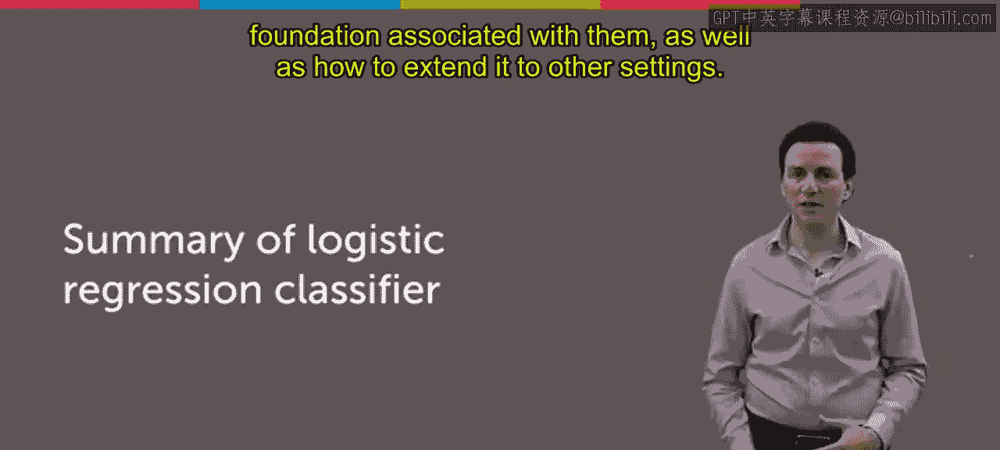
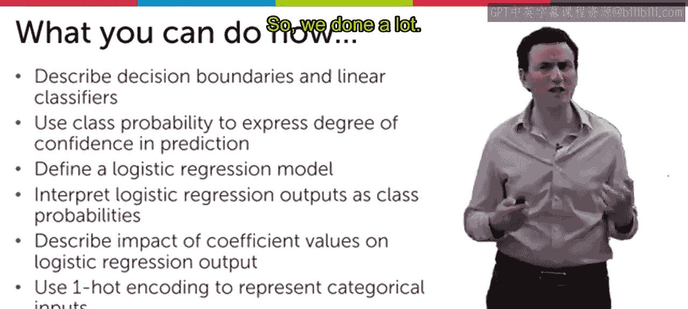

# 华盛顿大学《机器学习（分类，聚类和检索，第3-4课⧸共4课）｜Machine Learning》中英字幕 p26 25_Logistic回归分类器回顾.zh_en -BV1Sr421F7N7_p26-

。

Wow exciting， we got through our first module， we got through a representation for Lear classifier in much more depth than we did in the first course in fact we had a chance to dive in and really understand how these models are built the parameters in the line foundations associated with them as well as how to extend it to other settings。

😊。

Now we're able to take our loop learning loop that goes from training data to creating features H of X to this model。

 this logistic ratio model， and define a learning algorithm， which we've talked in highle only now。

 but we're going to talk in more detail on the next module to come up with WHs and we're about to make predictions from it。

😊，So now you can take everything you've learned and be able to talk about what does the linear classifier look like。

 what's the logistic regression model， how that relates to the general score function like we have regression but squeezes it to the interval 01 to predict probabilities how it's affected by parameters and how to extend that to multi class setting and how do you deal with categorical data。

 so we've done a lot， we're really ready to really think deeply about classifiers。😊。

