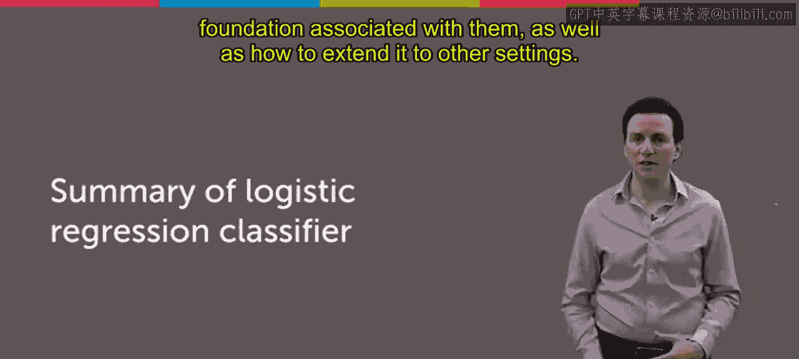
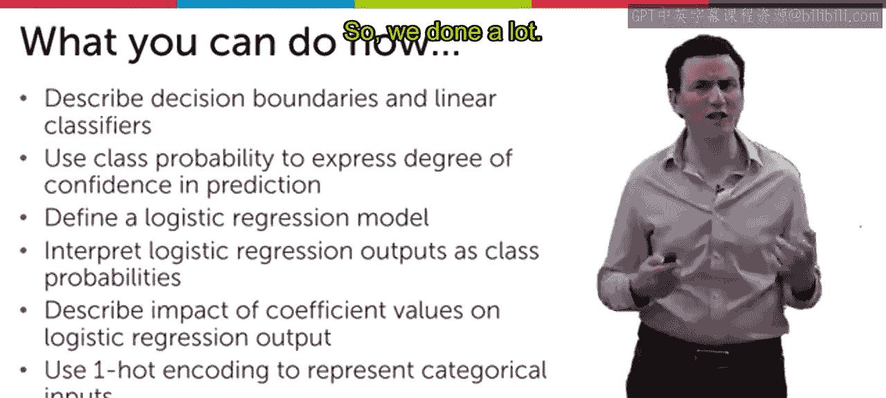

# 机器学习（分类，聚类和检索）：第3-4课：Logistic回归分类器回顾

在本节课中，我们将回顾Logistic回归分类器的核心概念。我们将深入探讨线性分类器的表示方法、Logistic回归模型如何将分数转换为概率，以及如何将其扩展到多类别和分类数据场景。通过本次回顾，你将能够清晰地理解分类器的工作原理。

---

我们已经完成了第一个模块的学习，并且比第一门课程更深入地探讨了线性分类器的表示方法。事实上，我们有机会深入其中，真正理解这些模型是如何构建的，包括与之相关的线性基础参数，以及如何将其扩展到其他场景。

现在，我们能够将学习循环——从训练数据到创建特征 `h(x)`，再到这个模型——应用到Logistic回归模型中，并定义一个学习算法。我们之前已经大致讨论过这个算法，但将在下一个模块中更详细地探讨如何得出权重 `w`，并利用它进行预测。

因此，现在你可以运用所学的所有知识，来讨论线性分类器的形态、Logistic回归模型是什么，以及它如何与一般的分数函数（如回归）相关联，但通过将其压缩到区间 `[0, 1]` 来预测概率。你还可以理解它如何受参数影响，如何扩展到多类别设置，以及如何处理分类数据。我们已经完成了大量工作，现在已准备好深入思考分类器。

---

## 核心概念回顾

以下是Logistic回归分类器的几个核心组成部分：

*   **线性分类器**：其决策边界由线性函数定义。对于一个特征向量 `x` 和权重向量 `w`，分数函数为 `score(x) = w · x + b`，其中 `b` 是偏置项。

*   **Logistic回归模型**：该模型将线性分数通过Sigmoid函数转换为概率。公式为 `P(y=1 | x) = σ(w · x + b) = 1 / (1 + exp(-(w · x + b)))`。这确保了输出在0和1之间，代表属于正类的概率。

*   **扩展到多类别**：对于多类别分类问题，可以使用Softmax函数。对于 `K` 个类别，给定分数向量 `s`（其中 `s_k = w_k · x + b_k`），类别 `k` 的概率为 `P(y=k | x) = exp(s_k) / Σ_{j=1}^{K} exp(s_j)`。

*   **处理分类数据**：对于非数值的分类特征（如颜色、城市），通常使用独热编码将其转换为二进制特征向量，以便模型能够处理。

---

## 总结

本节课中我们一起回顾了Logistic回归分类器的关键内容。我们明确了线性分类器的表示，理解了Logistic回归如何通过Sigmoid函数将线性分数映射为概率，并探讨了模型向多类别分类的扩展方法以及分类数据的处理方式。这些知识为我们接下来深入学习分类器的训练算法奠定了坚实的基础。