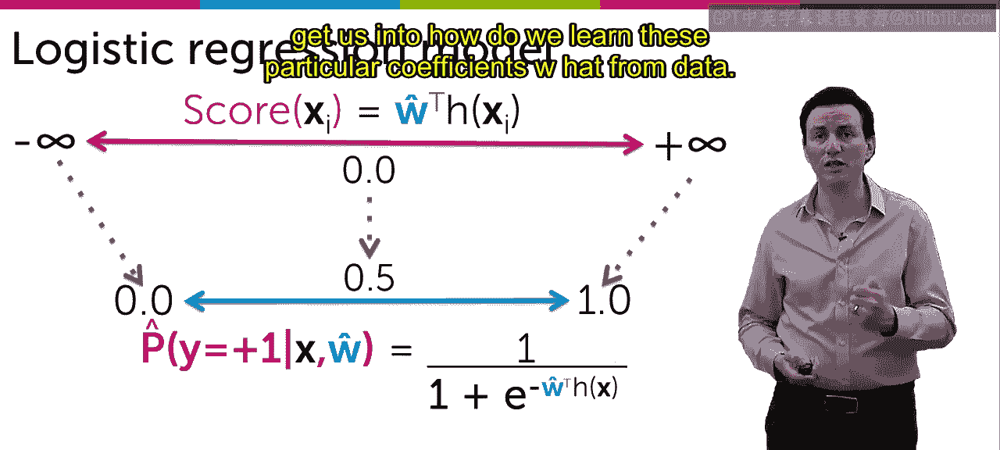

# 华盛顿大学《机器学习（分类，聚类和检索，第3-4课⧸共4课）｜Machine Learning》中英字幕 p27 26_目标：学习Logistic回归的参数.zh_en -BV1Sr421F7N7_p27-

。

Now we know everything about logistic regression classifiers， the representation。

 what the impact of parameters are， how they can be used for classification。

 they can be used for multiclass classification， that's the foundation we need to talk about linear classifiers and to do the rest of this classification course。

😊，In this module， we'm going to dig in and really figure out how to learn the parameters for the logistic regression classifier。

 but let's start with a quick review just get us in the same mindset。😊，Now remember。

 we had this product reviews or restaurant reviews and we wanted to figure out， for example。

 that the sushi and everything else were awesome as input has a high probability of being a positive review while the sushi is good and the service was okay as the probability of only 0。

55 of being a positive review。In other words， we want to learn a classifier of the form probability of y given x where y is the output label。

 positive or negative review， and exit is the input center actual review。😊。

So we talked about this task and we discussed linear classifiers where we can associate。😊。

A weight or a coefficient with every input feature in our case would be words like good， great。

 awesome and so on， and words positive coefficients， negative words may have negative coefficients。😊。

So this is our model and we define a score function。

 which is the weighted combination of the coefficients with whatever words appear in a particular input sentence。

 and that score can vary from minus infinity to plus infinity。

 so we squeezed it into the line01 to be able to predict the probability that a review is positive given。

😊，The text of the review and in logistic regressional model。

 that probability is defined by1 over1 plus each of the minus W transpose h。

So we spotted this quite a bit in the last module， just want to kind of warm us up and get us into how do we learn this particular coefficient W hat from data。

😊。

。