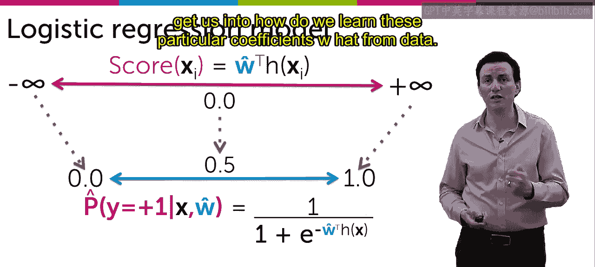

机器学习（分类，聚类和检索）：第3课：学习Logistic回归的参数

在本节课中，我们将深入探讨如何从数据中学习Logistic回归分类器的参数。我们将从快速回顾开始，确保大家对模型有共同的理解，然后详细讲解参数学习的过程。

---

### 概述

我们已经了解了Logistic回归分类器的表示形式、参数的影响以及如何将其用于分类和多类别分类。这是讨论线性分类器和完成后续分类课程的基础。现在，我们的目标是学习如何从数据中自动找到最优的参数。

### 模型回顾

回想一下我们的任务：例如，我们有一些餐厅评论，我们希望判断评论是正面还是负面。给定一条评论文本 `x`，我们希望模型能输出该评论为正面（`y=1`）的概率 `P(y=1 | x)`。

我们讨论过线性分类器，它为每个输入特征（在我们的例子中是单词，如“好”、“棒极了”等）关联一个权重或系数。正面词汇通常有正系数，负面词汇有负系数。

模型的核心是一个评分函数，它是输入句子中出现的单词与其对应系数的加权组合：
`score = w^T * h(x)`
其中 `w` 是权重向量，`h(x)` 是输入 `x` 的特征表示（例如，词袋向量）。这个分数可以从负无穷到正无穷。

为了将这个分数转化为一个介于0和1之间的概率，我们使用Logistic函数（或Sigmoid函数）进行“挤压”。在Logistic回归模型中，给定评论文本 `x`，其为正面评论的概率定义为：
`P(y=1 | x) = 1 / (1 + exp(-w^T * h(x)))`
这个公式是我们模型的核心。

### 学习目标

我们的目标是学习最优的权重系数向量 `w`。我们希望学到的 `w` 能够使得模型对训练数据中的正面评论给出高概率，对负面评论给出低概率。

那么，如何从数据中学习这些参数呢？以下是学习过程的关键步骤。

### 学习参数的方法

为了学习参数 `w`，我们需要一个衡量模型预测好坏的标准，即一个目标函数（或损失函数）。然后，我们通过优化这个函数来找到最佳的 `w`。

**1. 定义目标函数：最大似然估计**

一个自然的方法是使用最大似然估计。我们希望找到一组参数 `w`，使得模型对观测到的训练数据的“可能性”最大。换句话说，我们希望模型预测的概率分布与真实标签尽可能一致。

对于单个数据点 `(x_i, y_i)`，其似然可以表示为：
`L_i(w) = P(y_i | x_i)^y_i * (1 - P(y_i | x_i))^(1-y_i)`
当 `y_i=1`（正面）时，我们希望 `P(y=1|x_i)` 大；当 `y_i=0`（负面）时，我们希望 `P(y=1|x_i)` 小（即 `1-P(y=1|x_i)` 大）。

对于整个训练集，总似然是所有数据点似然的乘积。通常，我们最大化对数似然，因为乘积取对数后变为求和，更易于数学处理：
`log L(w) = Σ [y_i * log(P(y_i|x_i)) + (1-y_i) * log(1 - P(y_i|x_i))]`

**2. 优化目标函数**

我们的目标是找到使对数似然函数 `log L(w)` 最大的 `w`。由于最大化对数似然等价于最小化负对数似然，我们通常将问题转化为最小化一个损失函数，称为对数损失或交叉熵损失：
`Loss(w) = - Σ [y_i * log(P(y_i|x_i)) + (1-y_i) * log(1 - P(y_i|x_i))]`

这个函数是凸函数，意味着它有一个全局最小值。我们可以使用梯度下降法来找到使损失最小的 `w`。

**3. 使用梯度下降**

梯度下降是一个迭代优化算法。它从 `w` 的一个初始猜测开始，然后反复朝着使损失函数下降最快的方向（负梯度方向）更新 `w`。

权重更新公式为：
`w_new = w_old - η * ∇Loss(w_old)`
其中 `η` 是学习率，控制每次更新的步长；`∇Loss(w)` 是损失函数关于 `w` 的梯度。

对于Logistic回归，梯度的计算有简洁的形式，它与预测误差 `(y_i - P(y_i|x_i))` 和输入特征 `h(x_i)` 有关。这使得梯度下降的实现非常高效。

### 总结

在本节课中，我们一起学习了如何为Logistic回归分类器学习参数。

我们首先回顾了模型：它使用线性加权和计算分数，并通过Sigmoid函数将分数转化为概率。

然后，我们深入探讨了学习过程的核心：使用最大似然估计原理来定义目标。我们通过最大化训练数据的（对数）似然，或者等价地，最小化对数损失（交叉熵损失）来寻找最佳参数。

最后，我们介绍了如何使用梯度下降法来优化这个损失函数，从而迭代地更新权重系数 `w`，直到找到最优解。

通过这个过程，我们可以从标记好的数据中自动学习到一个能够有效区分正面和负面评论的Logistic回归模型。这为构建实用的文本分类器奠定了坚实的基础。在接下来的课程中，我们将看到如何评估和提升这些模型的性能。