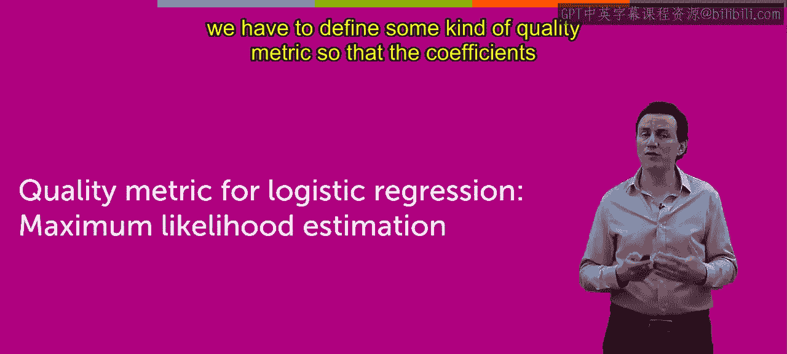
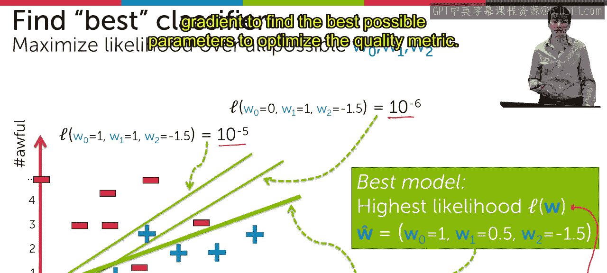
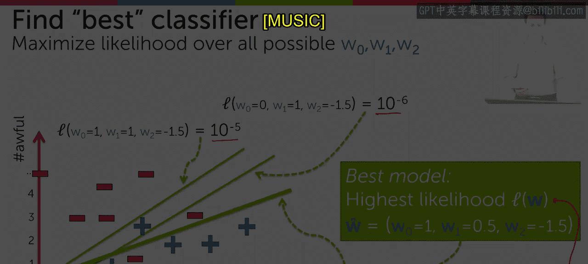

# 华盛顿大学《机器学习（分类，聚类和检索，第3-4课⧸共4课）｜Machine Learning》中英字幕 p28 27_最大似然估计的直观理解.zh_en -BV1Sr421F7N7_p28-

。

In order to learn the coefficients W had from data。

 we have to define some kind of quality metric so that the coefficients give you the highest quality that's what W hat is supposed to be so if we go back to our learning loop or giving some training data we squeeze it from future generation or future extraction system and it gets to H of x。

😊。

In our models logistic regression model， we're now going to talk about the quality metric。

 which is going to feed inter machine learning algorithm that's output put in W hat so do with this orange box over here。

😊，In particular， we would have be given some training data as the input and the data is kind of like the one I'm showing。

 so it has， for example， feeling had two features， the number of awesome。

 the number of authorss and the output label or sentiment which might be plus one or a negative one。

😊，all this data M data points， let's say one read data points。

 we're going to use some kind of learning algorithm that optimize the quality metric to give us a W hott。

 So what's the quality metric look like Let's get right into it and try to understand what the likelihood function that we hinted that in the previous module is really about。

Let's take our data set just for intuition and split it into the data points。

 they have positive sentiment on the right and the data points that have negative sentiment on the left。

 so we have two tables the slightly more negative sentiments or positive sentiments in this example。

 So what do we want that had to satisfy like a good w to satisfy for all the positive sentiment for all the data points of positive sentiment in the extreme we want the probability that it is positive to go all the way to plus one。

😊，For all the negative ones， we want the probability to go all the way to zero。So it's not positive。

 it must be negative。 So our goal is to find a W hat that makes this possible or as close as possible。

So in other words， if we take the negative examples and the positive examples。

 there might not be a W Haer that achieves exactly zero for the negative one for the positives for all of them and so the quality metric of the likelihood function tries to figure out kind of on average。

😊，It measures the quality throughout all the data points with respect to coefficients W。

 However we're gonna we're making kind of extremes happen。 Now， if I have the likelihood function。

 I can evaluate multiple lines or multiple classifiers。 So， for example， for the green line here。

 the likelihood function might have a certain value， let's say，10 to the -6。Well。

 for this other line where instead of having w0 be0， now w0 is1。

 but the w1 and W2 coefficient are the same， then the likelihood is slightly higher 10 to the minus6。

But for the best line， which maybe sets w0 to be 1， W1 to be 0。5 and w2 to be minus 1。5。

 then the likelihood is the biggest which in this case is  tend0 to minus4。Now。

 you've seen these numbers， they're kind of weird， tend0 to the minus something。

 but this is what likelihoods will come out to， they're going to be very very small numbers。

 they're going to be less than one， but the higher you get， the closer you get to one， the better。

And so the question is， how do we find the best ws， the best classifiers。

 we find the ones that make this likelihood function that we're going to talk about as big as possible。

 So we're going to define this function L of W， and then we're going to use gradient。😊，Assent。

To find。WH and you should have some fond memories， maybe some sad sad memories from the regression of course。

 when we talked about gradient descent and we explored the idea of using gradient to find the best possible parameters to optimize the quality metric and we're going to go through that in this case again。

😊。

