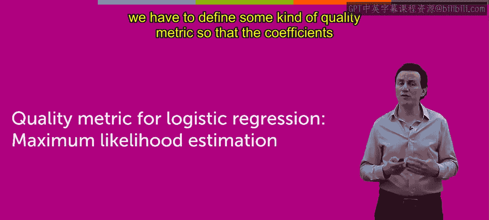
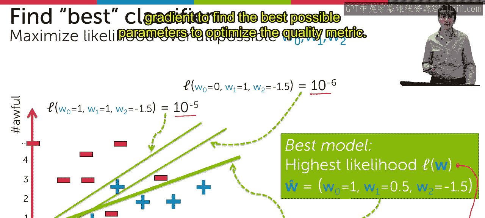

# 机器学习（分类，聚类和检索）：第3课：最大似然估计的直观理解

在本节课中，我们将学习如何为逻辑回归模型定义质量度量，即**似然函数**。我们将理解其直观含义，并了解如何通过最大化似然函数来找到最佳的模型参数。

---

为了从数据中学习系数 **W**，我们必须定义某种质量度量，使得系数能给出最高的质量，这就是 **W** 应该达到的目标。回顾我们的学习循环，给定一些训练数据（这些数据可能来自未来的生成或提取系统），我们将其输入到模型 **h(x)** 中。

在我们的逻辑回归模型中，现在我们将讨论质量度量。这个度量将输入到机器学习算法中，算法最终输出 **W**。具体来说，我们会得到一些训练数据作为输入，数据类似于我展示的这个例子。例如，每条数据可能有两个特征：“awesome”的数量和“awful”的数量，以及输出标签或情感，可能是+1（正面）或-1（负面）。

假设我们有 **N** 个数据点。我们将使用某种学习算法来优化质量度量，从而得到 **W**。那么，质量度量是什么样的呢？让我们直接深入探讨，尝试理解我们在上一模块中提到的似然函数到底是什么。

为了直观理解，让我们将数据集分成两部分：右边是具有正面情感的数据点，左边是具有负面情感的数据点。在这个例子中，我们有两个表格，分别对应负面和正面情感。

我们希望一个好的 **W** 能满足什么条件呢？对于所有正面情感的数据点，在理想情况下，我们希望模型预测其为正面的概率尽可能接近 **1**。对于所有负面情感的数据点，我们希望模型预测其为正面的概率尽可能接近 **0**（即它必须是负面的）。我们的目标是找到一个 **W**，使其尽可能实现这一点。

换句话说，对于所有的负面和正面例子，可能不存在一个 **W** 能对所有数据点都精确地实现概率为0或1。因此，似然函数这种质量度量试图在整体上找出一个平均最优解。它衡量的是在所有数据点上，系数 **W** 的质量，其目标是让极端情况（概率接近0或1）尽可能发生。

有了似然函数，我就可以评估多个分类器（或决策边界）。例如，对于图中这条绿色的线，似然函数可能有一个特定的值，比如 `10^-6`。对于另一条线（其中 `w0` 从0变为1，但 `w1` 和 `w2` 系数保持不变），似然值可能略高，为 `10^-5.8`。但对于最佳的线（例如，设 `w0=1`， `w1=0.5`， `w2=-1.5`），似然值是最大的，在这个例子中是 `10^-4`。

你看到了这些数字，它们看起来有点奇怪，都是 `10` 的负多少次方。这就是似然值通常的样子，它们是非常小的正数（小于1）。但值越大（越接近1），模型就越好。

那么问题来了：我们如何找到最好的 **W**，即最好的分类器呢？答案是，我们寻找能使我们将要讨论的这个似然函数 **L(W)** 最大化的 **W**。然后，我们将使用**梯度上升**方法来找到 **W**。

你应该还记得回归课程中关于梯度下降的讨论（无论是美好的还是痛苦的回忆），我们探索了使用梯度来寻找最佳参数以优化质量度量的思想。在本案例中，我们将再次经历这个过程，不过这次是最大化（梯度上升）而非最小化（梯度下降）。

---

本节课中，我们一起学习了**最大似然估计**的直观思想。我们了解到，似然函数 **L(W)** 衡量了在给定参数 **W** 下，观察到当前训练数据的概率。我们的目标是找到一组参数 **W**，使得这个概率（似然）最大化。这相当于寻找一个模型，使其预测结果与真实标签尽可能一致。接下来，我们将具体定义这个似然函数的数学形式，并学习如何使用梯度上升法来优化它。