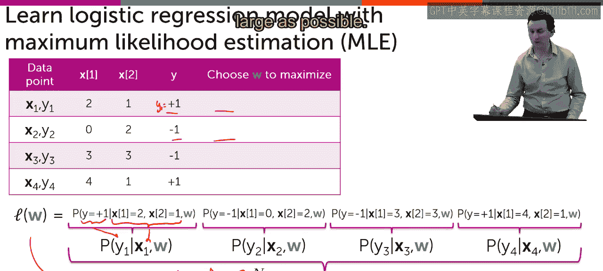

# 华盛顿大学《机器学习（分类，聚类和检索，第3-4课⧸共4课）｜Machine Learning》中英字幕 p29 28_数据似然.zh_en -BV1Sr421F7N7_p29-

。

Before we get to gradient the though， we need to figure out what the quality metric you're trying to optimize is and that quality metric is going to call the data likelihood。

 so let's dive in and explore exactly that concept。😊，To better understand the data likelihood。

 let's start with some simple examples and try to understand what W is trying to do。

 What we're trying to do here in the learning problem。

 So let's say that we have this data point that has two awesomes and one awful。

 So let's call that input X1。 And we' gonna not try to output。😊，Y1。

 which is that this is a positive sentiment。 This is review of positive sentiment。

 If our classifier were really good， if Ws were good， what would happen Well。

 for this particular input， it would output Y hat。For one is also equal to plus1， in other words。

 Y hat agrees with the true label Y。So what should we do for whyha to agree with the true label Y we're using logistic regression。

 Well， we're going to try to find a W that makes the probability。That y is equal to plus 1。

 when the input is x1。And the parameters of W， we to make that as big as possible。 In other words。

 we want to make the probability that y is equal to plus one when。X1 number of awesomes is 2。

 and x 2 number of os is one for the parameter W。 We want to make that probability as big as possible。

But that was for a positive example， We not make the probability of y equals plus one as big as possible。

 Now， let's take another example。 Let's call this example， x2。

Where it has zero awesomes and two awfuls， it must be an awful review， awful restaurant。

 And so the sentiment for y2 is minus-1。So if our classifier is good， if w is good， in this case。

 we should predict that y hat 2 is equal to minus-1 to agree with the true label。

 So in this case we're not maximizing the probability of y equals1。

 but we're maximizing the probability that y is equal to minus-1 when the input is x2。

For the parameters W。In other words， when the input is x1。

 were going to maximize the probability the y cos plus 1 and when input is x2。

 minimize the probability that y is equal to minus1。That's what the data likelihood tries to do。

 but let's dig in and understand that a little bit better。Now。

 we just don't have two training examples。 We have a ton of examples。 We have a big data set。

 So what we're trying to do。 So let's look at the first example in the first example。

 we want to maximize since is a positive example。 We want to maximize the probability that why。

Is equal to plus one when the input is。X1。And the parameters a W。

 So in this case is the probability that。Y is equal to plus one when。The number of awesomes。Is 2。

 And the number of awfuls。Is one。And the parameter is w。

 So we're trying to make the probability of y equal plus one given x1 to be as big as possible。

 For the next example， we're trying to make the probability that y is equal to minus1 given x to W to be as big as possible because the negative example for the third one is also negative example。

 So we're trying to make the probability that y is equal to。-1， given x 3 and W for the fourth one。

 we're trying to make the probability that y it's a positive examples of y equals plus 1， given x 4。

And W as large as possible。 So in other words， for the positive examples。

 we're trying to make the probability of y equal plus one as big as possible for negative examples。

 we're trying to make the probability whys called -1 as big as possible， which is pretty natural。

 And we want to do that for each example。For every single one of those。Now the question is。

How do we combine。Like it's if we a single quality metric。

 how do we combine these and you can imagine multiple ways of combining this averages， I don't know。

 all sorts of ideas out there， the way that you typically combine when you're doing what's called maximum likelihood estimation or maximizing likelihood is by multiplying these things together。

So， you multiply。Yeah。So in other words， you say that it's the product of y is equal to plus 1。

 given that's on the first line， given x1 and w times the probability that y is equal to minus1 from the second line here。

Given x2。And W， and the third line is also negative。 So times the probability that y is equal to -1。

 given x 3。AndW and so on。So you just multiply them all together。

Here's a side little note for those who know about probabilities。

 the reason you multiply is that you assume that every row is independent of each other so there's an independence that comes into play。

 but don't worry too much about this， just think about as a multiplication。😊。

Okay let so let's do that a little bit more explicitly。

 Now we have this data points one through four。 And for each one of them。

 we're trying to maximize the specific probability。 So for the positive examples。

 we're trying to maximize probability of y co plus one for the negative examples。

 the probability to y -1。 given the parameter to w is and we find w that makes those as big as possible。

 So the likelihood function， the thing we going optimize is the product of each one of this probabilitybabilities。

😊，I like that animation， pretty cool。So。We're going to use a shorthand notation here。

 So for the first example， we have that y1。Up here was plus one。

 So we're gonna denote that by probability of y1， given x 1 and W， so。

The y one is gonna get from this plus one。And x 1。Is going to come from this representation of x。

 and similarly for the other one。 So for for so the notians can get long and heavy。

 we just say probability of y1， given x1 and w， probability of y 2， given x 2 and W。

 probability of y 3， given x 3 and W， and we just multiplying them together。And finally。

 so that that line doesn't get really long because if we have a million training examples。

 there'll be a million of these entries， we use the product notation。😊。

So this is the little notation over here， and it just says。

 I'm going to just write the same function here， L of W。Is going to be equal to the product。

The ranges from the first data point。To end。Which is。Number of。Data。Point。

Of the probability of whatever label Y I has plus 1 -1， given the input X I。

 which is the sentence of that review and the parameter ws。

 This is the likelihood function we're trying to optimize。 So our goal here is to。Pick。W。To make。

This crazy thing。I mean， this function。Ass large。As。Possible。

Now that's our goal。