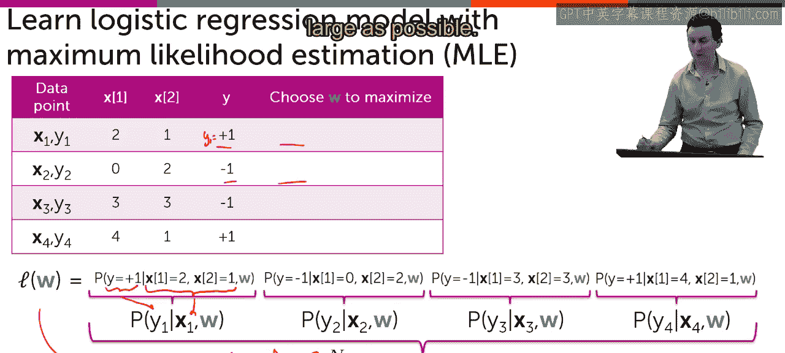

# 机器学习（分类，聚类和检索）：第3-4课：数据似然

在本节课中，我们将要学习一个在机器学习中至关重要的概念——**数据似然**。我们将探讨如何通过优化这个指标来找到最佳的模型参数，从而让我们的分类器（例如逻辑回归）做出最准确的预测。

---

在深入探讨梯度下降等优化方法之前，我们需要明确我们试图优化的质量指标是什么。这个质量指标被称为**数据似然**。

为了更好地理解数据似然，让我们从一些简单的例子开始，尝试理解参数 **W** 的目标是什么，也就是我们在学习问题中试图完成的任务。

假设我们有一个数据点，它包含两个“awesome”词和一个“awful”词。我们称这个输入为 **X1**。其对应的输出 **Y1** 是正面的情感（+1），表示这是一条正面评价。

如果我们的分类器性能很好，即参数 **W** 设置得当，那么对于这个特定的输入，模型的预测输出 **Ŷ1** 也应该等于 +1。换句话说，预测值 **Ŷ** 与真实标签 **Y** 一致。

那么，在使用逻辑回归时，我们如何让 **Ŷ** 与真实标签 **Y** 一致呢？我们将尝试找到一个参数 **W**，使得在输入为 **X1**、参数为 **W** 的条件下，**Y** 等于 +1 的**概率**尽可能大。也就是说，我们希望最大化这个概率：**P(Y = +1 | X1, W)**。

但以上是针对一个正面例子。我们不仅要最大化正面例子中 **Y=+1** 的概率。

现在，让我们看另一个例子。称这个例子为 **X2**，它包含零个“awesome”词和两个“awful”词，这必然是一条负面评价。因此，其情感标签 **Y2** 是 -1。

如果我们的分类器性能很好，即 **W** 设置得当，那么在这种情况下，我们应该预测 **Ŷ2** 等于 -1，以与真实标签一致。因此，在这种情况下，我们不是最大化 **Y=+1** 的概率，而是最大化在输入为 **X2**、参数为 **W** 的条件下，**Y** 等于 -1 的概率：**P(Y = -1 | X2, W)**。

总结一下：
*   当输入是 **X1**（正面例子）时，我们想要最大化 **P(Y = +1 | X1, W)**。
*   当输入是 **X2**（负面例子）时，我们想要最大化 **P(Y = -1 | X2, W)**。

这正是数据似然试图实现的目标。但让我们更深入地理解一下。

---

实际上，我们通常不止有两个训练样本，而是拥有一个包含大量样本的数据集。那么，我们具体要做什么呢？

让我们逐一审视数据集中的例子：
1.  对于第一个例子（正面），我们希望最大化 **P(Y = +1 | X1, W)**。
2.  对于第二个例子（负面），我们希望最大化 **P(Y = -1 | X2, W)**。
3.  对于第三个例子（负面），我们希望最大化 **P(Y = -1 | X3, W)**。
4.  对于第四个例子（正面），我们希望最大化 **P(Y = +1 | X4, W)**。

以此类推。换句话说：
*   对于所有**正面**例子，我们试图使 **P(Y = +1 | X, W)** 尽可能大。
*   对于所有**负面**例子，我们试图使 **P(Y = -1 | X, W)** 尽可能大。

这非常直观自然。我们希望为数据集中的**每一个**样本都做到这一点。

---

现在的问题是：我们如何将这些针对单个样本的目标组合成一个单一的质量指标？你可以想象有多种组合方式，比如求平均值等。

在所谓的**最大似然估计**或最大化似然的方法中，通常的组合方式是**将这些概率相乘**。

所以，似然函数 **L(W)** 可以写成：
**L(W) = P(Y1 | X1, W) × P(Y2 | X2, W) × P(Y3 | X3, W) × ...**

（注：对于了解概率论的读者，相乘的原因是我们假设每个数据样本是相互独立的。但不必过于担心这一点，只需理解为相乘即可。）

让我们更明确地表达这一点。对于数据集中的每个数据点，我们都在尝试最大化其对应的特定概率。因此，似然函数，即我们想要优化的目标，就是所有这些概率的乘积。

为了简化冗长的表示法，我们使用以下符号：
*   用 **P(y_i | x_i, W)** 表示第 i 个样本在其真实标签 **y_i**（+1 或 -1）下的概率。
*   使用连乘符号 **Π** 来表示所有样本概率的乘积。

因此，似然函数 **L(W)** 的正式定义为：

**L(W) = Π_{i=1}^{N} P(y_i | x_i, W)**

其中：
*   **N** 是数据点的总数。
*   **y_i** 是第 i 个数据点的真实标签（+1 或 -1）。
*   **x_i** 是第 i 个数据点的输入特征（例如，句子中“awesome”和“awful”的词频）。
*   **W** 是我们的模型参数。

---

**我们的最终目标**就是：**选择一组参数 W，使得这个似然函数 L(W) 的值尽可能大**。

通过最大化数据似然，我们实际上是在寻找一组参数，使得模型预测出的概率分布与观测到的真实数据（标签）最为吻合。这是训练许多概率模型（包括逻辑回归）的核心思想。

---

在本节课中，我们一起学习了**数据似然**的概念。我们了解到，为了训练一个好的分类器，我们需要找到模型参数 **W**，以最大化所有训练样本的预测概率的乘积，即似然函数 **L(W)**。这个函数量化了我们的模型参数与观测数据之间的匹配程度。在接下来的课程中，我们将探讨如何通过优化算法（如梯度下降）来实际找到这个最大化似然函数的 **W**。